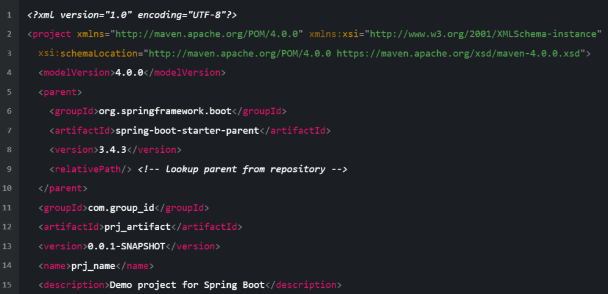
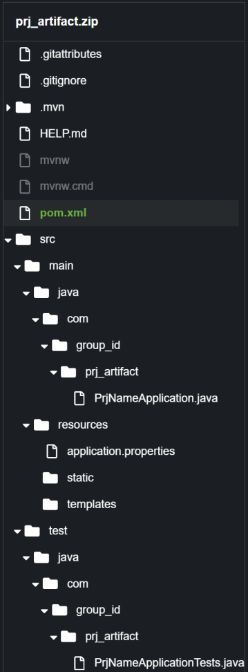
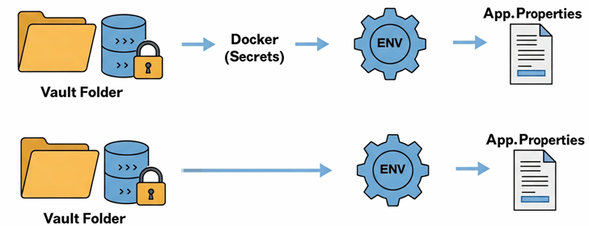
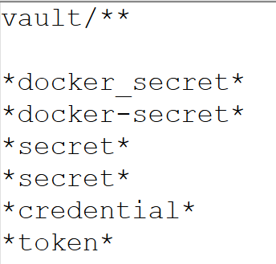
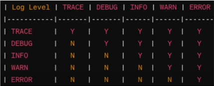

### Eda Archetype

<details><summary><strong>Introdução 👋</strong></summary>

* Este projeto cria um "archetype" baseado na metodologia do MAVEN archetypes.
* _"Eda"_ remete ao termo celta para "reflexo" ou "imagem" trazendo a ideia de algo que espelha ou reflete, remetendo à
  simplicidade e clareza de um espelho. Nao se trata de um termo mitologico.
* Este projeto partir da prova de conceito desenvolvida em out24(ferias BR) no projeto "archetype-v1-concept-proof"
</details>

<details><summary><strong>Tecnologias Utilizadas 🛠️</strong></summary>

* Escopo: as tecnologias **deste projeto** (o gerador). A stack dos projetos **gerados** não faz parte desta seção.

<details style="margin-left: 2em;"><summary><strong> 1) Núcleo do Archetype (build e empacotamento)</strong></summary>

| Tecnologia | Versão | Por quê |
|---|---|---|
| **Java** | JDK que roda o Maven (sem `maven.compiler.release` fixado) / 21 (default gerado) | Linguagem base do archetype e dos projetos que ele gera. O `pom.xml` do archetype não fixa a versão de compilação: vale o JDK do build. O default do catálogo é `java_version=21`; as fixtures de integração usam 17. |
| **Apache Maven** | 3.9.x | Coração do projeto: lifecycle, build e distribuição do artefato via `~/.m2`. O archetype **é** um artefato Maven (`packaging=maven-archetype`). |
| **Maven Archetype Plugin** | 3.4.1 | Mecanismo central: `archetype:generate` materializa a árvore do projeto, `archetype:jar` empacota o JAR, `integration-test` valida as fixtures e `update-local-catalog` registra o archetype no catálogo local. |
| **Archetype Packaging** | 3.4.1 | Extension do Maven que habilita o `packaging=maven-archetype` e os **3 slots** do JAR (metadata + resources + post-generate). |

</details>

<details style="margin-left: 2em;"><summary><strong> 2) Templates e Metadata</strong></summary>

| Tecnologia | Versão | Por quê |
|---|---|---|
| **Apache Velocity** | (via plugin) | Motor de templates do `filtered="true"`: renderiza os placeholders `${...}` nos `archetype-resources/` durante a geração. |
| **XML + XML Entities + XSLT** | — | O catálogo de flags é fragmentado (35 `property-*.xml` + 18 `fileset-*.xml` + DOCTYPE com 53 entities) e materializado por um XSLT identidade — evita um XML monolítico e mantém cada flag revisável isoladamente. |
| **XML Maven Plugin** | 1.2.1 | Executa a transformação XSLT na fase `generate-resources`, gerando o `archetype-metadata.xml` final em `target/classes`. |

</details>

<details style="margin-left: 2em;"><summary><strong> 3) Scripts e Automação</strong></summary>

| Tecnologia | Versão | Por quê |
|---|---|---|
| **Apache Groovy** | 4.0.28 | Linguagem dos scripts do build: pós-processador (`archetype-post-generate.groovy`), compositor e o runner de suíte. Escolhida por rodar nativo dentro do Maven e manipular arquivos/XML com pouca cerimônia. |
| **Groovy Maven Plugin** | 2.1.1 | Executa os scripts Groovy dentro do lifecycle (`process-resources` para compor o pós-processador, `test` para as suítes). |
| **Bash** | — | Legado: eras anteriores do pré-processamento (Q&A e manipulação de JSON); o repositório não mantém scripts bash. |

</details>

<details style="margin-left: 2em;"><summary><strong> 4) Procedimento do agente (empacotado no JAR)</strong></summary>

| Tecnologia | Por quê |
|---|---|
| **Markdown empacotado (`utils/`)** | Procedimento fixo da derivação: papel do agente, leitura do JAR, regras de formação do contrato e templates. Viaja dentro do JAR. |
| **JSON** | Formato do contrato de use-case e dos templates de contrato. |
| **SHA-256** | Nome determinístico do arquivo de contrato materializado (hash da forma canônica). |

</details>

<details style="margin-left: 2em;"><summary><strong> 5) Testabilidade</strong></summary>

| Tecnologia | Versão | Por quê |
|---|---|---|
| **JUnit 4** | 4.13.2 | Única dependência declarada (herdada) — mas o `surefire` do archetype não roda nada: não existe `*Test.java` no `src/test/java`. As classes JUnit reais viajam no **projeto gerado**. |
| **Groovy (suítes próprias)** | 4.0.28 | As suítes do archetype são scripts Groovy com checks próprios (sem infra JUnit), executados pelo `groovy-maven-plugin` na fase `test` — o build falha se qualquer check falhar. A lista e a contagem ficam em `run-archetype-post-generate-tests.groovy` (fonte da verdade). |

</details>

</details>

<details><summary><strong> Maven Archetype System 🏗️ </strong></summary>

<details style="margin-left: 2em;"><summary><strong> 1) Cores ⚛️</strong></summary>

**1) Flags p/ 'maven:Archetype:Generate':**
  * Arquivo: [ARCHETYPE-METADATA.XML](src/main/resources/META-INF/maven/archetype-metadata.xml):
  * Conceito:
    * Arquivo de configuração do archetype
    * Contendo:
      * as propriedades que serao capturadas para o uso no MVN CLI
      * Estrutura do Archetype e seus respectivos arquivos e pastas
  * Formacao do arquivo: Ver o item **'Archetype-Metadata.xml'** desta documentacao
  * Local:
    * [src \ "MAIN" \ resources \ _META-INF_ \ _**"MAVEN"**_ \ ](src/main/resources/META-INF/maven)
    * 02 - Setores (**_FileSet_** + **_RequiredProperties_**):
      * **_Setor 01:_** [_FileSets_](src/main/resources/META-INF/maven/archetype_metadata_filesets)
        * **Distribuicao atual:** **18 arquivos** `fileset-<NN>-<flag>[-parte].xml`, com **um `<fileSet>` por arquivo** (numerados `01` a `18`).
        * **Packaged** Tag:
          * **Conceito:**
            - A tag `packaged` controla como os arquivos serao estruturados
            - durante a geracao do projeto a partir do archetype,
            - especificamente em relacao a estrutura de pacotes Java.
            - Portanto:
              - os arquivos determinados neste _fileSet_
              - serao automaticamente movidos para a estrutura:
                + **"src/main"** OU
                + **"src/test"**

          * **packaged="true":**
            * **Comportamento esperado:**
              - Os arquivos SERAO organizados seguindo
              - a estrutura do _**pacote base do projeto**_
              - Por exemplo:
                + Se o pacote base for _"com.empresa.app"_. Um arquivo:
                  + _'Controller.Java'_ definido em **"src/main/java** / _Controller.java"_
                    + sera movido para _"src/main/java_ / **_com/empresa/app_** / _Controller.java"_
                  + _'ControllerTest.java'_ definido em **"src/test/java** / _ControllerTest.java"_
                    + sera movido para _"src/test/java_ / **_com/empresa/app_** / _ControllerTest.java"_
            * **Casos tipicos:**
              + Arquivos Java (.java)
              + Testes unitarios
              + Recursos especificos de classes.

          * **packaged="false":**
            * **Comportamento esperado:**
              - Os arquivos NAO seguirao a estrutura do _**pacote base do projeto**_
              - Permanecerao exatamente onde foram definidos no archetype
                - _**src/main/resources**_ / _properties_ / _**config.properties**_
            * **Casos Tipicos:**
              - Arquivos de configuracao global (application.properties)
              - Scripts de banco de dados
              - Arquivos de documentacao
              - Recursos estaticos (imagens, CSS, etc)

        * _Filtered_:
          * **Conceito:**
            - E um mecanismo para substituicao de variaveis (placeholders) no arquivo.
            - O Maven aplica o 'motor do velocity' nos elementos anotados por essa tag.
          * **filtered="true":**
            * **Comportamento esperado:**
              - O Maven procura por 'placeholders', nos padroes _**${variavel}**_ no arquivo.
              - Substituindo-os por valores pre-definidos no 'requiredProperties'.
          * **filtered="false":**
            * **Comportamento esperado:**
              - O arquivo seria copiado exatamente como esta.
              - Os placeholders **_${variavel}_** seriam ignorados.

        * _Enconding_:
          * **Conceito:**
            - E crucial para o tratamento correto de caracteres especiais.
          * **encoding="UTF-8":**
            * **Comportamento esperado:**
              - Caracteres como **ç, ã, é** sao processados corretamente.
              - **Emojis** sao mantidos.
              - Idiomas complexos **(chinês, arabe, etc)** sao processados corretamente.
          * **"SEM encoding":**
            * **Comportamento observado:**
              - Pode ocorrer mojibake (corrupcao de caracteres), exemplo:
                - "Configuração" _ficaria_ "Configuração"
                - "país" _ficaria_ "país"

        * _Outros tipos de Tags_:
          * **Conceito:** tags complementares do `<fileSet>` que configuram aspectos especificos do empacotamento.
            - _directory_: Define o diretorio fonte dos arquivos.
            - _includes_: Define padroes de inclusao de arquivos.
            - _excludes_: Define padroes de exclusao de arquivos.
            - _followSymlinks_: (true/false) - Se deve seguir links simbolicos.
            - _lineEnding_: Define o tipo de quebra de linha (keep, unix, windows, lf, crlf).

        * Estrutura das Tags:
        ```xml
        <fileSet
                filtered="true"
                packaged="true"
                encoding="UTF-8"
                followSymlinks="false"
                lineEnding="unix">
          <directory>src/main/resources</directory>
          <includes>
            <include>**/*.properties</include>
          </includes>
          <excludes>
            <exclude>**/*.tmp</exclude>
          </excludes>
        </fileSet> 
        ```

      * **_Setor 02:_** [_RequiredProperty_](src/main/resources/META-INF/maven/archetype_metadata_required_properties)
         * **Distribuicao atual:** **35 arquivos** `property-<NN>-<flag>.xml` (numerados `02` a `36`, com lacuna em `01`), **um por flag**.
         * Conceito:
           - Define propriedades que serao capturadas pelo **_SWITCHES -D_** do Maven CLI
         * Utilidade Pratica:
           - Captura **_SWITCHES -D_** fornecendo-as p/ a 'montagem' do Archetype
         * Caso de uso:
         1. Usuario deve _obrigatoriamente fornecer_ o **_-Denable_jwt_** no MVN CLI
            - **defaultValue** AUSENTE
            - Caso contrario, o MAVEN "prompetara"(geracao interativa)
              - Indagando o Switch **_-Denable_jwt_** omitido
              ```xml
                <requiredProperty key="enable_jwt">
                    <defaultValue></defaultValue>
                </requiredProperty>
              ```
         2. Usuario OMITE (NAO fornece) a Switch o **_-Denable_jwt_** do Maven CLI
            - (PROMPT INTERATIVO DO MAVEN) Define value for property 'enable_jwt':
               - **defaultValue** PRESENTE
               - MAVEN "nao prompetara"(geracao interativa)
                 - **defaultValue** sera usado
              ```xml
                  <requiredProperty key="enable_jwt">
                      <defaultValue>false</defaultValue>
                  </requiredProperty>
              ```

              - Exemplo de OMISSAO DA SWITCH 'enable_jwt':
                - mvn archetype:generate -DarchetypeGroupId=seu.grupo

**2) Manejo de Arquivos c/ Groovy (seguido da geracao do archetype):**
  * Arquivo: [ARCHETYPE-POST-GENERATE.GROOVY (GERADO)](target/classes/META-INF/archetype-post-generate.groovy)
  * Conceito:
    * Arquivo Groovy de manejo de pastas/arquivos, **APOS** a geracao do ARchetype
    * Contendo:
      * Codigo Groovy de manejo de pastas/arquivos
      * Formacao do arquivo: Ver item **'Archetype-Post-Generate.groovy'** desta documentacao
    * Local: **NAO existe em `src/`**. O unico artefato final fica em [target/classes/META-INF/](target/classes/META-INF) e viaja dentro do JAR.
  * Visibilidade (importante):
    * `target/` esta no `.gitignore`, e o IDE normalmente o exclui da arvore do projeto — por isso o arquivo **nao aparece** no Project view.
    * Ele so existe depois do build: `mvn clean process-resources` (ou qualquer fase posterior) recria.
    * Para abrir no IDE: `Ctrl+Shift+N` (IntelliJ) e digitar `archetype-post-generate.groovy`; ou abrir direto o caminho acima.
  * Conceito:
    * Script GROOVY nativo (build-time) que COMPOE o `archetype-post-generate.groovy` a partir dos snippets em `META-INF/archetype_post_generate_body/`, `..._variables/`, `..._generators/` e `..._snippets/`. Substituiu o pre-processamento em bash (`bash_script/create_archetype_post_generate.sh`, que nao existe mais no repositorio).
  * Local:
    * [src \ "MAIN" \ groovy \](src/main/groovy/)
  * Invocado por: `org.codehaus.gmaven:groovy-maven-plugin:2.1.1` (goal `execute`) na fase `process-resources`. Configurado em `pom.xml` (raiz).
  * Output: `target/classes/META-INF/archetype-post-generate.groovy` (gerado a cada build; `mvn clean` apaga, o proximo build recria).


**3) Testes Relativos ao Archetype:**
  * Local: [src \ "TEST" \ resources \ _projects_ \ _**"BASIC"**_ \ ](src/test/resources/projects/basic)
  * Conceito:
	* Arquivo de propriedades(requiredProperties) do archetype
	* Responsavel pelo _**teste do Archetype**_
	* Esse teste e realizado antes da montagem do Archetype

</details>

<details style="margin-left: 2em;"><summary><strong> 2) Fluxo 🔄 </strong></summary>

* **Objetivo:** explicar a **essência** do `archetype:generate` do Maven — como os slots
  do JAR empacotado se relacionam entre si, e **por que** o Maven os separa.

#### Os três slots do archetype empacotado 📦

* O archetype empacotado (`packaging=maven-archetype`) é um JAR com **três slots**
  de **nomes fixos**, reconhecidos pelo plugin por constantes próprias
  (`org.apache.maven.archetype.common.Constants`):

| Slot no JAR | Constante | Obrigatório? |
|---|---|---|
| `META-INF/maven/archetype-metadata.xml` | `ARCHETYPE_DESCRIPTOR` | sim |
| `archetype-resources/` | `ARCHETYPE_RESOURCES` | sim |
| `META-INF/archetype-post-generate.groovy` | `ARCHETYPE_POST_GENERATION_SCRIPT` | opcional |

* O slot **é** o nome da pasta/arquivo dentro do JAR — nada mais.
* O `archetype:jar` (goal `jar`, fase `package`) empacota `target/classes` no JAR.

#### 1) `archetype-metadata.xml` — o índice (não contém conteúdo) 📇

* Descreve **o que** o archetype precisa e **o que fazer** com a pasta de templates:
  * `<requiredProperties>` — as **variáveis** pedidas (`key`, `defaultValue`, `validationRegex`).
  * `<fileSets>` — o **roteamento**: cada `<fileSet>` diz *qual diretório* de
    `archetype-resources/` vira *qual lugar* da árvore gerada, e com que tratamento
    (`filtered`, `packaged`, `encoding`, `includes`/`excludes`).
* O metadata **nunca lista arquivos**: aponta pastas e deixa o `includes` filtrar.
* **Motivação:** separar a *declaração* do *conteúdo*.
  * o descritor é pequeno, revisável, substituível;
  * o template pode ser gigante e nunca é lido pelo parser — só copiado.

#### 2) `archetype-resources/` — o conteúdo (não sabe se existe) 📦

* A árvore esqueleto do projeto a ser gerado. Única fonte do *conteúdo* dos arquivos.
* O parser do metadata nunca entra aqui. Quem entra é o **gerador**, que usa o
  metadata como instrução de montagem:
  * `__entity_name_package__` no **nome** de arquivo/pasta → substituído pelo valor da flag;
  * `${entity_name}` no **conteúdo** → renderizado pelo Velocity (só com `filtered="true"`).
* **Motivação:** o template é puro "material virgem" — não carrega lógica de montagem.
  Quem decide como usá-lo é o metadata.

#### 3) `archetype-post-generate.groovy` — o pós-processamento (o único com poder) 🧬

* Script Groovy executado **depois** da cópia.
* Recebe, via `Binding` do `GroovyShell`:
  * cada `requiredProperty` como **variável direta**;
  * a variável `request` = `ArchetypeGenerationRequest` completo
    (`request.properties`, `request.outputDirectory`, `request.artifactId`…).
* **Motivação (a essencial):** o descritor é **estático e sem condição**.
  * No modelo atual (`archetype-metadata.xml` do Maven 3.4.1) **não existe** forma de
    dizer *"este fileSet só entra se a flag X for true"*.
  * O `includeCondition` do modelo `FileSet` pertence ao modelo legado **1.x** e é
    **rejeitado** pelo reader 3.4.1 (*"Unknown attribute"*).
  * Logo: **quem decide manter/excluir por flag é o Groovy**.
    Ele existe para o que a forma declarativa não consegue expressar.

#### A relação: um pipeline de 3 tempos ⏱️

```
   metadata.xml          resources/          post-generate.groovy
   ───────────────       ───────────         ─────────────────────
   "O QUE preciso"  +   "O QUE copio"   →   "O QUE ajusto"
   (variáveis)            (template bruto)     (mantém/exclui/renomeia)

   declarado / passivo                         único que decide
   estático / só conteúdo
```

* Cada slot é consumido em um **momento diferente da mesma execução** do
  `archetype:generate`:
  1. **Metadata primeiro** — o configurador lê o descritor, resolve as flags
     (CLI > `defaultValue` > prompt), monta o `Properties`.
  2. **Resources no meio** — o gerador percorre os `<fileSet>`, resolve os templates
     correspondentes, aplica Velocity / `packaged` / `encoding`, e escreve a árvore.
  3. **Groovy no fim** — roda sobre a árvore já escrita, com as mesmas flags em mãos.
* **A lei da relação:** o metadata **dirige**, os resources **sofrem**,
  o Groovy **corrige**.
  * Nenhum dos dois primeiros sabe que o terceiro existe;
  * o Groovy não pode adicionar ao contrato — só intervém no resultado.

#### O ciclo do artefato (o `archetype-packaging` amarra tudo) 🔗

```
process-resources → resources
package           → archetype:jar              (monta o JAR com os 3 slots)
integration-test  → archetype:integration-test (gera projeto, roda goal.txt, compara)
install           → install + archetype:update-local-catalog
                                               (escreve ~/.m2/archetype-catalog.xml)
```

</details>

<details style="margin-left: 2em;"><summary><strong> 3) Velocity📍</strong></summary>

* [User Guide](https://velocity.apache.org/engine/2.4.1/user-guide.html)
* [VTL Reference](https://velocity.apache.org/engine/2.4.1/vtl-reference.html)
</details>

</details>

<details><summary><strong> Maven Coordinates 📍</strong></summary>

* [Click to check the Coordinates Documentation](https://maven.apache.org/pom.html#Maven_Coordinates)

##### Configuration Project 🔧


##### POM.xml 📝


##### Folder Structure 🗂️

</details>

<details><summary><strong> Etapas de Processamento 📈</strong></summary>

* Visão geral: o processamento do archetype acontece em **3 etapas** — e apenas 2
  delas viajam empacotadas dentro do JAR:
  - **1) Pré-processamento** — captura a intenção (use-case + contrato JSON) e
    produz a command line `-D...` do Maven. ✅ **empacotado** (procedimento em
    `utils/`, lido pelo agente a partir do JAR).
  - **2) Processamento** — o `maven-archetype-plugin` materializa a árvore do
    projeto a partir do catálogo de flags + templates. ✅ **empacotado** (A1–A4).
  - **3) Pós-processamento** — o Groovy modulariza o projeto gerado (mantém /
    exclui arquivos e pastas). ✅ **empacotado** (A5–A6).

#### Visão das três etapas 🧭

| Etapa | Papel | Tecnologia | Empacotado no JAR? | Momento |
|---|---|---|---|---|
| 1. Pré-processamento | intenção → `mvn ... -D...` | procedimento do agente (`utils/` no JAR) | ✅ | antes do `archetype:generate` |
| 2. Processamento | catálogo + templates → árvore do projeto | `archetype-metadata.xml` + `archetype-resources/` (Velocity) | ✅ | durante o `mvn archetype:generate` |
| 3. Pós-processamento | árvore gerada → modularização | `archetype-post-generate.groovy` | ✅ | ao fim do `mvn archetype:generate` |

> O `mvn clean install` **não** é uma etapa de processamento: é o passo final do
> *pipeline do artefato* (montagem, testes e instalação em `~/.m2`), detalhado no
> §4 abaixo.

<details style="margin-left: 2em;"><summary><strong> 1) Pré-processamento (empacotado) 🧠</strong></summary>

* **Objetivo:** transformar **use-case + contrato JSON** na command line pronta
  do `mvn archetype:generate` (todas as flags `-D` resolvidas).
* **Quem faz:** o **agente** que opera o archetype. Não há motor, CLI ou script
  externo: o procedimento é um conjunto de arquivos Markdown e JSON empacotados
  no JAR.
* **Composição:** [`src/main/resources/utils/`](src/main/resources/utils/) — 19 arquivos em 4 categorias:
  - `01-entrada-inicializacao/` — porta de entrada (`prompt-00`) e mapa de leitura (`indice-01`);
  - `02-operacao-procedimento-do-agente/` — papel, leitura do JAR, regras obrigatórias, execução e entregáveis;
  - `03-derivacao-regras-de-formacao-do-contrato/` — derivação da entidade, tipos, tipos aninhados, precedência, materialização e proveniência;
  - `04-referencia-templates-de-contrato/` — schema e exemplos.
* **Entrada/Saída:** spec (tipo de módulo, package base, use-case, contrato JSON)
  → command line do Maven + tabela de proveniência.
* **Fonte da verdade:** o JAR instalado (`com.eda-archetype:eda-archetype`) e,
  dentro dele, o catálogo de flags (`META-INF/maven/archetype-metadata.xml`).
* **Histórico:** bash Q&A (commits 1.0–14.0) → bash + JSON (56.0–59.0) → motor
  Groovy (spec `003-llm-flag-inference`, removido) → procedimento empacotado no JAR.
* Detalhes do procedimento → seção **"Procedimento para Especificação"**

#### Suítes unitárias do pós-processador 🧪

Runner: `run-archetype-post-generate-tests.groovy` — as suítes são scripts Groovy com checks próprios, executados pelo `groovy-maven-plugin` na fase `test`.

> Detalhamento por camada, tecnologia, pasta e comando → seção **"Testabilidade 🧪"**

</details>

<details style="margin-left: 2em;"><summary><strong> 2) Processamento (empacotado) 🏗️</strong></summary>

* **Objetivo:** o `maven-archetype-plugin` materializa a árvore do projeto
  gerado a partir do catálogo de flags + templates — durante o
  `mvn archetype:generate`.
* **Composição (fonte da verdade):**

| # | Artefato | Local | Papel |
|---|----------|-------|-------|
| A1 | Catálogo de flags - `archetype_metadata_required_properties` | `src/main/resources/META-INF/maven/archetype_metadata_required_properties/` | 35 flags: `key`, `defaultValue`, `validationRegex`; descrição e `DEPENDS_ON` em comentário XML |
| A2 | Filesets — `archetype_metadata_filesets` | `src/main/resources/META-INF/maven/archetype_metadata_filesets/` | 18 arquivos, um `<fileSet>` cada; mapeia `archetype-resources/` → árvore do projeto gerado |
| A3 | Core do metadata | `src/main/resources/META-INF/maven/archetype-metadata.xml` | DOCTYPE com 53 entities (35 `property-<NN>-<flag>` + 18 `fileset-<NN>-<flag>`) |
| A4 | XSLT identidade | `src/main/resources/META-INF/maven/archetype-metadata-identity.xsl` | resolve as entities `SYSTEM` e materializa os blocos inline |

| Artefato | Local | Papel |
|----------|-------|-------|
| Templates | `src/main/resources/archetype-resources/` | esqueleto do projeto gerado; os `${...}` são renderizados pelo Velocity |
| Procedimento para Especificação | `src/main/resources/utils/` | 19 arquivos em 4 categorias (`01-entrada-inicializacao/`, `02-operacao-procedimento-do-agente/`, `03-derivacao-regras-de-formacao-do-contrato/`, `04-referencia-templates-de-contrato/`) que viajam no JAR; o agente lê o procedimento de dentro do JAR |
| Fixtures de integração | `src/test/resources/projects/*` | um projeto gerado por fixture, cada um validado com `mvn clean verify` |

* **Montagem do catálogo:** fragmentos (A1 + A2) + DOCTYPE (A3) →
  `xml-maven-plugin:transform` + `archetype-metadata-identity.xsl` (A4) na fase
  `generate-resources` → `target/classes/META-INF/maven/archetype-metadata.xml`
  (cópia convencional excluída — `pom.xml:38-41`).
* **Execução:** o plugin lê o JAR instalado (`~/.m2`), valida as flags `-D`
  (default × `validationRegex`) e renderiza os templates — etapa
  **autossuficiente**: depende apenas do `.m2`, nunca da pasta-fonte.

</details>

<details style="margin-left: 2em;"><summary><strong> 3) Pós-processamento (empacotado) 🧬</strong></summary>

* **Objetivo:** modularizar o projeto recém-gerado (mantém / exclui pastas e
  arquivos conforme as flags escolhidas) — ao fim do `mvn archetype:generate`.
* **Composição:**

| # | Artefato | Local | Papel |
|---|----------|-------|-------|
| A5 | Pós-processador — `body/` + `variables/` + `generators/` + `snippets/` | `src/main/resources/META-INF/archetype_post_generate_{body,variables,generators,snippets}/` | 63 fragmentos Groovy (15 `body/` + 25 `variables/` + 3 `generators/` + 20 `snippets/`) |
| A6 | Compositor do pós-processador | `src/main/groovy/ArchetypePostGenerateComposer.groovy` | remonta A5 em 1 arquivo: ordem canônica + consolidação de imports |

* **Montagem:** `ArchetypePostGenerateComposer` (A6) via `groovy-maven-plugin:execute` na fase
  `process-resources` → `target/classes/META-INF/archetype-post-generate.groovy`
  → levado no JAR.
* **O que faz em runtime:** mantém / exclui por flag; persiste o contrato em
  `src/test/resources/contracts/contract.json` (FR-023, quando
  `enable_folder_src_test_java=true`); gera enums customizados; log opcional
  (`show_archetype_post_generate_log`).
* Histórico: arquivo único editado à mão → compositor bash
  (`bash_script/create_archetype_post_generate.sh`) → compositor nativo Groovy
  (commit `63.0`).

</details>

<details style="margin-left: 2em;"><summary><strong> 4) Montagem e instalação do artefato 📦 (fora das três etapas)</strong></summary>

| Fase | Plugin | Entrada | Saída |
|------|--------|---------|-------|
| `generate-resources` | `xml-maven-plugin:1.2.1` (`transform`) | `archetype-metadata.xml` + `archetype-metadata-identity.xsl` | `target/classes/META-INF/maven/archetype-metadata.xml` (catálogo completo, sem DOCTYPE) |
| `process-resources` | `groovy-maven-plugin:2.1.1` (`execute`) | 63 fragmentos `.groovy` | `target/classes/META-INF/archetype-post-generate.groovy` |
| `test` | `groovy-maven-plugin:2.1.1` (`execute`) | `run-archetype-post-generate-tests.groovy` | as suítes unitárias do pós-processador (o build falha se alguma falhar) |
| `integration-test` | `maven-archetype-plugin:3.4.1` (`integration-test`) | `src/test/resources/projects/*` | um projeto gerado por fixture, cada um com `mvn clean verify` |
| `install` | `maven-install-plugin` + `maven-archetype-plugin:3.4.1` (`update-local-catalog`) | JAR do archetype | `~/.m2/repository/` + `archetype-catalog.xml` |

> **Comando canônico:** `mvn clean install`
>
> A fase `integration-test` é **anterior** a `install` e já é executada por ele.
> Portanto `mvn clean install integration-test` roda a suíte de integração
> **duas vezes** (cada fixture é gerada e validada 2×) — use `mvn clean install`
> ou, se não quiser instalar, `mvn clean integration-test`.

* **De volta aos 2 momentos do archetype:** o §4 acima é o **momento de
  montagem** (build + testes + instalação em `~/.m2`); as **etapas 1 → 3** são o
  **momento de geração** (`mvn archetype:generate`).

#### Fluxo 🔄

```text
TRILHA 1 — MONTAGEM (mvn clean install; fora das três etapas)
────────────────────────────────────────────────────────────────────------------
[1] CATÁLOGO         35 property-*.xml + 18 fileset-*.xml + DOCTYPE (53 entities)
                     └─ xml-maven-plugin:transform + archetype-metadata-identity.xsl (generate-resources)
                     
[2] PÓS-PROCESSADOR  63 fragmentos .groovy
                     └─ ArchetypePostGenerateComposer.groovy via gmaven:execute (process-resources)
                        (local: src/main/groovy/ArchetypePostGenerateComposer.groovy)
                        
[3] TESTES           unitários: as suítes do pós-processador (fase test)
                     integração: uma fixture por combinação de flags (fase integration-test)
                     
[4] INSTALAÇÃO       ~/.m2/repository + archetype-catalog.xml (fase install)


TRILHA 2 — USO (mvn archetype:generate; etapas 1 → 3)
──────────────────────────────────────────────────────────-----------───────────
[5] PRÉ PROCESSAMENTO   use-case + contrato JSON → o agente lê o procedimento em utils/
    (DENTRO DO JAR)     e o catálogo no JAR → mvn archetype:generate --batch-mode -D...
                        
[6] PROCESSAMENTO       archetype-metadata.xml + archetype-resources/ (Velocity)
                        → árvore do projeto gerado
                        
[7] PÓS PROCESSAMENTO   archetype-post-generate.groovy mantém / exclui
                        + FR-023: contrato → src/test/resources/contracts/contract.json
                              ▼
                        projeto final
```

#### Regras estruturais 📏

* **Fonte da verdade = os fragmentos** (A1, A2, A5). Os arquivos em `target/classes/`
  são **gerados** a cada build — editá-los é trabalho perdido.
* **O pré-processamento é empacotado:** o procedimento para especificação vive em
  `src/main/resources/utils/` e viaja no JAR — o agente lê de dentro do artefato.
* **O catálogo é lido do JAR:** o agente usa
  `META-INF/maven/archetype-metadata.xml` e os fragmentos
  `META-INF/maven/archetype_metadata_required_properties/*.xml` como fonte da
  verdade das flags.
* **O catálogo não é alterado em código:** as flags são lidas em runtime
  (FR-013) — flag nova = 1 fragmento `property-<NN>-<flag>.xml` + 1..N fragmentos
  `fileset-<NN>-<flag>[-parte].xml` (um `<fileSet>` cada) + registros no DOCTYPE.
* **As flags são auto-descritivas:** o `defaultValue` nunca é vazio (FR-018) e o
  `validationRegex` é aplicado por quem emite a command line.

> As siglas `FR-XXX` citadas neste README vêm da spec `003-llm-flag-inference`,
> **arquivada** em [`specs/_archive/003-llm-flag-inference/`](specs/_archive/003-llm-flag-inference/).
> O motor que a implementava foi removido; o procedimento ativo está em
> [`src/main/resources/utils/`](src/main/resources/utils/).

#### Onde detalhar cada parte 🔎

* Metadata (entities + XSLT) → seção **"Archetype-Metadata.xml"**
* Pós-processador (compositor Groovy) → seção **"Archetype-Post-Generate.groovy"**
* Catálogo de flags (35) → seção **"Flags do mvn archetype:generate"**
* Como adicionar uma flag → seção **"Acrescentando Novas Flags ➕️"**
* Procedimento do agente (empacotado no JAR) → seção **"Procedimento para Especificação"**
* Derivação (prompt → linha de comando do Maven) → seção **"A Anatomia da Derivação: do Prompt ao Maven CLI 🧠"**
* Testabilidade → seção **"Testabilidade 🧪"** (camadas, tecnologias, pastas e comando de cada uma)

</details>

</details>

<details><summary><strong> Inferência de Contrato e Use-Case: do Prompt ao Maven CLI 
🧠</strong></summary>

* **A pergunta:** 
  * o operador entrega um **use case** (texto) + um **contrato JSON**; 
    * o `mvn archetype:generate` precisa de **35 flags `-D`**. 
      * Quem faz a ponte?
* **A resposta:** 
  * o **agente**, seguindo os elementos (prompts + JSONs) empacotados dentro do JAR na pasta `utils/`. 
  * Ele não chuta: 
    * classifica cada chave do contrato, 
    * aplica as regras de formação e 
    * valida tudo contra o catálogo antes de emitir a linha de comando.

<details style="margin-left: 2em;"><summary><strong> 1) O que entra na Spec ou Prompt</strong></summary>

| Entrada | Exemplo |
|---|---|
| **Use case** | *"Cadastro de clientes de uma clínica. API REST com autenticação JWT na porta 8080."* |
| **Contrato JSON** | objeto JSON completo — corpo abaixo |

**Contrato JSON:**

```json
{
  "entityName": "Cliente",
  "attributes": {
    "nome": "Maria",
    "ativo": true,
    "nascimento": "1990-05-14"
  },
  "api_port": 8080
}
```

</details>

<details style="margin-left: 2em;"><summary><strong> 2) Onde cada informação vai parar</strong></summary>

O agente lê o contrato e separa as chaves em **três destinos** (exemplo com 3 flags do `mvn archetype:generate`):

| Chave do contrato | Destino | Por quê |
|---|---|---|
| `api_port` | **flag literal** (`CONTRACT`) | a chave existe no catálogo → vira `-D` direto |
| `entityName` | **flag derivada** (`CONTRACT_DERIVED`) | meta-chave → nomeia a entidade |
| `nome`, `ativo`, `nascimento` | **atributos da entidade** | não existem no catálogo → viram campos Java |

</details>

<details style="margin-left: 2em;"><summary><strong> 3) O exemplo, ponta a ponta</strong></summary>

```text
SPEC: USE CASE + CONTRATO
        │
        ├─ entityName = "Cliente" ──────────▶ -Dentity_name=Cliente
        │                                     └─▶ -Dentity_package_name=cliente      (derivado: minúsculas)
        │
        ├─ api_port = 8080 ─────────────────▶ -Dapi_port=8080                        (CONTRACT: literal)
        │
        ├─ attributes
        │   ├─ nome       = "Maria"      (string)  ─┐
        │   ├─ ativo      =  true        (boolean)  ├─▶ -Dcustom_entity_attributes_list=
        │   └─ nascimento = "1990-05-14" (string)  ─┘        String:nome,Boolean:ativo,String:nascimento
        │                                                    (tipo estimado pelo VALOR, na ordem do contrato)
        │
        ├─ há atributos? ────────────────────▶ -Denable_custom_entity_attributes=true   (forçado)
        │
        └─ contrato materializado em disco ──▶ -Dentity_contract_file_path=…/<sha256>.json
```

</details>

<details style="margin-left: 2em;"><summary><strong> 4) As três regras que mais surpreendem</strong></summary>

| Regra | Efeito |
|---|---|
| **O tipo vem do valor** | `true`→`Boolean` · inteiro que cabe em `int`→`Integer` · inteiro maior→`Long` · decimal→`Double` · string→`String` · objeto→POJO em `<pacote>.nested` · array→`String` |
| **Valor explícito vence** | um `type` declarado no contrato tem precedência **se** for `java.lang` ou um **tipo do projeto**; `java.time.Instant`, `List<String>` etc. são rejeitados com aviso e o tipo volta a ser estimado pelo valor |
| **Flag derivada em cascata** | `entity_package_name` vem de `entity_name`; `enable_custom_entity_attributes` é forçado a `true` quando há atributos; `entity_contract_file_path` só é emitido depois de gravar o contrato |

**Precedência** (quem vence quando duas fontes discordam):

```text
CONTRACT  >  CONTRACT_DERIVED  >  semântica da entidade  >  INFERENCE (use case)  >  DEFAULT (catálogo)
```

* Um valor **literal** no contrato nunca é sobrescrito.
* Um valor **inferido do use case** só entra quando o contrato silencia.
* O **default** é o último recurso — e nunca é vazio (`FR-018`).

</details>

<details style="margin-left: 2em;"><summary><strong> 5) O portão final e o resultado 🚪</strong></summary>

*   **Regra Geral:**
    * Antes de montar a linha, **cada valor** passa pela `validationRegex` localizada em sua flag 
     (`requiredProperties`). 
    * É importante notar que **todo este fluxo ocorre dentro da LLM**: 
      * o agente não apenas propõe, 
      * mas **constrói e executa** a linha de comando, 
        * apontando para as coordenadas do archetype que deve estar **previamente instalado no repositório local (~/.m2)**.

*   **Validação Estrita:**
    *   valor válido → mantém valor e fonte;
    *   valor inválido → cai no `defaultValue` **com aviso barulhento** (nunca em silêncio).
        *   **Objetivo:** Garantir que o operador esteja ciente de que o valor inferido ou fornecido foi rejeitado por não cumprir o contrato técnico da flag, forçando o uso do padrão seguro.
        *   *ex.:* derivar `api_port=abc` → a regex `^([1-9][0-9]{3,4})$` rejeita → o valor final vira `8080`.
        * exemplo de codigo `validationRegex'`:
```xml
<requiredProperty key="enable_s3_storage">
    <defaultValue>false</defaultValue>
    <validationRegex>^(true|false)$</validationRegex>   <<< Exemplo
</requiredProperty>
```

*   **Execução pelo Agente:**
    *   O agente materializa o contrato em disco, gera o hash SHA-256 e monta o comando `mvn archetype:generate`.
    *   A execução consome o artefato localmente (`com.eda-archetype:eda-archetype`), garantindo que o comportamento seja o do JAR empacotado e não de arquivos soltos na árvore de desenvolvimento.
    *   O agente valida a árvore gerada e verifica a integridade (compilação via `mvn clean compile`) sem intervenção manual no código.

Uma linha única, sem prompt interativo.
```bash
mvn archetype:generate --batch-mode \
  -DarchetypeGroupId=com.eda-archetype -DarchetypeArtifactId=eda-archetype -DarchetypeVersion=0.0.1-SNAPSHOT \
  -DgroupId=org.clinica -DartifactId=cliente -Dpackage=org.clinica \
  -Dentity_name=Cliente -Dentity_package_name=cliente \
  -Denable_custom_entity_attributes=true \
  "-Dcustom_entity_attributes_list=String:nome,Boolean:ativo,String:nascimento" \
  -Dapi_port=8080 -Djava_version=21 \
  "-DoutputDirectory=C:\Temp\eda-sandbox"
```

> ⚠️ **Duas armadilhas de ambiente** (validadas em Maven 3.9.16 + Windows):
> 1. O goal `generate` declara `executePhase` → o Maven exige um **`pom.xml` no diretório de execução**. Rodar numa pasta vazia falha com *"requires a project to execute but there is no POM"*. Use o diretório do archetype (com `-DoutputDirectory`) ou uma pasta de trabalho com um `pom.xml` mínimo.
> 2. No **PowerShell**, coloque **cada `-D` entre aspas**. Sem isso, a vírgula de `custom_entity_attributes_list` é tratada como separador de array e o valor chega truncado (`com.eda-archetype` vira `com`, por exemplo).


> O `-DoutputDirectory` mantém o projeto gerado **fora** da árvore do archetype — sem arquivos `untracked` no Git e sem o IDE indexar dois `pom.xml` aninhados.

> **Onde está o detalhe de cada coluna?** Em [`src/main/resources/utils/03-derivacao-regras-de-formacao-do-contrato/`](src/main/resources/utils/03-derivacao-regras-de-formacao-do-contrato/): `regras-01` (entidade e atributos), `regras-02` (tipos e enums), `regras-03` (aninhados), `regras-04` (precedência e validação), `regras-05` (materialização do contrato) e `regras-06` (proveniência). O ponto de entrada é `utils/01-entrada-inicializacao/prompt-00-leia-este-arquivo-primeiro.md`.

</details>

</details>

<details>
<summary><strong> Instalacao 📦</strong></summary>

#### Pré-requisitos

* **Java 17+** e **Maven 3.9.x** (build/teste validado com Maven 3.9.16 + Java 17.0.2).
  * O default do catálogo é `java_version=21`: um projeto gerado **sem** `-Djava_version` exige Java 21 para compilar.
  * As fixtures de integração usam `java_version=17`.
  * A `constitution.md` e o `specs/001` declaram Java 17; o README não deve tratar 21 como pré-requisito único.
* Conferir a instalação: `mvn -version`.
* Maven 'nao se atualiza' → instalar a versao mais recente:
  * Encontrar a versao mais recente em [Apache Maven](https://maven.apache.org/install.html)
  * Baixar o 'bin.zip', descompactar e atualizar o `PATH` (no Windows).

> **Possível BUG por Maven desatualizado** _(erro histórico)_:
> ```Console
> No signature of method: Script1.var()
>
>     [ERROR] Failed to execute goal org.apache.maven.plugins:maven-archetype-plugin:3.2.1:generate (default-cli)
>     on project standalone-pom:
>     No signature of method: Script1.var() is applicable for argument types:
>     (java.lang.String)
> ```
> * A versão do plugin citada no erro é a **3.2.1**; o projeto usa **3.4.1**.

---

#### Instalar e publicar este archetype

**a) Instale no repositório local do Maven:**

```bash
mvn clean install
```

* A fase `install` executa, em ordem: as **suítes unitárias** do pós-processador (fase `test`),
  as **fixtures** de integração (fase `integration-test`) e a publicação no repositório local.
  * ⚠️ A fase `integration-test` é **anterior** a `install` → `mvn clean install integration-test`
    roda a suíte de integração **duas vezes**. Use `mvn clean install`.
* Opções:
  * `-Darchetype.test.skip=true` → instala **sem** rodar as fixtures;
  * não há filtro por nome no plugin 3.4.1: `-Darchetype.test.projects` **não existe**.
    Para rodar uma fixture isolada, aponte `-Darchetype.test.projectsDirectory` para um diretório
    que contenha apenas ela (ex.: uma cópia em `target/it-single/`).
* O registro no catálogo local é feito pelo `maven-archetype-plugin:3.4.1:update-local-catalog`,
  disparado na fase `install`.

**b) Resultado da instalação 🎨**


**Legenda:**

* **Vermelho:** o nome do archetype criado
* **Verde:** catálogo que registra a instalação
* **Amarelo:** Destino das instalações
* **Azul:** Projeto instalado
* **Cinza:** Plugin de instalação

**c) Localização dos elementos 'Locais' do Maven:**

* Repositorio Local: `%USERPROFILE%\.m2\repository\`
  * Ex.: `C:\Users\<seu-usuario>\.m2\repository\`
* Archetype instalado: `%USERPROFILE%\.m2\repository\com\eda-archetype\eda-archetype\0.0.1-SNAPSHOT\`
* Catalogo de 'Archetypes Locais': `%USERPROFILE%\.m2\repository\archetype-catalog.xml`

**d) Visualizando/Checando a Instalação**
  

</details>

<details><summary><strong>Fases de Construcao 🏗️</strong></summary>

<details style="margin-left: 2em;"><summary><strong> 1) Milestones 📅</strong></summary>

* CRUD
  - Basic
  - Advanced


* Integration Testes
  - Repo
  - Service
  - Controller


  * DB's for Tests
    - H2
    - TestContainer


* Externalized Configurations
  - App properties
  - Excecoes
  - Mensagens
  - I18N
  - Rotas
  - Credentials (Unpushaveis)
  - etc...


* Type Safe 'Externalized Properties/Configuration' Binding
  - Filetypes:
    - .proprerties
    - .yml
  - Types:
    - Simple
    - List
    - Map
  - Mutable / Immutable
  - Validation


* Good Practices
  - Pageable
  - HATEOAS


* DTO
  - Tipos
    - Request
    - Response
    - Entity protection


* Mapper


* Exceptions
  - Global
  - Customizadas
  - Segurança
  - Autenticação


* BeanValidation
  - Exceções
  - Validações Personalizadas
    - Pattern Regex


* Cache


* I18N


* Testes de Contratos
  - Contratos
    - JSON
  - SchemaValidator
    - JSONSchema


* Documentação
- Swagger


* Database
  - DBs:
    - MongoDB
    - MySQL
    - Postgres
  - DDL
    - Hibernate
    - Flyway
  - Persistence
    - Spring Data
    - JDBC
    - JDBC Clients


* Autenticação (Spring Security)
  - JWT:
    - Simples
    - Oauth Server
  - OAuth2
    - GitHub
    - Google
    - Facebook


* DevOps
  - Docker
    - Folder
    - Dockerfiles
    - Docker Secrets
    - Docker-Compose
  - CI/CD
  - CloudFlare
  - AWS


* Seguranca
  - SAST (Static Application Security Testing)
    - Credentials:
      - GitGuardian:
        - dificil instalacao
        - Freemium
      - GitLeaks:
        - facil instalacao
        - Open-source
        - Depende de regras personalizadas, para credenciais customizidas
  - Proxy Reverso (Nginx)


* Modularidade


* Performance
  - Load Balancer (Nginx)
  - Cache
  - CDN
  - Virtual Threads


* API Proxies  (Internal UI Clients)
  - DB
  - Docker (Portainer)
  - Spring actuator (graphana)
  - Documentacao (swagger)
  - Log Kibana (logstash + Elasticsearch)
</details>

<details style="margin-left: 2em;"><summary><strong> 2) Task Planning 📝️</strong></summary>

1. DTO
  - Libraries
    - MapStruct (AutoAPI)
    - MyBatis (Guang)
    - ModelMapper
  - Request / Response
  - AbstractDto
    - Public class to facilitate DTO creation (Guang)


2. Lombok
  - AutoAPI
  - Guang


3. Database Versioning
  - FlyWay
  - Liquibase (AutoAPI)


4. Documentation
  - Swagger (AutoAPI + Guang)
  - Montagem Automática de README.md


5. Testing
  - DataBuilder (Guang)
  - CustomUtils (Guang)
    - Convert Java object to JSON string
    - Handle conversion failure with RuntimeException
  - TestController (Guang)
    - Unit testing with:
      - `@Transactional`
      - Mockito
  - Test-Db:
    - H2
    - TestContainer


6. Service
  - Transactional (Guang)
  - Dto-Mapper (Guang)
  - Apache Commons BeanUtils (Guang)
    - Copy properties from object to entity


7. Controller
  - @Validated on DTO (Guang)
    - BeanValidation
  - Pageable (Guang)
  - Dto-Mapper (Guang)


8. Repository
  - JPA Repository (AutoAPI + Guang)
  - CRUD Repository (AutoAPI)
  - JpaSpecificationExecutor (Guang)
  - Transactions (ACID)


9. Entities
  - POJO
  - Records


10. Safety
  - Input:
    - sanitizing/encode (replace)
    - filtering (block)
  - Shield Dtos:
    - BeanValidation REGEX
  - OWASP
  - Credentials Protection
    - Externalized Properties-File FROM .Env-file
    - Gitleaks (SAST)
      - Nao sera usado, pois depende de instalacao local
      - Apenas 'Recomendado como 2 layer de protecao"'
  - Sanitização de URL:
    - pré despatcherServlet
    - Header Request


11. Log
  - Logback:
    - logback-spring
    - logback-test
  - ELK:
    - Elasticsearch
    - Logstach
    - Kibana
    - Fluxo do ELK:
> 1) O WebApp envia os logs p/ (logstash.conf: "INPUT") APPENDER-TCP-LOGSTASH "<destination>" do Logback-spring.xml
> 2) O Logstasch (logstash.conf: "OUTPUT") envia os 'Logs Processados' p/ 'elasticsearch:9200'
> 3) O kibana exibe os Logs recebidos no 'elasticsearch:9200'


12. Health Check
  - Actuator


13. API Proxies (Internal UI Clients)
  - DBA Client
  - Docker (Portainer)
  - Spring actuator (graphana)
  - Documentacao (swagger)
  - Log Kibana (logstash + Elasticsearch)


14. Type Safe Externalized Properties/Configuration Binding
  - Application.propriedades
  - Mensagens:
    - Gerais
    - Excecoes
  - I18N (Traducoes)
  - Rotas
  - Credentials(secrets) Vault 'Unpushaveis'
</details>

<details style="margin-left: 2em;"><summary><strong> 3) Concluded Tasks ✅</strong></summary>

- [x] Credentials protection
  - [x] Gitleaks / GitGuardian (Alternative Approaches)
    - CONS:
      - GitGuardian:
        - is not free
        - Must be installed locally
      - GitLeaks:
        - dont works 'efficiently' with Custom-Credentials
  - [x] **'Encrypted Folder + Global GitIgnore'** _(Chosen Approach)_
    - [x] Encripted Folder:
      - Win10 BitLocker
      - ALL **Credentials-Files** (any sensitive data) must be storaged on this folder 'individually'
      - The folder will encrypt All its content automatically (files + subfolders)
      - This folder:
        - "IS NOT VERSIONED/COMMITTED" _(MUST be inserted in GitIgnore Global)_
        - 'dont belong' to any project
        - is not inside any project
        - is not inside any folder, from any project
      - Example:
        - 
    - [x] **GitIgnore-Global**:
      - Will detect (excluding for any commit):
      - Global GitIgnore CLI:
        - _Creating_ an "Global GitIgnore" **'NOT CREATED YET'**:
          - _git config --global core.excludesfile C:\your-path\.gitignore_global_
        - _Finding_ an **'ALREADY EXISTING FILE'**:
          - _git config --global core.excludesfile_
        - _GitIgnore-Global_ **'HELP'** can be found, in: 
          - [GitHub - Global GitIgnore Documentation](https://gist.github.com/subfuzion/db7f57fff2fb6998a16c)
      - Example:
        - 

      - Exclusion 'keywords'(fragment-word in begin/middle/end), such as:
          * docker_secret
          * dockersecret
          * secret
          * authorization
          * authentication
          * secret
          * secretkey
          * credential
          * token
          * etc...
    - [x] **_'Protected-properties-folder'_**
      - App Folder for 'sensitive-properties'
      - These 'sensitive-properties' will data from receive "Environment_Variables"
      - These "Environment_Variables" will be extracted from the **'Credentials-Files'**
      - All **'Credentials-Files'** will be stored in a **'Windows Encrypted Folder'**


- [x] Log
  - [x] Logback:
    - Logback-spring + logback-test
    - Console banner (dev + test)
  - [x] Logback - Console Appender:
    - 03 types:
      - Default (Spring)
      - Tabular
      - Granular
  - [x] Logback - Extra Appenders:
    - Email
    - RollingFile storage
      - classic
      - rolling
      - logstash
    - TCP-SOCKETS for logstash (CPanel)
  - [x] Log Hierarchy:
    - 


- [x] Type Safe 'Externalized Properties/Configuration' Binding
  - Types:
    - Constructor Binding (Immutable)
      - Record (native: no setters + canonical constructor + only constants[finals])
        - OBS: Implicit Canonical constructor not allow @ConstructorBinding annotation
      - Class (no setters + canonical constructor + only constants[finals])
        - OBS: All arguments constructor (canonical constructor in Records)
    - JavaBean Binding (Mutable)
      - No arguments constructor (implicit default constructor)
      - Setter mandatory
      - Only Classes (with setters/mutators)
  - **_'Context Scanning'_**:
    - Constructor Binding + JavaBean Binding:
        * EnableConfigurationProperties (define the class to be scanned)
        * _ConfigurationPropertiesScan_ (define the package to be scanned)
    -  JavaBean Binding:
        * Stereotype Annotations: Component or Configuration
  - File Types:
    - Properties
    - YAML
  - Formats:
    - Simple
    - Map
    - List
  - Validation:
    - Spring-Validation
      - jakarta.validation.constraints
    - Externalization of Messages Absence - Explanation:
      - Mensagens de 'falha de validacao' serao hardcoded
      - Pois, servem apenas para 'Log' ou 'debug' da API (Internal Messages)
      - Nao destinando-se ao 'output'(User/Admin Messages) da API
      - Nao sendo entao, objeto de I18N ou Externalizacao


  - [ ] TestDB
    - H2
    - TestContainer


- [ ] CPanel - API Proxies (UI Clients)
  - [ ] Log Kibana (ELK - Elasticsearch + Logstash + Kibana)
  - [ ] Docker (Portainer)
  - [ ] DB (DB-Client)
  - [ ] Documentacao (Swagger)
  - [ ] Spring actuator (Graphana)
</details>

<details style="margin-left: 2em;"><summary><strong> 4) Next Version 🔮️</strong></summary>

  - JpaSpecificationExecutor
  - Upload
  - Download
  - Oauth2 (Google + Facebook + Linkedin)
  - Swagger
  - Performance (ECache + Virtual Threads)
  - Multi-Tenant
  - Modularity (Java)
  - "Feature" Generation/Automation
  - "Component" Generation
  - Stripe
  - Document/PDF Visualizer
  - 2FA Authentication
  - Passwordless Authentication
  - UbyKey (OTP)
</details>

</details>

<details><summary><strong>Acrescentando Novas Flags ➕️</strong></summary>

<details style="margin-left: 2em;"><summary><strong> 1) Areas alteradas pela adição:</strong></summary>

   + **Processador:** [_"ARCHETYPE-METADATA"_.XML](src/main/resources/META-INF/maven/archetype-metadata.xml)
     - Local: _"maven"_
       - Root Path: [_C:\WORKBASE\DEV\SCRIPTS\archetype-v2-eda\src\main\resources\ "META-INF" \ **maven**_](src/main/resources/META-INF/maven)


  + **Processador Test:** [_"ARCHETYPE-PROPERTIES"_.PROPERTIES](src/test/resources/projects/basic/archetype.properties)
    - Local: _"basic"_
      - Root Path: [_C:\WORKBASE\DEV\SCRIPTS\archetype-v2-eda\src\test\resources\projects\ **basic**_](src/test/resources/projects/basic)


  + **Pos-Processador:** [_"ARCHETYPE-POS-GENERATE"_.GROOVY (GERADO)](target/classes/META-INF/archetype-post-generate.groovy)
    - Local: _"META-INF"_
        - Root Path: [_C:\WORKBASE\DEV\SCRIPTS\archetype-v2-eda\src\main\resources\ **META-INF**_](src/main/resources/META-INF)


  * **NOTA _(a partir de `003-llm-flag-inference`, arquivada)_:**
    * O passo de adição de uma nova flag **NÃO** requer criar um script
      `user_*_input.sh` nem editar `maven_command_line_archetype_generate.sh`.
    * Em vez disso, declare a flag no catálogo canônico
      ([`property-<NN>-<flag>.xml`](src/main/resources/META-INF/maven/archetype_metadata_required_properties/))
      e deixe o procedimento do agente montar a linha de comando a partir de uma
      descrição textual + um contrato JSON.
    * O catálogo é lido **em runtime** _(FR-013)_:
      + **zero** lista de flags hardcoded.
      + Uma flag nova é reconhecida **sem nenhuma alteração no procedimento**.
    * Veja o passo 1 abaixo, o passo 5 (registro da `ENTITY`) e a seção
      **"Procedimento para Especificação"**.


</details>

<details style="margin-left: 2em;"><summary><strong> 2) EXEMPLO PRATICO (na mao) - Flag c/ MANIPULACAO de Pasta e Arquivo:</strong></summary>

  * **Cenario:**
    * Flag: `enable_s3_storage`
    * Ela traz **2 arquivos** e **1 pasta**:
      + `src/main/resources/config/s3-storage.properties` (arquivo)
      + `src/main/java/.../config/StorageProperties.java` (arquivo)
      + pasta `docker/minio/` com `docker-compose.yml` (pasta)

  * **Total de arquivos tocados:** 9 CRIADOS + 3 EDITADOS (em 2 arquivos existentes)

---

##### PASSO 1 - Criar a pasta e os arquivos dentro do ARCHETYPE-RESOURCES:

  * Primeiro se cria a **pasta** e os **arquivos** que a flag traz.
```bash
src/main/resources/archetype-resources/
├── src/main/resources/               <- JA EXISTE
│   └── config/                       <- CRIAR
│       └── s3-storage.properties     <- CRIAR
├── src/main/java/                    <- JA EXISTE
│   └── config/
│       └── StorageProperties.java    <- CRIAR
└── docker/                           <- JA EXISTE
    └── minio/                        <- CRIAR
        └── docker-compose.yml        <- CRIAR
```

  * Conteudo de `src/main/resources/config/s3-storage.properties`:
```properties
storage.type=${enable_s3_storage}
storage.bucket=app-uploads
storage.endpoint=http://localhost:9000
```
    - OBS: o `${enable_s3_storage}` aqui **NAO** faz nada.
    - O Velocity so substitui o que esta entre `#if(...)`.

  * Conteudo de `src/main/java/config/StorageProperties.java`:
```java
package ${package}.config;

import org.springframework.boot.context.properties.ConfigurationProperties;

@ConfigurationProperties(prefix = "storage")
public class StorageProperties {
    private String type;
    private String bucket;
    private String endpoint;
    // getters e setters
}
```
    - OBS: aqui o `${package}` **FUNCIONA**, porque o arquivo passa pelo Velocity.

  * Conteudo de `docker/minio/docker-compose.yml`:
```yaml
services:
  minio:
    image: minio/minio:latest
    ports:
      - "9000:9000"
```

---

##### PASSO 2 - Criar a property 'PROPERTY-37-ENABLE_S3_STORAGE.XML':

  * Local: [_archetype_metadata_required_properties_](src/main/resources/META-INF/maven/archetype_metadata_required_properties/)
  * Nome do arquivo: `property-37-enable_s3_storage.xml`
  * Convencao: `property-<NN>-<flag>.xml`, com **um arquivo por flag**.
    * `NN` = proximo numero livre na ordem canonica. O catalogo atual tem **35 arquivos** (`02` a `36`), entao esta flag seria a **`37`**.
  * Conteudo completo (FORMATO OBRIGATORIO):
```xml
<?xml version="1.0" encoding="UTF-8"?>
<!-- PROPERTY-37-ENABLE_S3_STORAGE.XML ___________________________ -->
<!-- FLAG: enable_s3_storage -->
<!--   DESCRIPTION : Habilita o armazenamento de arquivos em S3 -->
<!--                  (MinIO local em desenvolvimento). -->
<!--   PROMPT      : Enable 'S3 Storage' -->
<!--   TYPE        : boolean -->
<!--   DEFAULT     : false -->
<!--   DOMAIN      : true | false -->
<!--   VALIDATION  : ^(true|false)$ -->
<requiredProperty key="enable_s3_storage">
    <defaultValue>false</defaultValue>
    <validationRegex>^(true|false)$</validationRegex>
</requiredProperty>
```
    - **REGRA CRITICA:** o `<defaultValue>` **NUNCA** pode ser vazio.
    - Se for vazio, o build quebra com **exit 4**.
    - Mensagem: `Flag 'X' has empty defaultValue.`
    - Indentacao: **4 ESPACOS** (nao 8).

---

##### PASSO 3 - Registrar a ENTITY da nova property no 'ARCHETYPE-METADATA.XML':

  * Local: [archetype-metadata.xml](src/main/resources/META-INF/maven/archetype-metadata.xml)
  * Sao **DUAS** edicoes neste arquivo:

  * Edicao A - Dentro do `<!DOCTYPE>` (ordem numerica, `02` -> `37` — o `01` e lacuna):
```xml
    <!ENTITY property-36-enable_folder_src_test_java SYSTEM "archetype_metadata_required_properties/property-36-enable_folder_src_test_java.xml">
    <!ENTITY property-37-enable_s3_storage SYSTEM "archetype_metadata_required_properties/property-37-enable_s3_storage.xml">
```

  * Edicao B - Dentro do `<requiredProperties>` (mesma ordem numerica):
```xml
        &property-36-enable_folder_src_test_java;
        &property-37-enable_s3_storage;
```
    - **ATENCAO:** se este passo for esquecido, o arquivo criado no Passo 2 **nunca sera lido**.

---

##### PASSO 4 - Criar os 'FILESET-*.XML' (um arquivo por `<fileSet>`):

  * Local: [_archetype_metadata_filesets_](src/main/resources/META-INF/maven/archetype_metadata_filesets)
  * Convencao: `fileset-<NN>-<flag>[-parte].xml`.
    * `NN` = posicao na ordem canonica dos `<fileSet>` (hoje `01` a `18`); o proximo numero livre seria **`19`**.
      - O `NN` e a **ordem** do `<fileSet>` no bloco `<fileSets>` — e o que torna a ordem visivel no nome do arquivo.
      - Escala **propria** dos filesets: nao reaproveita o `NN` das properties (8 filesets `base-*` nao tem flag, e uma flag pode ter varios filesets).
    * **Um arquivo = um `<fileSet>`**.
    * Quando a mesma flag precisa de varios `<fileSet>`, use um sufixo descritivo
      (`-config`, `-docker-minio`, `-src-main-java-config`, ...).
  * Como a flag traz **2 arquivos e 1 pasta**, crie **3 arquivos**:

```xml
<?xml version="1.0" encoding="UTF-8"?>
<!-- FILESET-19-ENABLE_S3_STORAGE-CONFIG.XML ___________________ -->
<!-- S3 / MINIO SUPPORT - CONFIG -->
<fileSet filtered="true" encoding="UTF-8">
    <directory>src/main/resources/config</directory>
    <includes>
        <include>s3-storage.properties</include>
    </includes>
</fileSet>
```

```xml
<?xml version="1.0" encoding="UTF-8"?>
<!-- FILESET-20-ENABLE_S3_STORAGE-SRC-MAIN-JAVA-CONFIG.XML _____ -->
<!-- S3 / MINIO SUPPORT - JAVA CONFIG -->
<fileSet filtered="true" encoding="UTF-8">
    <directory>src/main/java/config</directory>
    <includes>
        <include>StorageProperties.java</include>
    </includes>
</fileSet>
```

```xml
<?xml version="1.0" encoding="UTF-8"?>
<!-- FILESET-21-ENABLE_S3_STORAGE-DOCKER-MINIO.XML ____________ -->
<!-- S3 / MINIO SUPPORT - DOCKER -->
<fileSet filtered="true" encoding="UTF-8">
    <directory>docker/minio</directory>
    <includes>
        <include>**/*.*</include>
    </includes>
</fileSet>
```
    - **REGRA:** nunca agrupe varios `<fileSet>` no mesmo arquivo.
    - A associacao com a flag fica no nome do arquivo, nao no agrupamento.

---

##### PASSO 5 - Registrar os filesets no 'ARCHETYPE-METADATA.XML':

  * No mesmo arquivo do Passo 3, faca **tres** edicoes no `<fileSets>`
    (uma referencia para cada arquivo criado no Passo 4):
```xml
        &fileset-19-enable_s3_storage-config;
        &fileset-20-enable_s3_storage-src-main-java-config;
        &fileset-21-enable_s3_storage-docker-minio;
```
    - A ordem das referencias deve ser a mesma das entidades no `<!DOCTYPE>`.
    - A ordem e a **ordem numerica** (`19`, `20`, `21`) — o `NN` do nome do arquivo e a posicao no bloco.

---

##### PASSO 6 - Criar o 'VARIABLES-NN-S3-STORAGE.GROOVY':

  * Local: [_archetype_post_generate_variables_](src/main/resources/META-INF/archetype_post_generate_variables)
  * Nome do arquivo: `variables-NN-s3-storage.groovy` (`NN` = proximo numero livre)
    * Os `variables/` usam hoje `03`–`36` **com lacunas**: livres = `01`, `02`, `15`, `16`, `21`, `24`–`27`, `32`, `35`.
  * Objetivo: "ler" a flag e storing em uma variavel Groovy:
```groovy
// -----------------------------------------------------------------------------// VARIABLES-NN-S3-STORAGE.GROOVY -----------------------------------------------
def keep_s3_storage = "${properties?.enable_s3_storage}"
```
    - **CONVENCAO:** o nome da variavel costuma ser `keep_` + nome da flag.
    - O marcador `// VARIABLES-NN-S3-STORAGE.GROOVY` deve ser **exatamente o nome do arquivo em MAIUSCULAS** (o compositor valida no build).

---

##### PASSO 7 - Criar o 'SNIPPET-NN-S3-STORAGE.GROOVY' (a manobra real):

  * Local: [_archetype_post_generate_snippets_](src/main/resources/META-INF/archetype_post_generate_snippets)
  * Nome do arquivo: `snippet-NN-s3-storage.groovy` (`NN` = proximo numero livre)
  * Aqui esta a **logica condicional** (manipulacao de pasta/arquivo):

  * **CASO 1 - Apagar ARQUIVO:**
```groovy
// -----------------------------------------------------------------------------


// SNIPPET-NN-S3-STORAGE.GROOVY -------------------------------------------------
if (keep_s3_storage == 'false') {

    Path s3PropertiesPath =
            Paths.get(request.outputDirectory,
                    request.artifactId,
                    'src', 'main', 'resources', 'config', 's3-storage.properties')

    log_text += "\nFILE-S3-STORAGE.PROPERTIES:\n $s3PropertiesPath\n"
    deleteFile(s3PropertiesPath.toFile())
}
```

  * **CASO 2 - Apagar PASTA INTEIRA:**
```groovy
// -----------------------------------------------------------------------------


// SNIPPET-NN-S3-STORAGE.GROOVY -------------------------------------------------
if (keep_s3_storage == 'false') {

    Path minioFolder =
            Paths.get(request.outputDirectory,
                    request.artifactId,
                    'docker', 'minio')

    log_text += "\nFOLDER_MINIO:\n $minioFolder\n"
    deleteFolder(minioFolder.toFile())
}
```
    - **REGRA IMPORTANTE:** `import` **nao** e declarado no snippet. O compositor remove `import`/`//import` de todos os fragmentos e usa o preludio `archetype_post_generate_body/body-01-imports.groovy`, onde `Path`, `Paths` e `Files` ja estao ativos.
    - Se precisar de um import novo, adicione em `body-01-imports.groovy` como `//import ...` (o compositor remove as barras).

---

##### PASSO 8 - Adicionar na 'FIXTURE' de teste:

  * Local: [archetype.properties](src/test/resources/projects/basic/archetype.properties)
  * Adicionar:
```properties
enable_s3_storage=false
```
    - O nome tem que ser **IDENTICO** ao `<key>` do Passo 2.

---

##### PASSO 9 - Recriar o ARCHETYPE e TESTAR:

  * O arquivo `archetype-post-generate.groovy` e **GERADO**, nao editado.
  * O arquivo final fica em `target/classes/META-INF/` (fora do git e normalmente fora da arvore do IDE); `mvn clean` apaga e o proximo build recria.
  * O build monta ele a partir das pastas:
```bash
archetype_post_generate_body/          (15 arquivos, ordem fixa)
archetype_post_generate_variables/     (25 arquivos, ordem do NN)
archetype_post_generate_generators/    (3 arquivos, ordem do NN)
archetype_post_generate_snippets/      (19 arquivos, ordem do NN)
```
    - `variables-NN-s3-storage.groovy` entra na ordem do NN.
    - `snippet-NN-s3-storage.groovy` idem.

  * Rodar o build:
```bash
mvn clean install
```

  * Testar a geracao (flag LIGADA):
```bash
mvn archetype:generate \
  -DarchetypeGroupId=com.eda-archetype \
  -DarchetypeArtifactId=eda-archetype \
  -DarchetypeVersion=0.0.1-SNAPSHOT \
  -Denable_s3_storage=true
```
    - Se aparecer a pasta `docker/minio/` e o `StorageProperties.java` -> FUNCIONOU.

  * Testar a geracao (flag DESLIGADA):
```bash
mvn archetype:generate \
  -DarchetypeGroupId=com.eda-archetype \
  -DarchetypeArtifactId=eda-archetype \
  -DarchetypeVersion=0.0.1-SNAPSHOT \
  -Denable_s3_storage=false
```
    - Os arquivos devem SUMIR do projeto gerado.

---

##### RESUMO - 9 arquivos CRIADOS + 3 EDITADOS (em 2 arquivos existentes):

| #  | Arquivo | Acao |
|----|---------|------|
| 01 | `archetype-resources/src/main/resources/config/s3-storage.properties` | CRIAR |
| 02 | `archetype-resources/src/main/java/config/StorageProperties.java` | CRIAR |
| 03 | `archetype-resources/docker/minio/docker-compose.yml` | CRIAR |
| 04 | `archetype_metadata_required_properties/property-37-enable_s3_storage.xml` | CRIAR |
| 05 | `archetype-metadata.xml` | **EDITAR** (2 pontos: DOCTYPE + requiredProperties) |
| 06 | `archetype_metadata_filesets/fileset-19-enable_s3_storage-config.xml` | CRIAR |
| 07 | `archetype_metadata_filesets/fileset-20-enable_s3_storage-src-main-java-config.xml` | CRIAR |
| 08 | `archetype_metadata_filesets/fileset-21-enable_s3_storage-docker-minio.xml` | CRIAR |
| 09 | `archetype-metadata.xml` | **EDITAR** (1 ponto: fileSets, com 3 referencias) |
| 10 | `archetype_post_generate_variables/variables-NN-s3-storage.groovy` | CRIAR |
| 11 | `archetype_post_generate_snippets/snippet-NN-s3-storage.groovy` | CRIAR |
| 12 | `projects/basic/archetype.properties` | **EDITAR** |

---

##### O QUE NAO FOI FEITO (e nao precisa ser):

  * Nenhum script `user_*_input.sh` criado
  * Nenhuma edicao no `maven_command_line_archetype_generate.sh`
  * Nenhuma lista de flags adicionada em lugar nenhum
  * Nenhuma edicao no `ArchetypePostGenerateComposer.groovy` (ele le as pastas automaticamente)

  * **O procedimento nao precisa saber que `enable_s3_storage` existe.**
  * Ele le o catalogo em runtime (FR-013).
  * O catalogo acabou de crescer -> a flag ja existe para o agente.

---

</details>

<details style="margin-left: 2em;"><summary><strong> 3) Padronização:</strong></summary>
  * **FORMATO OBRIGATORIO** _(o mesmo dos 35 arquivos existentes)_:
```xml
<?xml version="1.0" encoding="UTF-8"?>
<!-- PROPERTY-12-ENABLE_DOCKER_SUPPORT.XML _____________________________ -->
<!-- FLAG: enable_docker_support -->
<!--   DESCRIPTION : Habilita o suporte a Docker (Dockerfile + docker-compose) no projeto gerado. -->
<!--   PROMPT      : Enable Docker Support -->
<!--   TYPE        : boolean -->
<!--   DEFAULT     : false -->
<!--   DOMAIN      : true | false -->
<!--   DEPENDS_ON  : nao aplicavel -->
<!--   VALIDATION  : ^(true|false)$ -->
<requiredProperty key="enable_docker_support">
    <defaultValue>false</defaultValue>
    <validationRegex>^(true|false)$</validationRegex>
</requiredProperty>
```
    - **NOMENCLATURA:** `property-<NN>-<flag>.xml` — **um arquivo por flag**.
      + `NN` = posicao na ordem canonica (`02` a `36`); o proximo numero livre seria `37`.
      + O trecho `<flag>` deve ser **identico** ao `<requiredProperty key="...">`.
    - **REGRA CRITICA** _(FR-018)_: o `<defaultValue>` **NUNCA** pode ser vazio.
      + Vazio => o build quebra com **exit 4**.
      + Mensagem: `Flag 'X' has empty defaultValue. Catalog is invalid per FR-018.`
    - **REGRA DE INDENTACAO**: **4 ESPACOS** _(nao 8)_. Veja os 35 arquivos
      existentes em [_archetype_metadata_required_properties_](src/main/resources/META-INF/maven/archetype_metadata_required_properties/)
      como referencia canonica.


  3. Use a _'REQUIRED-PROPERTY'_, c/ o **_VELOCITY_**, no _**'CODIGO'**_ SE _necessario_
  * **Local:** [_src/main/resources/archetype-resources_](src/main/resources/archetype-resources)


  4. Criar o **_'FILE-SET'_** _**(em caso de"MANIPULACAO DE PASTAS OU ARQUIVOS")**_:
  * Criar um 'arquivo.XML'
    * **Local:** [_src/main/resources/META-INF/maven/archetype_metadata_filesets_](src/main/resources/META-INF/maven/archetype_metadata_filesets)


  * Em sua nomenclatura, esse 'arquivo.XML' tera **_'obrigatoriamente'_**:
    * **'fileset-'** como prefixo
    * apos o prefixo, o **'NN'** (2 digitos) — a posicao na ordem canonica dos `<fileSet>`
    * apos o `NN`, o nome exato da _'SWITCH -D'_ criada
    * um sufixo descritivo quando a flag tiver **mais de um** `<fileSet>`
    * Exemplos:
      * fileset-01-enable_api_cpanel_elk_log_system.xml
      * fileset-07-enable_logback_support.xml
      * fileset-15-enable_jwt_authentication.xml
      * fileset-17-enable_folder_src_test_java-src-test-resources.xml


  * **FORMATO DO ARQUIVO** _(o mesmo dos 18 arquivos de filesets existentes)_:
    * **linha 1**: `<?xml version="1.0" encoding="UTF-8"?>`
    * **linha 2**: o comentario de identificacao — `<!-- FILESET-<NN>-<FLAG>.XML ______ -->`
      (1 espaco apos `<!--` e 1 antes do run de `_`, como nas properties)
    * **linha 3+**: o `<fileSet>` (4 ESPACOS de indentacao nos filhos)
    * **um unico** `<fileSet>` por arquivo


  * **REGRA DE DISTRIBUICAO**: **um arquivo = um `<fileSet>`**
    * Nunca agrupe varios `<fileSet>` no mesmo arquivo.
    * Se a flag precisar de varios `<fileSet>`, crie um arquivo para cada um,
      diferenciando pelo sufixo (ex.: `-src-test-resources`, `-src-test-java`).


  * **REGRA DE INDENTACAO**: **4 ESPACOS** para os filhos do `<fileSet>`; `<fileSet>` na coluna 1
    * Veja os 18 arquivos existentes em [_archetype_metadata_filesets_](src/main/resources/META-INF/maven/archetype_metadata_filesets)
    * como referencia canonica.


  * EXEMPLO 01 - **_'fileSet' de "PASTA"_** criado no arquivo 'fileset-01-enable_api_cpanel_elk_log_system.xml':
```xml
<?xml version="1.0" encoding="UTF-8"?>
<!-- FILESET-01-ENABLE_API_CPANEL_ELK_LOG_SYSTEM.XML __________ -->
<!-- CPANEL / ELK SUPPORT -->
<fileSet filtered="true" encoding="UTF-8">
    <directory>ELK</directory>
    <includes>
        <include>**/*.*</include>
    </includes>
</fileSet>
```

* EXEMPLO 02 - _**'fileSet' de "PASTA"**_ criado no arquivo 'fileset-07-enable_logback_support.xml':
```xml
<?xml version="1.0" encoding="UTF-8"?>
<!-- FILESET-07-ENABLE_LOGBACK_SUPPORT.XML __________________ -->
<!-- LOGBACK SUPPORT -->
<fileSet filtered="true" encoding="UTF-8">
    <directory>src/main/resources/logback-spring-config</directory>
    <includes>
        <include>**/*.xml</include>
    </includes>
</fileSet>
```

* EXEMPLO 03 - **_'fileSet' de "ARQUIVOS/PROPERTIES"_** criado no arquivo 'fileset-18-enable_folder_src_test_java-src-test-resources-properties.xml':
```xml
<?xml version="1.0" encoding="UTF-8"?>
<!-- FILESET-18-ENABLE_FOLDER_SRC_TEST_JAVA-SRC_TEST_RESOURCES_PROPERTIES.XML  -->
<!-- SRC\TEST\RESOURCES\PROPERTIES -->
<fileSet filtered="true" encoding="UTF-8">
    <directory>src/test/resources/properties</directory>
    <includes>
        <include>**/*.yml</include>
        <include>**/*.properties</include>
    </includes>
</fileSet>
```
  * Quando a flag tem varios `<fileSet>`:
    * Um arquivo `fileset-<NN>-<flag>-<parte>.xml` para cada `<fileSet>`.
    * O sufixo `<parte>` identifica a pasta/arquivo coberto.

  5. **Se** o 'novo Criterio' _realizar **"MANIPULACAO DE PASTAS OU ARQUIVOS"**_:
  * Insira a 'pasta/arquivo' a ser manipulado, dentro do 'ARCHETYPE', EM:
    * **Local:** [_src\ "MAIN" \resources\ "ARCHETYPE-RESOURCES"_](src/main/resources/archetype-resources)


  6. Crie uma **pos generate _'VARIAVEL 'GROOVY' P/ MANIPULACAO'_** do 'arquivo/pasta' (se necessario)
  * Criar um 'arquivo.GROOVY'
    * **Local:** [_src/main/resources/META-INF/archetype_post_generate_variables_](src/main/resources/META-INF/archetype_post_generate_variables)


  * Em sua nomenclatura, esse 'arquivo.GROOVY' tera **_'obrigatoriamente'_**:
    * **'variables-NN-'**(PLURAL) como prefixo (`NN` = proximo numero livre)
    * apos o prefixo, um texto semelhante ao _'SWITCH -D'_ criado
    * Exemplo:
      * variables-NN-cpanel.groovy


  * _Dentro deste 'arquivo.GROOVY'_, a 'property' tera **nome semelhante** ao da _'SWITCH -D'_


  * EXEMPLO:

```groovy
// -----------------------------------------------------------------------------// VARIABLES-NN-LOGBACK.GROOVY --------------------------------------------------
def keep_logback_support = "${properties?.enable_logback_support}"
```
  * **CONVENCAO** _(nao obrigatoria)_: o nome da variavel costuma ser
    `keep_` + nome da flag, em `snake_case`.
    + `enable_logback_support` -> `keep_logback_support`
    + `enable_api_cpanel_elk_log_system` -> `keep_cpanel_elk_log_system`


  7. Crie uma **pos generate _'SNIPPET 'GROOVY' P/ MANIPULACAO'_** do 'arquivo/pasta' (se necessario)
  * Criar um 'arquivo.GROOVY'
    * **Local:** [_src/main/resources/META-INF/archetype_post_generate_snippets_](src/main/resources/META-INF/archetype_post_generate_snippets)


  * Em sua nomenclatura, esse 'arquivo.GROOVY' tera **_'obrigatoriamente'_**:
    * **'snippet-NN-'** como prefixo (`NN` = proximo numero livre)
    * apos o prefixo, um texto semelhante ao _'SWITCH -D'_ criado
    * Exemplo:
      * snippet-NN-cpanel.groovy


  * _Os IMPORTES_ NAO sao declarados no fragmento: o compositor remove `import`/`//import` de todos os fragmentos e usa o preludio `archetype_post_generate_body/body-01-imports.groovy`. Se precisar de um import novo, adicione-o la como `//import ...`.
  * Se o fragmento **GERA fontes Java**, use `generator-NN-<flag>.groovy` em `archetype_post_generate_generators/` (mesmas regras de marcador e `NN`).


  * EXEMPLO de remocao de **_"FILE"_**:
```groovy
import java.nio.file.Path
import java.nio.file.Paths

// -----------------------------------------------------------------------------


// SNIPPET-NN-LOGBACK.GROOVY --------------------------------------------------------
if (keep_logback_support == 'true' && keep_cpanel_elk_log_system == 'false') {

    Path logstachPath =
            Paths.get(request.outputDirectory,
                    request.artifactId,
                    'src', 'main', 'resources', 'logback-spring-config', 'appender-tcp-elk-logstash.xml')

    log_text += "\nAppenders-tcp-logstash.xml -> resources -> logback-spring-config:\n $logstachPath\n"

    deleteFile(logstachPath.toFile())

    deleteElkLogSystemStructure(log_text)
}
```

  * EXEMPLO de remocao de **_"FOLDER"_**:
```groovy
import java.nio.file.Path
import java.nio.file.Paths

// -----------------------------------------------------------------------------


// SNIPPET-NN-BINDING-PROPERTIES.GROOVY --------------------------------------------
if (keep_binding_properties == 'false') {

    Path bindingPropertiesPath =
            Paths.get(request.outputDirectory,
                    request.artifactId,
                    'src', 'main', 'java', entity_name, 'config', 'properties')

    log_text += "\nFOLDER_BINDING_PROPERTIES:\n $bindingPropertiesPath\n"

    deleteFolder(bindingPropertiesPath.toFile())
}
```
    - **BUG CONHECIDO no exemplo antigo**: usava `folderPath.toFile()`, mas
      `folderPath` nao existe — o correto e `bindingPropertiesPath.toFile()`.

</details>

</details>

<details><summary><strong> Procedimento para Especificação/Spec </strong></summary>

#### Como usar no 'OpenCode' OU na Spec do 'GitHub Spec Kit'
* O procedimento completo **está empacotado no JAR** do archetype.
* O operador entrega apenas o **spec mínimo** abaixo; o agente lê o procedimento de dentro do JAR.
* O README não é fonte de runtime.

> ⚠️ **Advertência — premissa de entrada obrigatória.**
> Este modelo de prompt só é válido com **as _'duas partes'_, _'nesta ordem'_**:
>
> 1. **use-case** (texto) — seção `3. USE-CASE` ou marcador `USE CASE`;
> 2. **contrato JSON** (objeto não vazio) — seção `4. CONTRATO JSON` ou marcador `CONTRATO`.
>
> O procedimento Para e Reporta quando:
>
> - o use-case estiver **AUSENTE** ou em branco (**Gate A**);
> - o contrato estiver **AUSENTE**, em branco, for `{}` ou **'NAO FOR**' um **'OBJETO JSON'** (**Gate B**);
> - o contrato aparecer **ANTES** do use-case (**Gate C**).
>
> Não reordene as seções, não omita o contrato e não use `none` como substituto.
> A fonte normativa é `prompt-00` §0, dentro do JAR.

```text
# TAREFA: Gerar módulo com o Maven Archetype EDA

1. TIPO DE MÓDULO:
[X] RAIZ
[ ] SECUNDARIO

2. PACKAGE BASE:
org.clinica

3. USE-CASE:
- Cadastro de clientes de uma clínica
- O cadastro coleta: nome, data de nascimento, endereço, telefone e se o cliente está ativo.
- O sistema expõe uma API REST com autenticação JWT na porta 8080.

4. CONTRATO JSON do módulo:
{
  "id": 1024,
  "nome_cliente": "Maria Silva",
  "data_nascimento": "1990-05-14",
  "endereco": "Rua das Faias, 221",
  "telefone": "11987654321",
  "ativo": true,
  "enable_jwt_authentication": true,
  "api_port": 8080
}
```

* A ordem é normativa: **use-case primeiro, contrato depois**. Sem um dos dois, ou com o contrato
  antes do use-case, o procedimento para (Gates A, B e C de `prompt-00` §0).
* O agente começa por `utils/01-entrada-inicializacao/prompt-00-leia-este-arquivo-primeiro.md`, dentro do JAR
  instalado (`com.eda-archetype:eda-archetype`).
* O `-Dpackage` é sempre o **pacote-base**: o archetype concatena `entity_package_name` automaticamente.
  - ✅ `-Dpackage=org.clinica` → `package org.clinica.cliente;`
  - ❌ `-Dpackage=org.clinica.cliente` → `package org.clinica.cliente.cliente;`

#### Onde estão as regras de formação do contrato

O detalhamento do procedimento não vive mais no README. Ele está empacotado no JAR, em
`utils/`, e é lido pelo agente antes de qualquer derivação.

**Regras de formação do contrato** (`utils/03-derivacao-regras-de-formacao-do-contrato/`):

| Arquivo | Papel |
|---|---|
| `regras-01-como-derivar-a-entidade-do-contrato.md` | nome da entidade, pacote da entidade, extração e sanitização dos atributos |
| `regras-02-como-resolver-tipos-e-enums.md` | tipos `java.lang` × tipos do projeto × enums |
| `regras-03-como-derivar-flags-de-tipos-aninhados.md` | POJOs aninhados, imports, enums e tipos aninhados |
| `regras-04-como-aplicar-precedencia-e-validacao.md` | precedência das fontes e validação contra o catálogo |
| `regras-05-como-materializar-e-emitir-o-contrato.md` | materialização do contrato e emissão de `entity_contract_file_path` |
| `regras-06-como-relatar-proveniencia.md` | tabela de proveniência e resumo |

**Templates de contrato** (`utils/04-referencia-templates-de-contrato/`):

| Arquivo | Papel |
|---|---|
| `template-01-schema-do-contrato.json` | schema permissivo do contrato |
| `template-02-exemplo-contrato-plano.json` | exemplo com campos de negócio no topo |
| `template-03-exemplo-contrato-com-objetos-aninhados.json` | exemplo com objetos aninhados |
| `template-04-exemplo-contrato-com-enums.json` | exemplo com enums |
| `template-05-exemplo-contrato-com-tipos-do-projeto.json` | exemplo com tipos do projeto |
| `template-06-exemplo-contrato-com-attributes-explicito.json` | exemplo com `attributes` explícito |

* Campos de negócio viram atributos da entidade; chaves do catálogo viram flags `-D`.
* O contrato pode trazer a coleção `attributes` explícita, que tem precedência sobre os campos avulsos.
* Cada atributo pode declarar o seu `type`; um tipo do projeto é preservado, nomeia o atributo
  e viaja em `custom_entity_attribute_imports` e/ou `contract_enum_definitions`.
* O contrato materializado é copiado para `src/test/resources/contracts/contract.json` no projeto
  gerado (quando `enable_folder_src_test_java = true`) — é a base dos testes de esquema do módulo.

#### Onde usar cada abordagem

| Abordagem | Quando usar | Prós | Contras                        |
|---|---|---|--------------------------------|
| OpenCode | Testes rápidos, exploração, validação de ideias | Simples e imediato | Sem rastreabilidade; você cola a cada pedido |
| Spec Kit | Projeto que vai evoluir | Contrato vira artefato versionado; fases seguintes reutilizam | Burocrático                    |

**Em ambos os casos**, o seu modelo mental é o mesmo: descrição em cima,
JSON indentado embaixo. A parte técnica (`stdin`, flags, `-D` na saída)
fica a cargo do procedimento empacotado no JAR —
`utils/01-entrada-inicializacao/prompt-00-leia-este-arquivo-primeiro.md` e as regras em
`utils/03-derivacao-regras-de-formacao-do-contrato/`.

</details>

<details><summary><strong> Montagem dos Arquivos de Archetype 🏗️ </strong></summary>

<details style="margin-left: 2em;"><summary><strong> 1) Archetype-Metadata.xml 🏗️</strong></summary>

* **OBJETIVO**
  * Manter 1 arquivo final [ARCHETYPE-METADATA.XML](src/main/resources/META-INF/maven/archetype-metadata.xml) consumido pelo (`maven-archetype-plugin`),
    mas organizado no source em modulos menores (**35 arquivos de propriedades + 18 de filesets**).

* **MECANISMO**
  * O XML "core" declara DOCTYPE com (`ENTITY property-<NN>-<flag> SYSTEM ".../property-<NN>-<flag>.xml"`) para cada snippet de propriedade
    e (`ENTITY fileset-<NN>-<flag> SYSTEM ".../fileset-<NN>-<flag>.xml"`) para cada snippet de fileset.
  * O total e **53 entidades** (35 + 18).
  * O corpo referencia as entities como (`&property-<NN>-<flag>;`) (em (`requiredProperties`)) e (`&fileset-<NN>-<flag>;`) (em (`fileSets`)).
  * Resultado: o arquivo-fonte continua sendo um unico XML valido, legivel, com (`&`) no lugar dos blocos.

* **PLUGIN** — [`xml-maven-plugin`](https://www.mojohaus.org/xml-maven-plugin/) 1.2.1
  * Fase: (`generate-resources`) (antes do (`maven-archetype-plugin`) ler o metadata).
  * Goal: (`transform`) — aplica XSLT em um input e grava o resultado no outputDir.
  * Input : (`src/main/resources/META-INF/maven/archetype-metadata.xml`)
  * Output: (`${project.build.outputDirectory}/META-INF/maven/archetype-metadata.xml`)
    (ou seja, (`target/classes/META-INF/maven/...`), dentro do JAR do arquetipo).
  * O (`<resources>`) do pom **exclui** o (`archetype-metadata.xml`) da copia convencional,
    garantindo que so a versao transformada va para o classpath.

* **ARCHETYPE-METADATA-IDENTITY.XSL**
  * XSLT 1.0, template identidade: (`<xsl:template match="@*|node()"><xsl:copy><xsl:apply-templates.../></xsl:copy></xsl:template>`).
  * Copia verbatim, forca reescrita do XML — efeito colateral desejado: o parser XSLT resolve as (`SYSTEM`) entities DOCTYPE
    e o output sai com os blocos inline (sem DOCTYPE/entities no XML final).

* **LAYOUT FISICO**
  * [`archetype_metadata_required_properties/`](src/main/resources/META-INF/maven/archetype_metadata_required_properties)
    => **35** (`property-<NN>-<flag>.xml`) (**1 por flag**, numerados `02` a `36`).
  * [`archetype_metadata_filesets/`](src/main/resources/META-INF/maven/archetype_metadata_filesets)
    => **18** (`fileset-<NN>-<flag>[-parte].xml`) (**1 `<fileSet>` por arquivo**, numerados `01` a `18`).
  * [`archetype-metadata-identity.xsl`](src/main/resources/META-INF/maven/archetype-metadata-identity.xsl) => folha de estilo XSLT.
  * [`archetype-metadata.xml`](src/main/resources/META-INF/maven/archetype-metadata.xml) => core (DOCTYPE com 53 entidades + (`&property-<NN>-<flag>;`)/(`&fileset-<NN>-<flag>;`)).

* **FLUXO BUILD**
  * source (`archetype-metadata.xml`) (com (`&entity;`))
    * => (`xml-maven-plugin:transform`) aplica (`archetype-metadata-identity.xsl`)
    * => (`target/classes/META-INF/maven/archetype-metadata.xml`) (XML completo, sem DOCTYPE)
    * => empacotado no JAR do arquetipo
    * => lido pelo (`maven-archetype-plugin`) 3.4.1 em (`mvn archetype:generate`).

</details>
<details style="margin-left: 2em;"><summary><strong> 2) Archetype-Post-Generate.groovy 🧬</strong></summary>

* **OBJETIVO**
  * Manter 1 arquivo final gerado em (`target/classes/META-INF/archetype-post-generate.groovy`) e consumido pelo (`maven-archetype-plugin`)
    durante o pos-processamento do projeto gerado,
    mas organizado no source em modulos menores (15 arquivos de (`body/`) + 25 de (`variables/`) + 3 de (`generators/`) + 20 de (`snippets/`)).

* **MECANISMO**
  * O arquivo final **nao existe como fonte unica** — ele e remontado a cada build a partir de 4 diretorios.
  * A [`List<String> SECTIONS`](src/main/groovy/ArchetypePostGenerateComposer.groovy) no topo do compositor e a **fonte unica da verdade da ordem** (substitui o `ls -1` alfabetico implicito do bash legado).
  * Resultado: o source continua sendo uma colecao de 63 arquivos `.groovy` granulares, e o arquivo final e remontado sob demanda.
  * Visibilidade: (`target/`) esta no (`.gitignore`) e o IDE normalmente o exclui — o arquivo **nao aparece** na arvore do projeto. Use `mvn clean process-resources` e abra (`target/classes/META-INF/archetype-post-generate.groovy`), ou `Ctrl+Shift+N` no IntelliJ.

* **PLUGIN** — [`groovy-maven-plugin`](https://groovy.github.io/gmaven/) 2.1.1
  * Fase: (`process-resources`) (imediatamente apos (`xml-maven-plugin:transform`) montar o metadata em (`generate-resources`), e antes do (`package`) e do (`integration-test`)).
  * Goal: (`execute`) — invoca o script Groovy declarado em (`<source>`).
  * Input : [`src/main/groovy/ArchetypePostGenerateComposer.groovy`](src/main/groovy/ArchetypePostGenerateComposer.groovy) (o compositor).
  * Output: (`${project.build.outputDirectory}/META-INF/archetype-post-generate.groovy`)
    (ou seja, (`target/classes/META-INF/...`), dentro do JAR do arquetipo).
  * O (`archetype-post-generate.groovy`) **nao existe** em (`src/main/resources/META-INF/`). O (`BuildArtifactsTest`) 1.4 falha se alguem recriar o monolito; assim o unico arquivo no classpath e o remontado.

* **COMPOSITOR** — [`ArchetypePostGenerateComposer.groovy`](src/main/groovy/ArchetypePostGenerateComposer.groovy)
  * Le os 15 arquivos de (`body/`) na ordem canonica da (`List<String> SECTIONS`); le os diretorios (`variables/`), (`generators/`) e (`snippets/`) em ordem do `NN` via (`listFiles().sort { it.name }`).
  * Aplica **consolidacao de imports** em 3 passos:
    1. Para cada arquivo concatenado, remove (`^import …`) e (`^//[[:space:]]*import`) (espelha o (`remove_lines_with_import_keyword`) do bash legado).
    2. Prepende o conteudo de (`archetype_post_generate_body/body-01-imports.groovy`) no topo, aplicando (`replaceAll('/', '')`) em cada linha (espelha o (`tr -d '/'`) do bash legado).
    3. Concatena tudo e grava em (`target/classes/META-INF/archetype-post-generate.groovy`).
  * Sanity check: falha com (`IllegalStateException`) listando o arquivo faltando se qualquer arquivo obrigatorio de (`body/`) estiver ausente, ou se (`variables/`)/(`generators/`)/(`snippets/`) estiverem vazios.

* **LAYOUT FISICO**
  * [`archetype_post_generate_body/`](src/main/resources/META-INF/archetype_post_generate_body)
    => 15 arquivos canonicos (1 imports, 1 header, 1 logging, 1 global-vars, 5 path-vars, 1 binding-artifact-registry, 1 footer, 4 helpers).
  * [`archetype_post_generate_variables/`](src/main/resources/META-INF/archetype_post_generate_variables)
    => 25 (`variables-NN-*.groovy`) (1 por categoria de flag).
  * [`archetype_post_generate_generators/`](src/main/resources/META-INF/archetype_post_generate_generators)
    => 3 (`generator-NN-*.groovy`) (geram fontes Java: enums, tipos aninhados e contrato).
  * [`archetype_post_generate_snippets/`](src/main/resources/META-INF/archetype_post_generate_snippets)
    => 19 (`snippet-NN-*.groovy`) (1 por comportamento condicional).
  * [`ArchetypePostGenerateComposer.groovy`](src/main/groovy/ArchetypePostGenerateComposer.groovy) => o compositor Groovy de build-time.

* **FLUXO BUILD**
  * source 4 diretorios (`body/`)+(`variables/`)+(`generators/`)+(`snippets/`) + (`body-01-imports.groovy`)
    * => (`ArchetypePostGenerateComposer.groovy`) le na ordem da (`List<String> SECTIONS`), consolida imports
    * => (`target/classes/META-INF/archetype-post-generate.groovy`) (Groovy completo, sem duplicacao de imports)
    * => empacotado no JAR do arquetipo
    * => executado pelo (`maven-archetype-plugin`) 3.4.1 em (`mvn archetype:generate`), durante o pos-processamento do projeto gerado.

* **⚠️ ADVERTENCIAS** (particularidades deste mecanismo)
  * **1. Plugin estagnado**: o (`groovy-maven-plugin:2.1.1`) nao recebe release desde **2019-08-04** — risco latente se o (`groovy-bom`) do archetype-plugin migrar para Groovy 5/6.
  * **2. Override de Groovy 4.0.28 via (`<dependencies>`) nao pega**: o gmaven roda em classloader proprio com Groovy 2.4.9 default. O composer funciona com 2.4.9, mas o override documentado em `specs/002-native-groovy-composer/research.md` Decisao 2 e parcialmente falso (validado em T019).
  * **3. Arquivo de source legado (nao existe mais)**: o (`archetype-post-generate.groovy`) que ficava em (`src/main/resources/META-INF/`) nao existe mais no working tree **nem no indice do git** — a delecao ja foi commitada. O (`BuildArtifactsTest`) 1.4 impede que o monolito volte. A unica fonte de verdade e o composer, que grava (`target/classes/META-INF/archetype-post-generate.groovy`) a cada build.
  * **4. Equivalencia com o bash legado (historico)**: o compositor nasceu byte-equivalente a saida historica de (`bash_script/create_archetype_post_generate.sh`), script que **nao existe mais** no repositorio. Ele **nao era** byte-equivalente ao antigo arquivo commitado manualmente em (`src/main/resources/META-INF/`), que usava (`properties?.show_archetype_post_generate_log`) direto, sem variavel intermediaria (validado em T014). O criterio atual e o (`ComposerTest`) + o parse do artefato, nao o `diff` contra o bash.

</details>

</details>

<details><summary><strong> Testabilidade 🧪 </strong></summary>

<details style="margin-left: 2em;"><summary><strong> 1) ONDE OS TESTES VIVEM</strong></summary>

  | Pasta | O que é | Executado por | Testa | Fase | Como rodar |
  |---|---|---|---|---|---|
  | `src/test/archetype-post-generate/` | suítes unitárias — scripts Groovy, um por assunto | **Groovy** | o pós-processador **e** o catálogo/templates do Maven | `test` | `mvn test` |
  | `src/test/groovy/` | o runner que executa as suítes | **Groovy** | — | `test` | `mvn test` (o `groovy-maven-plugin` dispara o runner) |
  | `src/test/resources/projects/` | fixtures de integração — **1 subpasta = 1 combinação de flags** | **Maven** | o plugin do Maven **e** o pós-processador (roda dentro do `generate`) | `integration-test` | `mvn clean integration-test` |
  | `archetype-resources/src/test/java/` | classes JUnit que **viajam no projeto gerado** | **Maven** (surefire) | o projeto gerado | `integration-test` (aninhado) | `mvn clean integration-test` (rodam dentro do `verify` de cada fixture) |

  > `mvn clean integration-test` já executa **as quatro linhas**: a fase `test` vem antes de `integration-test`, e o `verify` de cada fixture roda as classes JUnit do projeto gerado.
  > `mvn clean install` faz o mesmo e ainda instala o artefato em `~/.m2`.

</details>

<details style="margin-left: 2em;"><summary><strong> 2) O QUE CADA PASTA COBRE</strong></summary>

  * **`src/test/archetype-post-generate/`** — é plana, sem subpastas; agrupada por assunto:
    * **Pós-processador** — helpers de arquivo/pasta, variáveis, geradores (enums, POJOs aninhados) e todos os snippets (JWT, binding, logback, docker, git, contrato, filetype).
    * **Lado Maven** — fragmentos do catálogo, catálogo montado, filesets × templates, wiring do build (3 slots, `utils/` no JAR).
    * **Templates Velocity** — flags declaradas, guards `#if` vivos, `<include>`/imports resolvidos, paridade `.properties` × `.yml`.
    * **Procedimento e cobertura** — o `utils/` empacotado e o gate que amarra suítes ↔ arquivos ↔ runner.
  * **`src/test/groovy/`** — **não cobre nada por si só.** 
    * Contém **apenas** o runner (`run-archetype-post-generate-tests.groovy`): é o *harness* que avalia cada suíte da 
     pasta acima no mesmo `GroovyShell` e converte um check falho em falha de build. 
    * Não tem asserção própria — a cobertura é a das suítes que ele executa. 
    * Sem ele, `mvn test` roda **zero** testes: as suítes são scripts Groovy, não `*Test.java`, então o `surefire` não as enxerga.
  * **`src/test/resources/projects/`** — uma subpasta por fixture; agrupadas por tema:
    * **Binding externalizado** — default / list / map / mutability / validation.
    * **Binding com testes no projeto gerado**.
    * **Base e defaults** — mínimo, básico, só defaults.
    * **Contrato e tipos do projeto** — imports FQN, enums, persistência do contrato.
    * **Tipos aninhados** — objetos aninhados e casos-limite.
    * **Logback** — console granular, sem ELK.
    * **Outros** — formato de config (yml), Java 21, tudo ligado, normalização do `id`.
  * **`archetype-resources/src/test/java/`** — **não cobre o archetype**: 
    * são as **10 classes JUnit que viajam para dentro do projeto gerado** (`ApplicationProperties*Test`, 
     `ListProperties*Test`, `MapProperties*Test`) e testam o **binding de propriedades do próprio projeto gerado**. 
    * Elas só sobrevivem lá quando `enable_folder_src_test_java=true` **e** `enable_binding_external_properties_tests=true` com pelo menos um sub-módulo (`default`/`list`/`map`) ligado; `mutability` e `validation` podam as variantes que não combinam. 
    * Como rodam dentro do `mvn verify` de cada fixture, uma falha nelas aparece como falha da fixture correspondente.

  > **Uma subpasta = um cenário = um vetor de flags.** A *assinatura* de cada fixture (as flags cujo valor **difere do default do catálogo**) fica declarada no cabeçalho `# FIXTURE SIGNATURE` do `archetype.properties` e é verificada por `FixturesMatrixTest.groovy`.
  > Matriz completa (cluster × flags sob teste × o que assere) → [src/test/resources/projects/README.md](src/test/resources/projects/README.md).

</details>

<details style="margin-left: 2em;"><summary><strong> 2.1) SCHEMA TEST ENTIDADE-CONTRATO (gerado na aplicacao)</strong></summary>

  * **Premissa**: o schema test e um artefato DA APLICACAO GERADA. O archetype apenas o materializa/remove e verifica a entrega.
  * **Ativacao derivada** (sem flag nova): o pacote `src/test/java/<entity_package>/contract/` so existe quando `enable_folder_src_test_java=true` **e** `src/test/resources/contracts/contract.json` foi persistido. Caso contrario, `snippet-20-contract_schema_test.groovy` remove o pacote.
  * **Conteudo**: 6 classes de teste (`<Entidade>ContractTest`, `...ConformanceTest`, `...CoverageTest`, `ContractNestedTypesTest`, `ContractEnumsTest`, `ContractRoundTripTest`) + 2 de apoio (`ContractModel`, `ContractDiagnostics`).
  * **Execucao**: pelo ciclo de testes da propria aplicacao (`mvnw test`), para sempre. Falha agregada e deterministica com atributo, tipo esperado/encontrado, direcao (contrato->entidade ou entidade->contrato) e caminho hierarquico.
  * **Regras espelhadas**: `utils/03-derivacao-regras-de-formacao-do-contrato/regras-01..03` (formas, precedencia `attributes` > `fields` > topo, tipos/enums, aninhados ate 25 niveis, `id` -> `<entidade>Id`).
  * **JSON**: Spring Boot 4 usa Jackson 3 (`tools.jackson.databind`), disponivel via `spring-boot-starter-web`; nenhuma dependencia nova entra no `pom.xml` gerado.
  * **Prova no archetype (Frente 02)**: a fixture `entity-contract` verifica a presenca do pacote, o relatorio surefire verde da aplicacao e a matriz de sabotagem da Frente 02.
  * **Sabotagem coberta**: contrato (chave removida, folha mais profunda renomeada, JSON corrompido), entidade (campo renomeado, campos clandestinos, tipo alterado), enums de topo e aninhado, e multiplas divergencias agregadas numa unica falha deterministica - mais a paridade Lombok on/off com o mesmo veredito. O contrato da fixture cobre 6 POJOs aninhados em cadeia (7 niveis), enums de topo/aninhado, tipo de projeto sobre array e dois campos do mesmo enum.

</details>

<details style="margin-left: 2em;"><summary><strong> 3) COMO RODAR (Maven)</strong></summary>
  * **Todos os cenarios** (na raiz do projeto; **nao instala** o artefato em `~/.m2`):
    ```bash
    mvn clean integration-test
    ```
  * **Modo offline** (apos primeira execucao online):
    ```bash
    mvn -o integration-test
    ```
  * NAO use `mvn archetype:integration-test` — esse goal falha com *"Unable to get the archetypes' artifact which should have just been built: you probably launched 'mvn archetype:integration-test' instead of 'mvn integration-test'"*: fora do lifecycle nao existe `package`, logo `project.getArtifact().getFile()` e nulo e o plugin tenta resolver o archetype do repositorio (`~/.m2`).
  * O mesmo comando roda, **antes** das fixtures, as **suites unitarias** do pos-processador (a fase `test` vem antes de `integration-test` no lifecycle).
  * **CI (GitHub Actions) — `.github/workflows/ci.yml`:**
    * Roda em **dois comandos**, na ordem obrigatoria:
      ```bash
      mvn -B clean install "-Darchetype.test.skip=true"   # suites unitarias + instala o artefato
      mvn -B clean integration-test                       # fixtures contra o artefato instalado
      ```
    * A ordem importa: o `archetype:integration-test` resolve o archetype **do repositorio local** (`~/.m2`). Se o `install` rodar depois, as fixtures validam um artefato ausente ou obsoleto.
    * O `install` sozinho roda as suites unitarias; o `-Darchetype.test.skip=true` pula as fixtures para nao duplicar o trabalho.
  * **Knobs do `maven-archetype-plugin:3.4.1`** (user properties):

    | Property | Default efetivo | Para que serve |
    |---|---|---|
    | `archetype.test.skip` | `false` | pula as fixtures |
    | `archetype.test.projectsDirectory` | `target/test-classes/projects` | diretorio das fixtures; aponte para um diretorio contendo **uma so** para isolar |
    | `archetype.test.verifyScript` | `verify` | nome do hook pos-build (busca `.bsh` e `.groovy`) |
    | `archetype.test.localRepositoryPath` | `~/.m2/repository` | repositorio local usado nas invocacoes do projeto gerado |
    | `archetype.test.streamLogs` | `true` | espelha o log do build do projeto gerado no console |

    * **COMO RODAR (OpenCode)**
      * **Todos os cenarios:**
        ```text
           "Rode `mvn clean integration-test` e me diga quais fixtures passaram. Se alguma falhar, me mostre o trecho relevante do log."
        ```
      * **Em modo offline:**
        ```text
           "Rode `mvn -o integration-test` e me confirme que as fixtures passam sem rede."
        ```
      * **Sanity Check Completo:**
        O prompt canonico (passo a passo, formato das tabelas e criterios de falha) esta no fim desta secao.

</details>

<details style="margin-left: 2em;"><summary><strong> 4) verify.groovy — o hook pós-build 🔬</strong></summary>

  * Script Groovy executado **depois** do `mvn clean verify` da fixture. Atua como **assercao estrutural pos-build** sobre o projeto Spring Boot gerado (NAO e teste unitario) e e **auto-contido** — hardcoda a expectativa e nao depende do JSON copiado.
  * O `maven-archetype-plugin:3.4.1` dispara o hook pelo parametro `postBuildHookScript` (default **`verify`**, user property `archetype.test.verifyScript`): procura `verify.bsh` ou `verify.groovy` na raiz da fixture.
  * **Semantica de falha:** se o script lancar excecao **ou** retornar algo diferente de `null`/`true`, a fixture inteira e marcada como **falha**.
  * O plugin **gera** o projeto em `target/test-classes/projects/<fixture>/project/<artifactId>/` e e esse diretorio que chega ao hook como `basedir` (sem o binding, os scripts caem para `System.getProperty('basedir')`).

  > Detalhe do que cada `verify.groovy` assere → [specs/001-archetype-integration-tests/quickstart.md](specs/001-archetype-integration-tests/quickstart.md).

</details>

<details style="margin-left: 2em;"><summary><strong> 5) TRABALHAR COM UM `verify.groovy`</strong></summary>
  * **Rodar uma fixture isolada (com verify automatico):**
    ```txt
    Isole a fixture `entity-contract` num diretorio temporario (copie `src/test/resources/projects/entity-contract` para `target/it-single/entity-contract`), rode `mvn clean integration-test -Darchetype.test.projectsDirectory=target/it-single` e me mostre a saida do `verify.groovy`.
    ```
    - O plugin 3.4.1 **nao** tem filtro por nome; `archetype.test.projectsDirectory` apontando para um diretorio com **uma so** fixture e o unico jeito de rodar apenas ela.
  * **Debug manual do verify (fora do Maven):**
    ```txt
    Debug: rode `groovy -Dbasedir=target/test-classes/projects/entity-contract/project/entity-contract src/test/resources/projects/entity-contract/verify.groovy` e me diga se passou.
    ```
    - `basedir` deve apontar para o **projeto gerado** (nao para `src/test/resources/...`); o script tambem aceita o binding `basedir` do invoker.
    - O `groovy` CLI nao e dependencia declarada do projeto — o Groovy vem do `groovy-maven-plugin`. Sem CLI instalado, rode via `mvn clean integration-test`.
  * **Criar verify para nova fixture:**
    ```txt
    Crie um `verify.groovy` para a fixture `minimal` que valide a entidade padrao: PK `private Long myEntityId;` (com `@Id`/`@GeneratedValue`), mais `private String username;` e `private String password;`, e nenhum import de Lombok.
    ```

</details>

<details style="margin-left: 2em;"><summary><strong> 6) SANITY CHECK COMPLETO (1 comando)</strong></summary>

  * o prompt canonico (passo a passo, formato das tabelas e criterios de falha):
    ```txt
    Faca um sanity check completo do projeto archetype-v2-eda, na ordem:
    (1) Confirme os pre-requisitos: Java 17+ e Maven 3.9.x instalados. As fixtures pinam `java_version=17`; o default `java_version=21` do catalogo so vale para geracoes avulsas.
    (2) Rode `mvn clean integration-test` — um unico comando que executa, nesta ordem, as suites unitarias Groovy (fase `test`), as fixtures de `src/test/resources/projects/` e o `verify.groovy` das que o possuem. O `clean` ja recria `target/classes/META-INF/maven/archetype-metadata.xml`.
    (3) Me entregue um sumario final tabelado, com DOIS blocos:
    (3.1) UNITARIOS — todas as suites, todos os checks, quantas passaram e a lista de checks por suite;
    (3.2) INTEGRACAO — todas as fixtures, quantas passaram e qualquer `verify.groovy` que tenha falhado.
    (4) Quanto ao sumario final:
    (4.1) Qdo o item falhar, mostre o trecho do log e sugira a correcao.
    (4.2) Qdo o item passar, confirme com 'Tudo verde' e o tempo total gasto.
    (5) Formato obrigatorio do relatorio (100% em tabelas Markdown, nesta ordem):
    (5.1) Tabela de Setup [(1)-(2)]: colunas `Etapa | Comando / Verificacao | Resultado Obtido | Status | Tempo`.
    (5.2) Bloco (3.1) UNITARIOS: 
    - Tabela Resumo Geral: colunas `# | Suite | Total de Checks | Passaram | Falharam | Status` (com linha final de Total).
    - Uma tabela separada para CADA suite listando TODOS os checks individuais: colunas `ID | Check | Resultado`.         
    (5.3) Bloco (3.2) INTEGRACAO: tabela unica com todas as fixtures e linha final de Total: colunas `# | Fixture | Invoker Exit Code | Pos-Build verify.groovy | Verificacoes do verify.groovy | Status`.
    (5.4) Bloco (4) Sumario Final: tabela consolidada por bloco + linha `TOTAL GERAL`: colunas `Bloco | Escopo | Passaram | Falharam | Diagnostico / Correcao (4.1) | Confirmacao e Tempo (4.2)`.
    (5.5) Para testes que passaram use o emoji de 'checado' (verde); para testes que falharam use o emoji 'X' (vermelho).
    ```

</details>

<details style="margin-left: 2em;"><summary><strong> 7) PROMPTS PARA HOMOLOGAÇÃO MANUAL (Geração via OpenCode - 02 Cenários) 🧪</strong></summary>

  * Estes prompts **simulam o spec** que o operador entrega: 
    * use case + contrato JSON. 
    * Não fazem parte da suíte automatizada — eles exercitam o **agente**, não o build.
  * Servem para validar o **alinhamento da inferência**: 
    * se o agente derivar as flags erradas, 
    * o projeto gerado sai torto e você percebe antes de rodar `mvn archetype:generate`.

<details style="margin-left: 4em;"><summary><strong> 7.1) Cenário A — contrato plano (3 atributos)</strong></summary>

```text
# TAREFA: Gerar módulo com o Maven Archetype EDA

1. TIPO DE MÓDULO:
[X] RAIZ
[ ] SECUNDARIO

2. PACKAGE BASE:
br.com.loja

3. USE-CASE:
- Cadastro simplificado de produtos.
- O cadastro coleta nome do produto, preço e quantidade em estoque.
- O sistema expõe uma API REST na porta 8080.

4. CONTRATO JSON do módulo:
{
  "nome_produto": "Teclado Mecânico",
  "preco": 250.50,
  "quantidade_estoque": 15
}

5. INSTRUÇÕES DE EXECUÇÃO (PARA O AGENTE):
- Gere FORA da árvore do archetype: use uma pasta de trabalho com pom.xml
  ou passe "-DoutputDirectory=<pasta temporaria>".
- No PowerShell, coloque cada -D entre aspas (a virgula da lista de
  atributos quebra o argumento).
- Depois de gerar, rode "mvn clean verify" na pasta do projeto gerado.
- Se o build passar, ABRA O PROJETO NO INTELLIJ automaticamente:
  "idea <pasta_do_projeto_gerado>".
- O projeto gerado TEM o proprio pom.xml; ele nao e um modulo do archetype.
```

  * **O que esperar:** 
    * entidade `Produto` no pacote `br.com.loja.produto`; 
    * `custom_entity_attributes_list=String:nome_produto, Double:preco,Integer:quantidade_estoque` (ordem do contrato, tipo estimado pelo valor);
    * `enable_custom_entity_attributes=true`; 
    * `entity_package_name=produto`; 
    * `api_port=8080`.

</details>

<details style="margin-left: 4em;"><summary><strong> 7.2) Cenário B — contrato aninhado (filho + neto)</strong></summary>

```text
# TAREFA: Gerar módulo com o Maven Archetype EDA

1. TIPO DE MÓDULO:
[X] RAIZ
[ ] SECUNDARIO

2. PACKAGE BASE:
br.com.loja

3. USE-CASE:
- Cadastro de produtos com categoria e fabricante detalhados.
- O cadastro coleta nome do produto, preço, quantidade em estoque,
  os dados da categoria e os dados de origem do fabricante.
- O sistema expõe uma API REST na porta 8080.

4. CONTRATO JSON do módulo:
{
  "nome_produto": "Smartphone",
  "preco": 1500.0,
  "quantidade_estoque": 10,
  "detalhes_categoria": {
    "nome_categoria": "Eletrônicos",
    "codigo_setor": "E01",
    "fabricante_origem": {
      "nome_empresa": "Tech Corp",
      "cnpj_distribuidor": "12.345.678/0001-99"
    }
  }
}

5. INSTRUÇÕES DE EXECUÇÃO (PARA O AGENTE):
- Gere FORA da árvore do archetype: use uma pasta de trabalho com pom.xml
  ou passe "-DoutputDirectory=<pasta temporaria>".
- No PowerShell, coloque cada -D entre aspas (a virgula da lista de
  atributos quebra o argumento).
- Depois de gerar, rode "mvn clean verify" na pasta do projeto gerado.
- Se o build passar, ABRA O PROJETO NO INTELLIJ automaticamente:
  "idea <pasta_do_projeto_gerado>".
- O projeto gerado TEM o proprio pom.xml; ele nao e um modulo do archetype.
```

  * **O que esperar:** 
    * os mesmos 3 atributos do Cenário A **mais** o objeto aninhado; 
      * `contract_nested_type_definitions` com **2 POJOs**:
        * `DetalhesCategoria` (campos `nomeCategoria`, `codigoSetor` e o filho `fabricanteOrigem`) e 
        * `FabricanteOrigem` (campos `nomeEmpresa`, `cnpjDistribuidor`).
    * Os POJOs nascem em `br.com.loja.produto.nested`, com campos em **camelCase** e o pai emitido antes do filho.
    * Na entidade, o campo do objeto aninhado é referenciado por **FQN** e marcado com `@Transient`.
    * **Sinal de alerta:** 
      * se o agente devolver `detalhes_categoria` como `String`, a profundidade não foi reconhecida
      * o contrato tem 2 níveis (filho + neto) e a regra manda virar POJO.

</details>

</details>

</details>

<details><summary><strong>Flags do mvn archetype:generate 🤖</strong></summary>

* **NOTA**: as flags se dividem em *de pergunta* (aparecem no prompt interativo do archetype:generate) e *de
  resposta* (vão no archetype.properties do perfil de teste). A flag entity_package_name é **derivada** pelo
  agente e nunca chega ao usuário na command line gerada — mas, como toda `<requiredProperty>`, o
  `archetype:generate` **interativo** ainda a pergunta (com o default `myentity` pré-preenchido); só
  `--batch-mode` ou `-D` explícito a dispensam.

<details style="margin-left: 2em;"><summary><strong> Onde cada efeito acontece</strong></summary>

| Camada | Onde age | Flags com efeito nesta camada |
|---|---|---|
| **Velocity** (`filtered="true"`) | conteúdo dos arquivos de `archetype-resources/` | `api_port`, `java_version`, `project_description`, `entity_name`, `entity_package_name`, `custom_entity_attributes_list`, `custom_entity_attribute_imports`, `contract_nested_type_definitions`, `enable_lombok_support`, `enable_jwt_authentication`, `enable_folder_src_test_java`, `enable_logback_support` + `enable_api_cpanel_elk_log_system`, `enable_binding_external_properties` + `enable_binding_external_properties_validation`, `git_repo_url`, `git_repo_branch` |
| **Pós-processador** (`archetype-post-generate.groovy`) | mantém / exclui / renomeia na árvore gerada | `enable_docker_support`, `enable_git_support`, `enable_logback_support`, `enable_api_cpanel_elk_log_system`, `enable_binding_external_properties*`, `config_file_format`, `enable_folder_src_test_java`, `enable_jwt_authentication`, `extra_pom_dependencies`, `entity_contract_file_path`, `contract_enum_definitions`, `contract_nested_type_definitions`, `show_archetype_post_generate_log` |
| **Catálogo** (`archetype-metadata.xml`) | resolve as flags `-D` (CLI > `defaultValue` > prompt) | todas as 35 |

> `enable_lombok_support` é a **única flag consumida só pelo Velocity** — não tem fragmento em `archetype_post_generate_variables/` nem snippet.

> As siglas `FR-XXX` citadas nesta seção vêm da spec `003-llm-flag-inference`,
> **arquivada** em [`specs/_archive/003-llm-flag-inference/`](specs/_archive/003-llm-flag-inference/).
> O motor que a implementava foi removido; as regras de formação do contrato
> que ele aplicava estão em [`src/main/resources/utils/03-derivacao-regras-de-formacao-do-contrato/`](src/main/resources/utils/03-derivacao-regras-de-formacao-do-contrato/).

</details>

<details style="margin-left: 2em;"><summary><strong> 0. Property built-in (fora do catálogo)</strong></summary>

* **`package`**
  * Padrão: — (o `archetype:generate` exige o valor; não há `<requiredProperty>` correspondente)
  * Efeito: pacote-base de todos os pacotes Java gerados — o archetype **concatena** `entity_package_name` automaticamente (`<package>.<entity_package_name>`).
    * ✅ `-Dpackage=org.clinica` → `package org.clinica.cliente;`
    * ❌ `-Dpackage=org.clinica.cliente` → `package org.clinica.cliente.cliente;`
  * Sem dependência.

</details>

<details style="margin-left: 2em;"><summary><strong> 1. Projeto</strong></summary>

<details style="margin-left: 4em;"><summary><strong> 1.1 Metadados do projeto</strong></summary>

* **`project_description`**
  * Padrão: `This is my Archetype`
  * Efeito: escreve a `<description>` do `pom.xml` e o texto do `README.md`.
  * Sem dependência.

* **`show_archetype_post_generate_log`**
  * Padrão: `false`
  * Efeito: quando `true`, imprime no console todo o relatório de deleção/renomeação acumulado no pós-processador.
  * Sem dependência.

</details>

<details style="margin-left: 4em;"><summary><strong> 1.2 Ambiente de build</strong></summary>

* **`java_version`**
  * Padrão: `21` (aceita `17` ou `21`)
  * Efeito: define `<java.version>` no `pom.xml`; o `maven.compiler.release` é derivado pelo parent do Spring Boot.
  * Sem dependência.

</details>

<details style="margin-left: 4em;"><summary><strong> 1.3 Idioma — flags reservadas</strong></summary>

* **`llm_prompt_language`**
  * Padrão: `pt`
  * Efeito: **reservada** — hoje nenhum componente lê a flag; o script externo recebe apenas a descrição e o contrato. Não altera arquivos nem o prompt.
  * Sem dependência.

* **`project_i18n_language`**
  * Padrão: `pt`
  * Efeito: **reservada para i18n futura** — hoje não há resources de i18n no template e a flag não altera o projeto gerado. O `MetadataContractTest` a mantém explicitamente como declarada e não consumida.
  * Sem dependência.

</details>

<details style="margin-left: 4em;"><summary><strong> 1.4 Dependências externas</strong></summary>

* **`extra_pom_dependencies`**
  * Padrão: `false`
  * Efeito: quando não é `false`, o pós-processador lê o `pom.xml` gerado linha a linha e insere cada `groupId:artifactId:version[:scope]` dentro da primeira tag `<dependencies>` encontrada. Sem `scope` → assume `compile`.
  * Sem dependência.

</details>

</details>

<details style="margin-left: 2em;"><summary><strong> 2. Domínio</strong></summary>

* **`entity_name`**
  * Padrão: `MyEntity`
  * Efeito: nomeia as **classes** da entidade em `src/main/java/<package>/<entity_package_name>/` — `<entity_name>.java`, `<entity_name>Controller.java`, `<entity_name>Service.java` e `<entity_name>Repository.java`. A **pasta** é `entity_package_name`, **não** `entity_name`. Validação `^[A-Z][a-zA-Z0-9_]+$`.
  * Sem dependência.
  * *Derivação:* o agente (`utils/03-derivacao-regras-de-formacao-do-contrato/regras-01` §2) resolve o nome
    **a partir do contrato** (campo `entityName`/`entity_name`/`entity`) e, na ausência dele,
    aceita a inferência do use-case — `entity_name` é a única flag da *allowlist* de
    inferência (`regras-04` §6). O default do catálogo só entra como último recurso.

* **`entity_package_name`**
  * Padrão: `myentity` (literal do catálogo — exigido pelo FR-018, que proíbe default vazio)
  * Efeito: o archetype **usa o valor verbatim** como pacote (não há `${entity_name,,}` no
    template). Passar `-Dentity_package_name=<entity_name em minúsculas>` é o que faz o
    pacote acompanhar o nome da entidade.
  * *Derivação:* quando o contrato não traz `entity_package_name`, o agente o deriva do nome
    resolvido da entidade (em minúsculas) — fonte `CONTRACT_DERIVED` no relatório de
    proveniência (`regras-01` §3).
  * **Depende de:** `entity_name`

* **`enable_custom_entity_attributes`**
  * Padrão: `false`
  * Efeito: habilita a inclusão de campos extras na entidade.
  * Sem dependência.
  * *Derivação:* o agente o **força** a `true` sempre que o contrato traz atributos — sem
    isso o template nem renderiza os campos (`regras-01` §7).

* **`custom_entity_attributes_list`**
  * Padrão: `String:name`
  * Efeito: cada par `Tipo:nome` gera um campo na entidade.
  * O `id` e estrutural: o campo e `<entity_name em camelCase>Id` (ex.: `KitchenChef` -> `kitchenChefId`; `PET` -> `petId`).
  * **Depende de:** `enable_custom_entity_attributes = true`
  * *Derivação:* o agente monta a lista **a partir do contrato**, no formato estrito
    `Tipo:nome,Tipo:nome` (sem espaços, na ordem do contrato). O **tipo é estimado pelo
    valor** do atributo (`Boolean`, `Integer`, `Long`, `Double`, `String`); um `type`
    declarado no contrato tem precedência quando é um tipo de `java.lang` **ou um tipo do
    projeto** (fora de `java.lang`). Um tipo do projeto é referenciado pelo nome simples e
    **nomeia o atributo pelo próprio tipo** (`EnderecoCliente` → `enderecoCliente`). Um
    `type` fora dessas duas categorias (ex.: `java.time.Instant`, `List<String>`) é
    rejeitado com **aviso** e o valor volta a ser estimado pelo valor do atributo.
    Um **objeto JSON aninhado** não cai nessa estimativa: ele é derivado como POJO em
    `<entity_package>.nested` (ver `contract_nested_type_definitions`).

* **`custom_entity_attribute_imports`**
  * Padrão: `none`
  * Efeito: lista de FQNs dos **tipos do projeto** referenciados pela entidade — o template
    emite um `import` para cada um (o import do próprio pacote da entidade é omitido).
  * **Depende de:** `enable_custom_entity_attributes = true`
  * *Derivação:* preenchida pelo agente a partir do contrato: cada atributo com `type`
    fora de `java.lang` **e com pacote declarado** contribui com seu FQN.
  * Validação: `none` ou uma lista de FQNs separados por vírgula.

* **`contract_enum_definitions`**
  * Padrão: `none`
  * Efeito: os **enums** que o pós-processador gera no projeto gerado, no formato
    `Tipo:CONSTANTE|CONSTANTE` (vários enums separados por `;`).
  * **Depende de:** `enable_custom_entity_attributes = true`
  * *Derivação:* preenchida pelo agente a partir do contrato. Um enum é reconhecido
    quando: (a) um tipo do projeto tem **valor textual**; (b) um tipo do projeto tem
    `enumValues`/`values` explícitos; ou (c) um campo **sem tipo declarado** tem um
    array não vazio de strings **MAIÚSCULAS** — neste caso o nome do enum vem da chave
    do campo em PascalCase (`status` → `Status`). As constantes vêm de `enumValues`/`values`
    quando declaradas; caso contrário, do próprio valor observado (`"ATIVO"` → `ATIVO`).
    Um `Tipo` sem pacote é gerado no pacote da entidade; um `Tipo` com pacote é gerado no
    próprio pacote; o marcador relativo `nested.Tipo` gera o enum em `<entity_package>.nested`.
    Um arquivo de enum já existente **não é sobrescrito**.
  * Validação: `none` ou uma lista de definições no formato acima.

* **`contract_nested_type_definitions`**
  * Padrão: `none`
  * Efeito: os **POJOs** que o pós-processador gera para os objetos aninhados do contrato,
    no formato `Tipo|Campo:Tipo,Campo:Tipo` (vários separados por `;`), no pacote
    `<package>.<entity_package_name>.nested`.
  * **Depende de:** `enable_custom_entity_attributes = true`
  * *Derivação:* preenchida pelo agente a partir do contrato: cada objeto aninhado vira
    um POJO; a entidade o referencia pelo nome totalmente qualificado e marca o campo com
    `@Transient`. O **agente** só emite a definição de um tipo que aparece em `custom_entity_attributes_list` (`regras-03` §1/§10) — o `generator-02` não faz essa checagem: o gate dele é apenas `contract_nested_type_definitions != none`.
  * Objeto vazio, nome inválido, nenhum campo válido ou profundidade acima de **25 gerações**
    → `String` com aviso. POJO já existente **não é sobrescrito**.
  * Validação: `none` ou uma lista de definições no formato acima.

* **`entity_contract_file_path`**
  * Padrão: `none`
  * Efeito: caminho do arquivo JSON do contrato do módulo — **absoluto** (é o que o agente
    emite, `regras-05` §5) **ou relativo** (aceito pelo catálogo e resolvido pelo
    `generator-03` via `resolveExistingFileWalkingUp`). É preenchido pelo
    agente, que grava o contrato com nome determinístico (SHA-256 da forma canônica) em
    `%LOCALAPPDATA%\eda-archetype\contracts\<sha256>.json` (no POSIX: `$XDG_CACHE_HOME` ou
    `~/.cache`) e emite o caminho aqui (`regras-05` §2-§5).
    Quando o arquivo existe **E** `enable_folder_src_test_java = true`, o pós-processador
    copia o contrato para `src/test/resources/contracts/contract.json` no projeto gerado —
    o contrato passa a ser a **base do módulo** e a referência dos testes de esquema futuros.
  * Validação: `none` ou um caminho (absoluto ou relativo) para arquivo `.json`.
  * **Depende de:** `enable_folder_src_test_java = true` (a pasta de contratos pertence à
    árvore de testes)

> **Removido em 2026-10-23** (`flag-contrato-absoluto-obsoleta`): as flags `enable_json_entity_contracts` e
> `absolute_path_jsonfile_contract` saíram do catálogo. O contrato JSON chega **inline** ao spec entregue ao
> agente, junto da descrição do caso de uso — não existe mais caminho de arquivo a
> apontar, e o fluxo `src/main/resources/contracts/` deixou de ser materializado no projeto gerado.
>
> **Parcialmente revogado em 2026-10-23** (`contrato-json-inferido-inoperante`): o contrato deixou de ser
> apenas conteúdo do prompt. O agente o **materializa em disco** e emite o caminho em
> `entity_contract_file_path`; o pós-processador o copia para `src/test/resources/contracts/contract.json`
> (quando `enable_folder_src_test_java = true`). A extração do nome da entidade e dos atributos a partir
> do contrato no prompt está em
> `.specify/bugs/contrato-json-inferido-inoperante/assessment.md`.

</details>

<details style="margin-left: 2em;"><summary><strong> 3. Servidor HTTP</strong></summary>

* **`api_port`**
  * Padrão: `8080`
  * Efeito: define `server.port` no `application.properties`/`.yml`. Validação `^([1-9][0-9]{3,4})$`.
  * Sem dependência.

</details>

<details style="margin-left: 2em;"><summary><strong> 4. Segurança</strong></summary>

* **`enable_jwt_authentication`**
  * Padrão: `false`
  * Efeito: quando `false`, o pós-processador **deleta** a pasta `authentication/` (dentro de `<Entity>/config/`) e os arquivos `security/appJwt.key` e `security/appJwt.pub` de `src/main/resources/security/`.
  * Efeito no `pom.xml`: quando `true`, o template **injeta** `spring-boot-starter-security`, `spring-security-test` (scope `test`) e `spring-boot-starter-oauth2-resource-server`.
  * Sem dependência.

</details>

<details style="margin-left: 2em;"><summary><strong> 5. Containers</strong></summary>

* **`enable_docker_support`**
  * Padrão: `false`
  * Efeito: quando `false`, deleta a pasta `docker/` inteira — `docker-compose.yml`, `api_Dockerfile`, `api-compose.yml`, `db-mongo-compose.yml`, `nginx-compose.yml` e `elk-compose.yml`. Quando `true`, a pasta é mantida inteira.
  * Sem dependência.

</details>

<details style="margin-left: 2em;"><summary><strong> 6. Repositório Git</strong></summary>

* **`enable_git_support`**
  * Padrão: `false`
  * Efeito: quando `true`, renomeia `git_temp/` → `.git/` e `gitignore` → `.gitignore`. O `git_temp/config` já vem com o remote `origin` e o branch preenchidos por Velocity (ver `git_repo_url` e `git_repo_branch`). Quando `false`, deleta ambos.
  * Sem dependência.

* **`git_repo_url`**
  * Padrão: `https://github.com/your-git-user/your-repo.git`
  * Efeito: **renderizado pelo Velocity** em dois lugares — `url = <url>` na seção `[remote "origin"]` do `.git/config` gerado e o link `Git Repo:` do `README.md` gerado. **Nenhum comando `git` é executado** pelo archetype.
  * **Depende de:** `enable_git_support = true`

* **`git_repo_branch`**
  * Padrão: `master`
  * Efeito: **renderizado pelo Velocity** no `.git/config` gerado — `[branch "<branch>"]` e `merge = refs/heads/<branch>`. **Nenhum comando `git` é executado** pelo archetype.
  * **Depende de:** `enable_git_support = true`

</details>

<details style="margin-left: 2em;"><summary><strong> 7. Produtividade</strong></summary>

* **`enable_lombok_support`**
  * Padrão: `false`
  * Efeito: injeta `org.projectlombok:lombok` no `pom.xml` e exclui o Lombok do jar executável no `spring-boot-maven-plugin`. Não há `annotationProcessorPaths` explícito.
  * É a **única flag consumida só pelo Velocity** (não tem fragmento em `archetype_post_generate_variables/` nem snippet): 6 templates do `archetype-resources/` trocam anotações Lombok por getters/setters explícitos — a entidade, `<Entity>UserDetails`, `AdminCredentials`, `AuthenticationCredentials`, o `pom.xml` e o `README.md` gerado.
  * Sem dependência.
  * **Nome anterior:** `enable_lombok` — renomeada; quem usa `-Denable_lombok` precisa migrar para `-Denable_lombok_support`.

</details>

<details style="margin-left: 2em;"><summary><strong> 8. Observabilidade</strong></summary>

* **`enable_logback_support`**
  * Padrão: `false`
  * Efeito: quando `false`, deleta `logback-spring.xml`, `logback-test.xml`, a pasta `logback-spring-config/`, a pasta `ELK/` e `docker/elk-compose.yml`.
  * Efeito (segundo ramo, mesmo `snippet-17`): o conjunto acima **também** é removido quando `logback_console_type=1` **E** `enable_logback_appender_smtp=false` **E** `enable_logback_appender_file=false` **E** `enable_api_cpanel_elk_log_system=false` — Logback ligado, porém sem console custom e sem appender ⇒ a configuração inteira é apagada.
  * Sem dependência.
  * **Nome anterior:** `enable_logback` — renomeada; quem usa `-Denable_logback` precisa migrar para `-Denable_logback_support`.

* **`logback_console_type`**
  * Padrão: `1`
  * Efeito: `1` = deleta os 3 consoles custom (`appender-console-tabular.xml`, `appender-console-granular.xml`, `appender-console-layouts-granular.xml`) **e** o `logback-test.xml` (fica o console default do Spring); `2` = mantém o console **tabular** (deleta o granular e o layout granular) **e** mantém o `logback-test.xml`; `3` = mantém o console **granular** (colorido, deleta o tabular) **e** mantém o `logback-test.xml`.
  * **Depende de:** `enable_logback_support = true`

* **`enable_logback_appender_smtp`**
  * Padrão: `false`
  * Efeito: quando `false`, deleta `appender-smtp-email.xml` de `logback-spring-config/`.
  * **Depende de:** `enable_logback_support = true`

* **`enable_logback_appender_file`**
  * Padrão: `false`
  * Efeito: quando `false`, deleta `appender-rolfile-file.xml` de `logback-spring-config/`.
  * **Depende de:** `enable_logback_support = true`

* **`enable_api_cpanel_elk_log_system`**
  * Padrão: `false`
  * Efeito: quando `true`, mantém `appender-tcp-elk-logstash.xml`, a pasta `ELK/` e `docker/elk-compose.yml`. Quando `false`, os três são removidos — a remoção por esta flag só ocorre com `enable_logback_support=true`; com Logback off quem remove é o `snippet-17`.
  * Efeito no `pom.xml`: quando `true` (e `enable_logback_support=true`), o template **injeta** `logstash-logback-encoder:8.0` e `janino:3.1.12`.
  * **Depende de:** `enable_logback_support = true`

</details>

<details style="margin-left: 2em;"><summary><strong> 9. Externalização de Propriedades</strong></summary>

<details style="margin-left: 4em;"><summary><strong> 9.1 Formato do arquivo</strong></summary>

* **`config_file_format`**
  * Padrão: `1`
  * Efeito: `1` = deleta todos os `.yml` de `src/main/resources/` e `src/test/resources/` recursivamente; `2` = deleta todos os `.properties`. Apenas um formato sobrevive.
  * Sem dependência.

</details>

<details style="margin-left: 4em;"><summary><strong> 9.2 Sistema de binding</strong></summary>

* **`enable_binding_external_properties`**
  * Padrão: `false`
  * Efeito: liga o sistema inteiro. Quando `false` (ou quando nenhum sub-módulo está ligado), deleta `config/properties/`, `list_properties/`, `map_properties/` e os arquivos `application_list.*` / `application_map.*`.
  * Sem dependência.

* **`enable_default_binding_external_properties`**
  * Padrão: `false`
  * Efeito: mantém `ApplicationProperties.java` e `ApplicationPropertiesRecord.java` na pasta `config/properties/`. Quando `false`, ambos são deletados.
  * **Depende de:** `enable_binding_external_properties = true`

* **`enable_list_binding_external_properties`**
  * Padrão: `false`
  * Efeito: mantém a pasta `config/properties/list_properties/` com `ListObjects.java`, `ListProperties.java`, `ListPropertiesImmutable.java`, `ListPropertiesRecord.java` e os resources `application_list.*`.
  * **Depende de:** `enable_binding_external_properties = true`

* **`enable_map_binding_external_properties`**
  * Padrão: `false`
  * Efeito: mantém a pasta `config/properties/map_properties/` com `MapItem.java`, `MapProperties.java`, `MapPropertiesImmutable.java`, `MapPropertiesRecord.java` e os resources `application_map.*`.
  * **Depende de:** `enable_binding_external_properties = true`

* **`binding_external_properties_mutability`**
  * Padrão: `none`
  * Efeito: `immutable` = mantém apenas as variantes imutáveis (record/campos `final` + constructor binding); `mutable` = mantém apenas as variantes mutáveis (bean com setters); `none` = mantém todas as variantes. Age sobre as classes `.java` do main e do test, deletando as que não combinam com a escolha.
  * **Depende de:** `enable_binding_external_properties = true` **E** pelo menos um dos três sub-módulos ligado

* **`enable_binding_external_properties_validation`**
  * Padrão: `false`
  * Efeito: quando `false`, deleta `ApplicationPropertiesValidationTest.java` e `ApplicationPropertiesRecordValidationTest.java` do projeto de testes.
  * Efeito no `pom.xml`: quando `true` (com `enable_binding_external_properties=true`), o template **injeta** `spring-boot-starter-validation`.
  * **Depende de:** `enable_default_binding_external_properties = true`

</details>

<details style="margin-left: 4em;"><summary><strong> 9.3 Testes do binding</strong></summary>

* **`enable_binding_external_properties_tests`**
  * Padrão: `false`
  * Efeito: quando `false`, deleta `src/test/java/<Entity>/config/properties/` e `src/test/resources/properties/` inteiros.
  * **Depende de:** `enable_folder_src_test_java = true` **E** pelo menos um sub-módulo de binding ligado

</details>

</details>

<details style="margin-left: 2em;"><summary><strong> 10. Estrutura de testes</strong></summary>

* **`enable_folder_src_test_java`**
  * Padrão: `false`
  * Efeito: quando `false`, deleta `src/test/java/` e `src/test/resources/` inteiros.
    Quando `true`, o `pom.xml` gerado recebe `h2` (scope `runtime`) e
    `spring-boot-starter-test` (scope `test`).
    Sem dependência.
  * **Consequência (FR-023):** a pasta `src/test/resources/contracts/` — onde o contrato do
    módulo é persistido — **só existe quando esta flag é `true`**. Com a flag `false` não há
    pasta de contratos e o contrato não é persistido.

</details>

<details style="margin-left: 2em;"><summary><strong> Grafo de dependências</strong></summary>

```text
enable_folder_src_test_java = true
  └─→ enable_binding_external_properties_tests

enable_binding_external_properties = true
  ├─→ enable_default_binding_external_properties = true
  │     └─→ enable_binding_external_properties_validation = true
  ├─→ enable_list_binding_external_properties = true
  ├─→ enable_map_binding_external_properties = true
  └─→ binding_external_properties_mutability (none | immutable | mutable)

enable_logback_support = true
  ├─→ logback_console_type
  ├─→ enable_logback_appender_smtp
  ├─→ enable_logback_appender_file
  └─→ enable_api_cpanel_elk_log_system

enable_git_support = true
  ├─→ git_repo_url
  └─→ git_repo_branch

enable_custom_entity_attributes = true
  ├─→ custom_entity_attributes_list
  ├─→ custom_entity_attribute_imports
  ├─→ contract_enum_definitions
  └─→ contract_nested_type_definitions

entity_name
  └─→ entity_package_name (derivada pelo agente a partir de entity_name)

enable_folder_src_test_java = true
  └─→ entity_contract_file_path (contrato copiado para src/test/resources/contracts/)
```
</details>

</details>

<details><summary><strong> Funcionalidades 🛠️ </strong></summary>

  <details style="margin-left: 2em;"><summary><strong> Contratos📜: a 'Fonte da Verdade' do Módulo da API </strong></summary>

  * **1. Raciocínio central**:
    * o contrato nasce do desenho da tela (Design de Front-End) e é a fonte da verdade do módulo da API que alimenta essa tela.
    * a entidade é a classe que representa esse módulo: a expressão programática do contrato.
    * o ciclo é: desenho da tela → contrato → módulo da API → tela.
    * é um ciclo fechado: cada etapa depende da anterior.
    * se a entidade se separar do contrato, o ciclo se rompe.
    * a tela passa a receber dado errado, incompleto ou nenhum dado.
    * por isso a conferência protege o ciclo, e não apenas confere campos.

  ```text
        DESENHO DA TELA
               │
               │ 1. o desenho diz o que a tela precisa
               ▼
           CONTRATO   ◄── fonte da verdade do módulo
               │
               │ 2. o contrato diz o que o módulo entrega
               ▼
         MÓDULO DA API
               │
               │ 3. o módulo entrega os dados
               ▼
              TELA
               │
               │ 4. a tela pede ajuste
               └──────────────► volta ao desenho: o ciclo recomeça
  ```

  * **2. O que faz**:
    * quando há contrato salvo e a pasta de testes habilitada, a aplicação nasce com um teste automático.
    * a cada execução, ele confere se a entidade continua fiel ao contrato.
    * se alguém mudar um dos dois, o teste falha.
    * a falha aponta o campo, o motivo e o sentido da diferença.

  * **3. Como funciona**:
    * o teste lê o contrato salvo no próprio projeto.
    * depois compara com a entidade, campo por campo.
    * vale nos dois sentidos: nada do contrato pode faltar; nada da entidade pode sobrar.
    * objetos dentro de objetos e listas de valores fixos também entram na conferência.
    * havendo vários problemas, todos aparecem juntos, em ordem previsível.

  * **4. Para quem serve**:
    * para quem usa o módulo gerado: entidade e contrato não se desencontram com o tempo.
    * para quem mantém o archetype: todo módulo novo já sai com a conferência funcionando.
    * para o front-end: os dados que chegam continuam sendo os combinados no desenho.

  * **5. Quando ele existe**:
    * apenas quando a pasta de testes está habilitada e o contrato foi salvo.
    * sem contrato, o teste não é criado.
    * nesse caso, o projeto segue compilando e passando normalmente.

  * **6. Detalhes técnicos**:
    * onde o teste vive, o que cobre e como a entrega é provada: [Testabilidade → 2.1) SCHEMA TEST ENTIDADE-CONTRATO](#21-schema-test-entidade-contrato-gerado-na-aplicacao).

  </details>

</details>