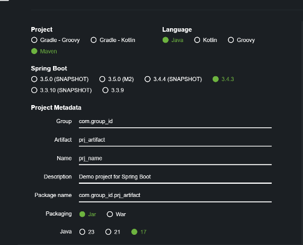
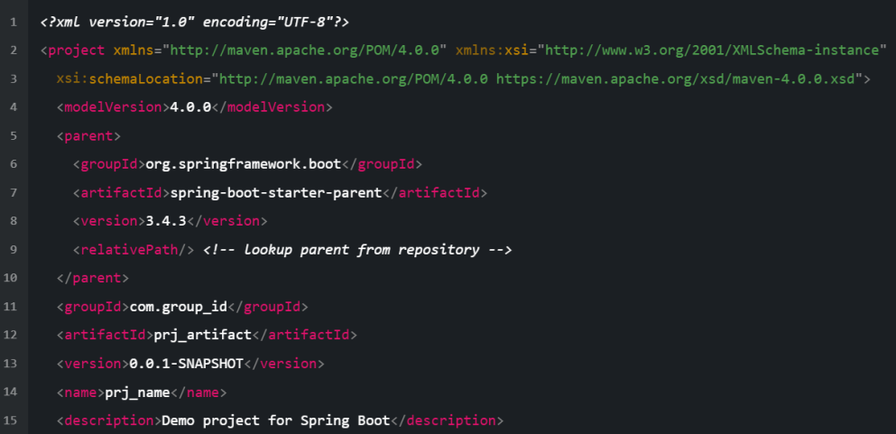
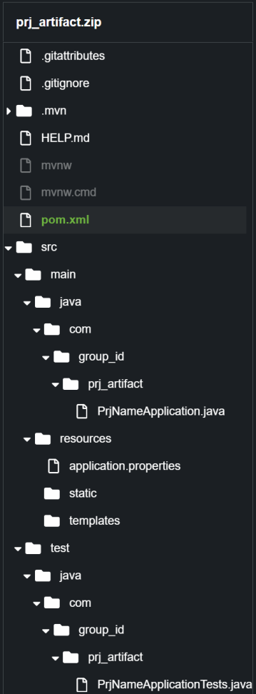
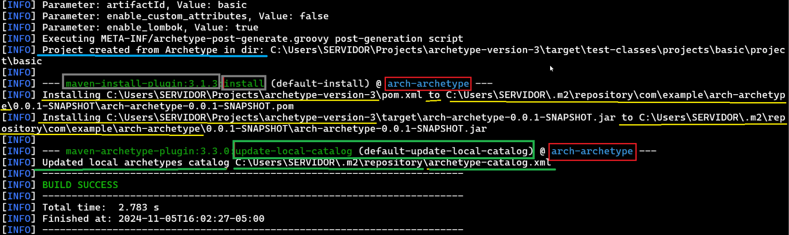
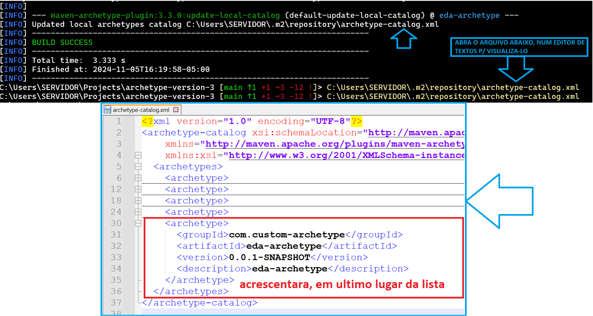
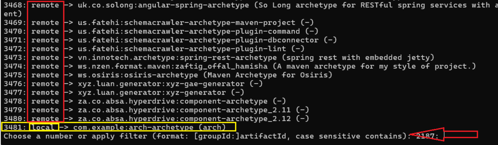
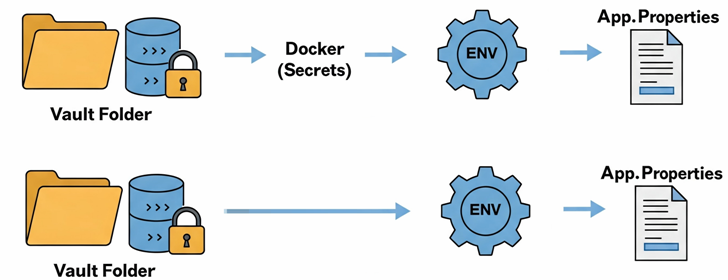
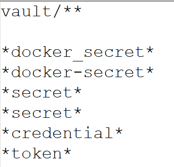
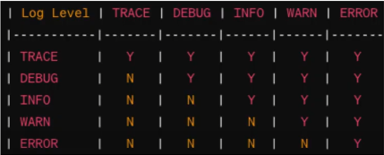

### Eda Archetype

<details><summary><strong>Introdução 👋</strong></summary>

* Este projeto cria um "archetype" baseado na metodologia do MAVEN archetypes.
* _"Eda"_ remete ao termo celta para "reflexo" ou "imagem" trazendo a ideia de algo que espelha ou reflete, remetendo à
  simplicidade e clareza de um espelho. Nao se trata de um termo mitologico.
* Este projeto partir da prova de conceito desenvolvida em out24(ferias BR) no projeto "archetype-v1-concept-proof"
</details>

<details><summary><strong> ️Velocity Guidelines 📍</strong></summary>

* [User Guide](https://velocity.apache.org/engine/2.4.1/user-guide.html)
* [VTL Reference](https://velocity.apache.org/engine/2.4.1/vtl-reference.html)

</details>

<details><summary><strong> Features Test Validation 📍</strong></summary>

* **FASE 01: POS-PROCESSAMENTO**
  * Target: Pastas/Arquivos gerados a partir do Archetype
    * Manejo de Pastas/Arquivos
  * Metodologia:
    * Tabelamento analitico de hipoteses


* **FASE 02: Teste de Aplicacao**
  * Target: App Gerados a partir do Archetype
    * Testes de unidade
    * Testes de Integracao
  * Metodologia:
    * Tabelamento analitico de hipoteses
</details>

<details><summary><strong>Cores ⚛️</strong></summary>

* [ARCHETYPE-POST-GENERATE.GROOVY](src/main/groovy/eda/postgenerate/SnippetComposer.groovy):
  * Conceito: 
    * Script GROOVY nativo (build-time) que COMPOE o `archetype-post-generate.groovy` a partir dos snippets em `META-INF/archetype_post_generate_body/`, `..._snippets/` e `..._variables/`. Substituiu o pre-processamento em bash (`bash_script/create_archetype_post_generate.sh`).
  * Local:
    * [src \ "MAIN" \ groovy \ eda \ postgenerate \](src/main/groovy/eda/postgenerate/)
  * Invocado por: `org.codehaus.gmaven:groovy-maven-plugin:2.1.1` (goal `execute`) na fase `process-resources`. Configurado em `pom.xml` (raiz).
  * Output: `target/classes/META-INF/archetype-post-generate.groovy` (gerado a cada build, equivalente ao output do bash legado).


* [ARCHETYPE.PROPERTIES](src/test/resources/projects/basic/archetype.properties):
  * Conceito:
    * Arquivo de propriedades(requiredProperties) do archetype
    * Responsavel pelo _**teste do Archetype**_
    * Esse teste e realizado antes da montagem do Archetype
  * Local:
    * [src \ "TEST" \ resources \ _projects_ \ _**"BASIC"**_ \ ](src/test/resources/projects/basic)


* [ARCHETYPE-METADATA.XML](src/main/resources/META-INF/maven/archetype-metadata.xml):
  * Conceito:
    * Arquivo de configuração do archetype
    * Contendo:
      * as propriedades que serao capturadas para o uso no MVN CLI
      * Estrutura do Archetype e seus respectivos arquivos e pastas
  * Local:
    * [src \ "MAIN" \ resources \ _META-INF_ \ _**"MAVEN"**_ \ ](src/main/resources/META-INF/maven)
  * 02 - Setores (**_FileSet_** + **_RequiredProperties_**):
    * Setor 01: [_FileSets_](src/main/resources/META-INF/maven/archetype_metadata_filesets)
      * **Packaged** Tag:
        * **Conceito:**
          - A tag `packaged` controla como os arquivos serao estruturados
          - durante a geracao do projeto a partir do archetype,
          - especificamente em relacao a estrutura de pacotes Java.
          - Portanto:
            - os arquivos determinados neste _fileSet_
            - serao automaticamente movidos para a estrutura:
              + **"src/main"** OU
              + **"src/test"**

        * **packaged="true":**
          * **Comportamento esperado:**
            - Os arquivos SERAO organizados seguindo
            - a estrutura do _**pacote base do projeto**_
            - Por exemplo:
              + Se o pacote base for _"com.empresa.app"_. Um arquivo:
                + _'Controller.Java'_ definido em **"src/main/java** / _Controller.java"_
                  + sera movido para _"src/main/java_ / **_com/empresa/app_** / _Controller.java"_
                + _'ControllerTest.java'_ definido em **"src/test/java** / _ControllerTest.java"_
                  + sera movido para _"src/test/java_ / **_com/empresa/app_** / _ControllerTest.java"_
          * **Casos tipicos:**
            + Arquivos Java (.java)
            + Testes unitarios
            + Recursos especificos de classes.

        * **packaged="false":**
          * **Comportamento esperado:**
            - Os arquivos NAO seguirao a estrutura do _**pacote base do projeto**_
            - Permanecerao exatamente onde foram definidos no archetype
              - _**src/main/resources**_ / _properties_ / _**config.properties**_
          * **Casos Tipicos:**
            - Arquivos de configuracao global (application.properties)
            - Scripts de banco de dados
            - Arquivos de documentacao
            - Recursos estaticos (imagens, CSS, etc)

      * _Filtered_:
        * **Conceito:**
          - E um mecanismo para substituicao de variaveis (placeholders) no arquivo.
          - O Maven aplica o 'motor do velocity' nos elementos anotados por essa tag.
        * **filtered="true":**
          * **Comportamento esperado:**
            - O Maven procura por 'placeholders', nos padroes _**${variavel}**_ no arquivo.
            - Substituindo-os por valores pre-definidos no 'requiredProperties'.
        * **filtered="false":**
          * **Comportamento esperado:**
            - O arquivo seria copiado exatamente como esta.
            - Os placeholders **_${variavel}_** seriam ignorados.

      * _Enconding_:
        * **Conceito:**
          - E crucial para o tratamento correto de caracteres especiais.
        * **encoding="UTF-8":**
          * **Comportamento esperado:**
            - Caracteres como **ç, ã, é** sao processados corretamente.
            - **Emojis** sao mantidos.
            - Idiomas complexos **(chinês, arabe, etc)** sao processados corretamente.
        * **"SEM encoding":**
          * **Comportamento observado:**
            - Pode ocorrer mojibake (corrupcao de caracteres), exemplo:
              - "Configuração" _ficaria_ "Configuração"
              - "pais" _ficaria_ "país"

      * _Outros tipos de Tags_:
        * **Conceito:** tags complementares do `<fileSet>` que configuram aspectos especificos do empacotamento.
          - _directory_: Define o diretorio fonte dos arquivos.
          - _includes_: Define padroes de inclusao de arquivos.
          - _excludes_: Define padroes de exclusao de arquivos.
          - _followSymlinks_: (true/false) - Se deve seguir links simbolicos.
          - _lineEnding_: Define o tipo de quebra de linha (keep, unix, windows, lf, crlf).

      * Estrutura das Tags:
```xml
        <fileSet
                filtered="true"
                packaged="true"
                encoding="UTF-8"
                followSymlinks="false"
                lineEnding="unix">
          <directory>src/main/resources</directory>
          <includes>
            <include>**/*.properties</include>
          </includes>
          <excludes>
            <exclude>**/*.tmp</exclude>
          </excludes>
        </fileSet> 
```
   * Setor 02: [_RequiredProperty_](src/main/resources/META-INF/maven/archetype_metadata_properties)
      * Conceito:
        - Define propriedades que serao capturadas pelo **_SWITCHES -D_** do Maven CLI
      * Utilidade Pratica:
        - Captura **_SWITCHES -D_** fornecendo-as p/ a 'montagem' do Archetype
      * Caso de uso:
      1. Usuario deve _obrigatoriamente fornecer_ o **_-Denable_jwt_** no MVN CLI
         - **defaultValue** AUSENTE
         - Caso contrario, o MAVEN "prompetara"(geracao interativa)
           - Indagando o Switch **_-Denable_jwt_** omitido
           ```xml
             <requiredProperty key="enable_jwt">
                 <defaultValue></defaultValue>
             </requiredProperty>
           ```
      2. Usuario OMITE (NAO fornece) a Switch o **_-Denable_jwt_** do Maven CLI
         - (PROMPT INTERATIVO DO MAVEN) Define value for property 'enable_jwt':
            - **defaultValue** PRESENTE
            - MAVEN "nao prompetara"(geracao interativa)
              - **defaultValue** sera usado
           ```xml
               <requiredProperty key="enable_jwt">
                   <defaultValue>false</defaultValue>
               </requiredProperty>
           ```

           - Exemplo de OMISSAO DA SWITCH 'enable_jwt':
             - mvn archetype:generate -DarchetypeGroupId=seu.grupo
</details>

<details><summary><strong> Sources 🔍</strong></summary>

##### Videos 📺
* [Creating & Using Maven Archetypes](https://www.youtube.com/watch?v=U3AvNVT5j8w)
* [How to create a Custom Maven Archetype](https://www.youtube.com/watch?v=NBimK5qFy3E)
* [Spring Boot Code Structure](https://www.youtube.com/watch?v=B1d95I7-zsw)
* [Centralize spring boot log to ELK Elasticsearch, Logstash, Kibana](https://www.youtube.com/watch?v=hvYUwUmHB6M)
* [Spring Boot Configuration Properties: Working with Lists & Maps](https://youtu.be/RiG9YORZOfc)
* [External Properties in Spring Boot 3 @ConfigurationProperties, @Value, Environment](https://youtu.be/s_BT8o0KbxQ)
* [@ConfigurationProperties: Application Properties in Spring Boot 3 - Properties/Constructor Binding](https://youtu.be/qWr9WD3uYCE)

##### Artigos 📝
* [Externalized Configuration - Spring Documentation](https://docs.spring.io/spring-boot/reference/features/external-config.html)
* [Guide to @ConfigurationProperties in Spring Boot](https://www.baeldung.com/configuration-properties-in-spring-boot)
* [What is Gitleaks?](https://akashchandwani.medium.com/what-is-gitleaks-and-how-to-use-it-a05f2fb5b034l)
* [What is GitLeaks and How to Use It?](https://www.geeksforgeeks.org/gitleaks/)
* [Logging in Spring Boot](https://www.baeldung.com/spring-boot-logging)
* [Spring Boot Logging Example](https://mkyong.com/spring-boot/spring-boot-logging-example/)
* [Logback xml Configuration Examples](https://javatechonline.com/logback-xml-configuration-examples/)
* [Setting the Log Level in Spring Boot When Testing](https://www.baeldung.com/spring-boot-testing-log-level)
* [Logback in Spring Boot](https://www.linkedin.com/pulse/logback-spring-boot-pradeep-h-r-k6fec)
* [Logback - Chapter 5: Encoders](https://logback.qos.ch/manual/encoders.html)
* [Understanding Logback](https://medium.com/@facuramallo8/understanding-logback-66044df087ed)
* [Configuring Centralized Logging with Logback in Logstash and Kibana for Java Applications](https://medium.com/@noushka99anu/configuring-centralized-logging-with-logback-in-logstash-and-kibana-for-java-applications-2d51ba509b9f)
* [Send the Logs of a Java App to the Elastic Stack (ELK)](https://www.baeldung.com/java-application-logs-to-elastic-stack)
* [Monitoring Spring Boot Microservices Logs with the ELK Stack](https://medium.com/@sovisrushain/monitoring-spring-boot-microservices-logs-with-the-elk-stack-aeeaf3e98d7b)
* [ELK Kibana Logs + Springboot Logback](https://www.youtube.com/embed/6kfmMIWrFpg?si=vTF2s1ffOxahT1yP)
* [Spring Boot & ELK Stack with Log4j2 Socket Appender](https://karadenizfaruk28.medium.com/spring-boot-elk-stack-with-log4j2-socket-appender-6dd63f01ddba)
* [Testing Spring Boot @ConfigurationProperties](https://www.baeldung.com/spring-boot-testing-configurationproperties)
* [Custom Validation MessageSource in Spring Boot](https://www.baeldung.com/spring-custom-validation-message-source)

##### Repos 🐙
* [lemoncode21/docker-loging-elk](https://github.com/lemoncode21/docker-loging-elk)
* [lemoncode21/springboot-logging-elk](https://github.com/lemoncode21/springboot-logging-elk)
* [danvega/list-map-props](https://github.com/danvega/list-map-props.git)

##### Documentation 📖
* [Double words package name](https://docs.oracle.com/javase/tutorial/java/package/namingpkgs.html)
</details>

<details><summary><strong>Maven Coordinates 📍</strong></summary>

* [Click to check the Coordinates Documentation](https://maven.apache.org/pom.html#Maven_Coordinates)

##### Configuration Project 🔧


##### POM.xml 📝


##### Folder Structure 🗂️

</details>

<details><summary><strong> Tech Triad 🔺️</strong></summary>


#### 1) Development (Dev)
* Code
  - **WebService Structure**: The project is structured as a web service.
  - **Technologies**: Written in Java, utilizing Spring Boot and Vaadin frameworks.

* Performance
  - **EhCache**: Used for caching to improve performance.
  - **Virtual Threads**: Leveraged for efficient concurrency.

* CI/CD
  - **GitOps**: Implemented for continuous integration and continuous deployment.

#### 2) Security (Sec)
  * **Secure Protocols**: The security of the project is ensured by the use of secure protocols.

#### 3) Operations (Ops)
  * Testing
    - **Unit Tests**: Tests for individual components.
    - **Integration Tests**: Tests for combined components.
    - **Contract Tests**: Tests for API contracts.
    - **Schema Tests**: Tests for database schemas.
    - **Functional Tests**: Tests for system functionality.

  * Documentation
    - **Swagger**: Used for API documentation.

  * Log Management
    - **ELK Stack**: Elasticsearch, Logstash, and Kibana for log management.

  * Health Check
    - **Grafana**: For monitoring and visualizing metrics.
    - **Spring Actuator**: For monitoring and managing the application.

  * Containerization
    - **Docker**: Used for containerization.
    - **Docker Compose**: For defining and running multi-container Docker applications.

  * Maintenance CPanel
    - **Health Check**: Monitored using Grafana.
    - **DBA Client**: Tools like Robo3T, MongoCompass, PhpMyAdmin, and Adminer.
    - **Log Management Client**: Kibana for log visualization.
    - **Dockerization Client**: Portainer for managing Docker environments.

</details>


<details><summary><strong> Bug Summary 🐜</strong></summary>

1. '_fileSet filtered="true"_' em target incorreto:
  - Problema: 
    - "Filtered="true" aplica o motor do Velocity em placeholders (ex: ${placeholder})
    - O BUG ocorre se o Velocity e desnecessario na pasta/arquivo (_targets do fileSet_)
    - Logo, o "filtered="false" devera substitui-lo, para desligar o 'velocity', pois
    - o Velocity "quebra" se nenhum 'placeholder' e encontrado no _'target do fileSet'_
```Console
[INFO] Scanning for projects...
(...)
[ERROR] ResourceManager: parse exception: Encountered ">[0]}) {\n" at archetype-resources/.git_temp/hooks/pre-rebase.sam
ple[line 79, column 56]
Was expecting one of:
    "[" ...
    "|" ...
    "}" ...
    "}" ...
[INFO] ------------------------------------------------------------------------
[INFO] BUILD FAILURE
[INFO] ------------------------------------------------------------------------
[INFO] Total time:  1.642 s
[INFO] Finished at: 2025-02-14T17:17:47-05:00
[INFO] ------------------------------------------------------------------------
```
  - Solucao: Isolamento de 'TARGET ATINGIDO PELO VELOCITY'
```xml
        <fileSet filtered="false" encoding="UTF-8"> (filtered="false" - Exclue Velocity)
          <directory>.git_temp</directory>
          <includes>
            <include>**/*.*</include>      (NADA NO 'TARGET' DEMANDA O VELOCITY)
          </includes>
          <excludes>
            <exclude>config</exclude>(EXCLUI 'ARQUIVO' 'ATINGIDO' PELO VELOCITY)
          </excludes>
        </fileSet>


        <fileSet filtered="true" encoding="UTF-8">  (filtered="TRUE" - Aplica Velocity)
          <directory>.git_temp</directory>
          <includes>
            <include>config</include> (ISOLA 'ARQUIVO' 'ATINGIDO' PELO VELOCITY)
          </includes>
        </fileSet>
```
---

2. Falta de Atualizacao do Maven:
```Console
No signature of method: Script1.var()

    [ERROR] Failed to execute goal org.apache.maven.plugins:maven-archetype-plugin:3.2.1:generate (default-cli) 
    on project standalone-pom: 
    No signature of method: Script1.var() is applicable for argument types: 
    (java.lang.String)
```

---

3. Excesso "DISPLICENTE" de arquivos de "Properties":
```Console
java.lang.IllegalStateException: 
Failed to load ApplicationContext for 
[WebMergedContextConfiguration@425357dd testClass = dev.danvega.props.properties.ApplicationPropertiesTest, locations = [], classes = [dev.danvega.props.AppDriver], contextInitializerClasses = [], activeProfiles = [], propertySourceDescriptors = [], propertySourceProperties = ["org.springframework.boot.test.context.SpringBootTestContextBootstrapper=true"], 
contextCustomizers = [org.springframework.boot.test.context.filter.ExcludeFilterContextCustomizer@14028087, org.springframework.boot.test.json.DuplicateJsonObjectContextCustomizerFactory$DuplicateJsonObjectContextCustomizer@1750fbeb, org.springframework.boot.test.mock.mockito.MockitoContextCustomizer@0, org.springframework.boot.test.web.client.TestRestTemplateContextCustomizer@303cf2ba, org.springframework.boot.test.autoconfigure.actuate.observability.ObservabilityContextCustomizerFactory$DisableObservabilityContextCustomizer@1f, org.springframework.boot.test.autoconfigure.properties.PropertyMappingContextCustomizer@0, org.springframework.boot.test.autoconfigure.web.servlet.WebDriverContextCustomizer@6f53b8a, org.springframework.boot.test.context.SpringBootTestAnnotation@118ad067], 
resourceBasePath = "src/main/webapp", 
contextLoader = org.springframework.boot.test.context.SpringBootContextLoader, 
parent = null]
```
* Descricao:
  - Nao pode existir no “basePathResources”(src\main\resources OR src\test\resources) Application.PROPERTIES “e” 
    Application.YML “SIMULTANEAMENTE”
* Reason:
  - Eventualmente, por descuido e necessidade de, enviar arquivos para o “Archetype”, todos os os arquivos de “propriedades” (Application.properties OR Application.yml) sao colocados/mantidos no classpath do “App de Prova de Conceito”.
  -	Isso ocorre pois, para implantar a “Prova de Concenceito” no “Archetype”, precisamos de todos os arquivos “SIMULTANEAMENTE”
  - Em caso de necessidade de TESTE, apos o envio da “Prova de Conceito”, 
  ao Archetype, ESTANDO OS DOIS OS ARQUIVOS, SIMULTANEANTE PRESENTES NA “PROVA DE CONCEITO”, por alguma displicencia(um deletes deveria ser deletado ou renomeado), o testes FALHARAO
* Solucao:
  - Deixar apenas UM TIPO de arquivos de “propriedades”, seja: “Application.properties e derivados” OU “Application.yml e derivados

---

4. Mudancas no Archtype "NAO SURTEM EFEITO":
* Descricao:
  * Mudancas no Archetype, sejam:
    - 'Velocity'(acrescimos/alteracoes ou delecoes de 'placeholders')
    - Mudanca Estruturais (pastas / arquivos)
    - Codigo 'alterado' nao surte efeito
    - Alteracao no 'archetype-metadata.xml' nao surte efeito ou desaparecem
    - Alteracao no 'archetype-pos-generate.groovy' nao surte efeito ou desaparecem
* Razao:
  * A "RE-CRIACAO" do Archetype, esta sendo "MAL SUCEDIDA"
    - 'MVN CLEAN INSTALL' nao "sem completa" _**recriando**_ "o" "novo archetype" no REPO-LOCAL DO MAVEN
    - Mantendo o "archetype anterior", ainda valendo
    - Isso causa a impressao de que as "mudancas nao surtiram efeito"
    - Ou seja, apos a criacao do novo projeto, elas nao "aparecem"
    - Pois, o que se enxerga, e' o "antigo archetype"
* Solucao:
    * Encontrar o BUG que impede o "RE-CRIACAO" do Archetype
      - Essa "RE-CRIACAO" se da atraves do "MVN CLEAN INSTALL"
      - Corrigir o BUG ate ela ser "BEM SUCEDIDA"
---
</details>


<details><summary><strong> Composição 📈</strong></summary>

**O projeto é dividido em 05 fases:**
1. Pre-processamento
2. Processamento
3. Testes de Processamento
4. Pos-processamento
5. Instalacao do Archetype no repositorio local do Maven

### 1) Pre-processamento: 🔍

* **Script** (bash script) 📝
  - Local: `./bash_script/eda.sh`
* Finalidade:
  - Captura (input) do usuário com parâmetros estruturais do projeto a ser criado 📝
  - Os inputs são armazenados em variáveis 📚
  - Essas variáveis serao usadas na fase de processamento 📊
  - "Etape Executada" via "script bash" 📝

#### 1.1) Elementos 🎨

* Valores **'Default'** em caso de tecla "Enter" nos inputs 📝
* Exemplos de valores orientando os inputs 🤔
* "Padrões aceitáveis **[REGEX]**" nos inputs 🔍
* Sistema de Log pré-configurável abrangendo as 03 fases 📊
* Criação das **"switches [-D]"** do "mvn line command -D" executado no pre-processamento 🔌
* Possui **"CONSTANTES"** que facilitam o manuseio e configuracao dos Inputs 📈

### 2) Processamento: 🔄

* Processador - _"Archetype-Metadata.XML"_:
  - **Local:** `src/main/resources/META-INF/maven/`
* Finalidade:
  - "Etapa Executada" pela "Line Command" do Maven (mvn) definida no pre-processamento 🔄
  - Processa os "inputs" capturados no pre-processamento 📝
  - "Etapa Executada" atraves de "filesets" e "requiredProperties" definidas num _"arquivo XML"_ 🔄

#### 2.1) Elementos 🎨

* requiredProperties:
  - properties:
    - Sao exatamente as switches([-D]) fornecidas na "mvn line command"(pre-processamento)
* fileSets - Modularização do "Archetype"
  - "Arquivos e pastas" compoe o "Archetype"
  - Define quais desses "arquivos e pastas" pertencerao "Originariamente" ao "Archetype":
  - Os "Módulos do Archetype" são "arquivos e pastas" definidos origináriamente no ato de criacao do "Archetype"
  - Esses "Módulos" são gerenciados nae "Modulação" do "Archetype", conforme:
    * includes/excludes file
    * includes/excludes file-type
    * includes/excludes folder

### 3) Testes de Processamento: 🔄

* Processador de Testes: _"Archetype.properties"_:
  - **Local:** `src/test/resources/projects/basic/`
* Finalidade:
  - Testa as Required Properties do Archetype-Metadata.XML

### 4) Pos-processamento: 📈

* Pos-Processador - _"archetype-post-generate.groovy"_:
  - **Local:** `src/main/resources/META-INF/`
* Finalidade:
  - Processo de "Modulacao" do "Archetype" ja processado E criado 🔄
  - Manipulacao de arquivos e pastas do "Archetype" a partir do "processamento" realizado
  - "Etapa Executada" atraves do manejo de pastas e arquivos com "script groovy"

#### 4.1) Elementos 🎨

* Captura:
  - Captura as propriedades definidas no "Archetype-Metadata.XML" (processador)
* Modulação
  - Observa as propriedades capturadas E:
    - Exclue, dos os Módulos Originários, itens (arquivos ou pastas) preteridos
    - Mantem, nos Módulos Originários, itens desejados
</details>

<details>
<summary><strong> Instalacao 📦</strong></summary>

### a) Atualizar/Instalar **versao mais recente do Maven**

* Maven 'nao se atualiza':
  * se instala nova versao mais recente
  * Encontrar a versao mais recente do Maven em [Apache Maven](https://maven.apache.org/install.html)
* Baixar o arquivo 'bin.zip' da versao mais recente do Maven
  * Descompactar o arquivo 'bin.zip'
* Atualizar as env-vars do `PATH` (no Windows) atualizando/inserindo a localizacao do Maven 'descompactado'
* Testando a instalacao:
  * mvn -version
* Possivel BUG por falta de Atualizacao do Maven:
```Console
No signature of method: Script1.var()

    [ERROR] Failed to execute goal org.apache.maven.plugins:maven-archetype-plugin:3.2.1:generate (default-cli) 
    on project standalone-pom: 
    No signature of method: Script1.var() is applicable for argument types: 
    (java.lang.String)
```

### b) Entre na **nova pasta**

- Esta pasta poderá conter - ALTERNATIVAMENTE:
  - Os **items** (`pom.xml` + `src`) criados a partir do item anterior.
    - POM.XML:
      - Arquivo POM relativo ao "ARchetype"
- Ajustar nele, caso deseje (item exemplificativos):
```xml
   <groupId>com.custom-archetype</groupId>
   <artifactId>eda-archetype</artifactId>
   <version>0.0.1-SNAPSHOT</version>
   <name>eda-archetype</name>
```
  - Um projeto de **Archetype** já existente (em andamento).

### c) Limpe a pasta `src` deletando:

- `test/resources/projects/basic` _(SE HOUVER)_.
- Arquivos temporários _(SE HOUVER)_.

### d) Separe numa pasta **temporária** _(permanece somente pasta 'src' + 'pom.xml')_:

- `.idea`
- `EDA.SH`
- `README.md`
- `Outros, que nao 'src' e 'pom.xml'`

### e) Instale o **Archetype** no **Maven-Local-Repo-Archetypes**:

```
  mvn clean verify
  mvn clean
  mvn install 
```

### f) Resultado da Instalacao 🎨


**Legenda:**

* **Vermelho:** o nome do archetype criado
* **Verde:** catálogo que registra a instalação
* **Amarelo:** Destino das instalações
* **Azul:** Projeto instalado
* **Cinza:** Plugin de instalação

### g) Retornar a "pasta do Archetype", os arquivos separados na "pasta temporária":

* .idea
* EDA.SH (SEPARAR NUMA PASTA AVULSA, E DEPOIS RETORNA-LO)
* README.md
* Outros separados

### h) Localizacao dos elementos 'Locais' do Maven:

* Repositorio Local: `C:\Users\SERVIDOR\.m2\repository\`
* Catalogo de 'Archetypes Locais': `C:\Users\SERVIDOR\.m2\repository\archetype-catalog.xml`

### i) Visualizando/Checando a Instalação

* **OPÇÃO 01:**
  


* **OPÇÃO 02:**
  - Inicie um processo interativo: (só para visualizar)
    - mvn archetype:generate -DarchetypeCatalog=local
      - somente p\ checagem:
        - cancelar assim que visualizar o "archetype"
    - Visualizado o archetype, no "local-repo"
      - Atente para o "número do Archetype"
      - Cancele esse processo interativo (Crtl+C)
        
</details>

<details><summary><strong> Lib JQ - JSON validation 📄</strong></summary>

### j) Instalando Lib JQ (Teste e Validação de JSON):
  - A Lib 'JQ' do bash e necessaria para validacao de JSON/Contratos
    * Instale usando:
      * Linux:
        * Ubuntu: _sudo apt-get install jq_
        * CentOS: _sudo yum install jq_
      * macOS:
        * _brew install jq_
      * Windows (Chocolatey):
        * _choco install jq_
      * Windows (Manual):
        * Baixe de https://stedolan.github.io/jq/download/
        * Adicione ao PATH

</details>

<details><summary><strong> Code Structure 📐</strong></summary>

- Structural approach chosen: _Package by Feature_    

| Criteria                | Package by Feature                                         | Package by Layer                                       |
|-------------------------|------------------------------------------------------------|--------------------------------------------------------|
| Best Practices          | **- High cohesion<br>- Low coupling<br>- High modularity** | - Low cohesion<br>- High coupling<br>- Low modularity  |
| Encapsulation           | **- Some classes use package-private access modifier**     | - Most classes must be public                          |
| Modularity              | **- Easy to break down into microservices**                | - Difficult to break down into microservices           |
| Maintainability         | **- Reduces navigation between packages**                  | - Difficult to find needed classes                     |
| Testability             | **- Tests limited to same package<br>- Focused tests**     | - Tests can access any package<br>- Less focused tests |
| Design Approach         | **- Promotes Domain Driven Design**                        | - Promotes Database Driven Design                      |
| Microservices Migration | **- Facilitates Migration for Microservices**              | - Difficult to migrate for Microservices               |
</details>

<details><summary><strong> Milestones 📅</strong></summary>

* CRUD
  - Basic
  - Advanced


* Integration Testes
  - Repo
  - Service
  - Controller


  * DB's for Tests
    - H2
    - TestContainer


* Externalized Configurations
  - App properties
  - Excecoes
  - Mensagens
  - I18N
  - Rotas
  - Credentials (Unpushaveis)
  - etc...


* Type Safe 'Externalized Properties/Configuration' Binding
  - Filetypes:
    - .proprerties
    - .yml
  - Types:
    - Simple
    - List
    - Map
  - Mutable / Immutable
  - Validation


* Good Practices
  - Pageable
  - HATEOAS


* DTO
  - Tipos
    - Request
    - Response
    - Entity protection


* Mapper


* Exceptions
  - Global
  - Customizadas
  - Segurança
  - Autenticação


* BeanValidation
  - Exceções
  - Validações Personalizadas
    - Pattern Regex


* Cache


* I18N


* Testes de Contratos
  - Contratos
    - JSON
  - SchemaValidator
    - JSONSchema


* Documentação
- Swagger


* Database
  - DBs:
    - MongoDB
    - MySQL
    - Postgres
  - DDL
    - Hibernate
    - Flyway
  - Persistence
    - Spring Data
    - JDBC
    - JDBC Clients


* Autenticação (Spring Security)
  - JWT:
    - Simples
    - Oauth Server
  - OAuth2
    - GitHub
    - Google
    - Facebook


* DevOps
  - Docker
    - Folder
    - Dockerfiles
    - Docker Secrets
    - Docker-Compose
  - CI/CD
  - CloudFlare
  - AWS


* Seguranca
  - SAST (Static Application Security Testing)
    - Credentials:
      - GitGuardian:
        - dificil instalacao
        - Freemium
      - GitLeaks:
        - facil instalacao
        - Open-source
        - Depende de regras personalizadas, para credenciais customizidas
  - Proxy Reverso (Nginx)


* Modularidade


* Performance
  - Load Balancer (Nginx)
  - Cache
  - CDN
  - Virtual Threads


* API Proxies  (Internal UI Clients)
  - DB
  - Docker (Portainer)
  - Spring actuator (graphana)
  - Documentacao (swagger)
  - Log Kibana (logstash + Elasticsearch)
</details>

<details><summary><strong>Task Planning 📝️</strong></summary>

1. DTO
  - Libraries
    - MapStruct (AutoAPI)
    - MyBatis (Guang)
    - ModelMapper
  - Request / Response
  - AbstractDto
    - Public class to facilitate DTO creation (Guang)


2. Lombok
  - AutoAPI
  - Guang


3. Database Versioning
  - FlyWay
  - Liquibase (AutoAPI)


4. Documentation
  - Swagger (AutoAPI + Guang)
  - Montagem Automática de README.md


5. Testing
  - DataBuilder (Guang)
  - CustomUtils (Guang)
    - Convert Java object to JSON string
    - Handle conversion failure with RuntimeException
  - TestController (Guang)
    - Unit testing with:
      - `@Transactional`
      - Mockito
  - Test-Db:
    - H2
    - TestContainer


6. Service
  - Transactional (Guang)
  - Dto-Mapper (Guang)
  - Apache Commons BeanUtils (Guang)
    - Copy properties from object to entity


7. Controller
  - @Validated on DTO (Guang)
    - BeanValidation
  - Pageable (Guang)
  - Dto-Mapper (Guang)


8. Repository
  - JPA Repository (AutoAPI + Guang)
  - CRUD Repository (AutoAPI)
  - JpaSpecificationExecutor (Guang)
  - Transactions (ACID)


9. Entities
  - POJO
  - Records


10. Safety
  - Input:
    - sanitizing/encode (replace)
    - filtering (block)
  - Shield Dtos:
    - BeanValidation REGEX
  - OWASP
  - Credentials Protection
    - Externalized Properties-File FROM .Env-file
    - Gitleaks (SAST)
      - Nao sera usado, pois depende de instalacao local
      - Apenas 'Recomendado como 2 layer de protecao"'
  - Sanitização de URL:
    - pré despatcherServlet
    - Header Request


11. Log
  - Logback:
    - logback-spring
    - logback-test
  - ELK:
    - Elasticsearch
    - Logstach
    - Kibana
    - Fluxo do ELK:
> 1) O WebApp envia os logs p/ (logstash.conf: "INPUT") APPENDER-TCP-LOGSTASH "<destination>" do Logback-spring.xml
> 2) O Logstasch (logstash.conf: "OUTPUT") envia os 'Logs Processados' p/ 'elasticsearch:9200'
> 3) O kibana exibe os Logs recebidos no 'elasticsearch:9200'


12. Health Check
  - Actuator


13. API Proxies (Internal UI Clients)
  - DBA Client
  - Docker (Portainer)
  - Spring actuator (graphana)
  - Documentacao (swagger)
  - Log Kibana (logstash + Elasticsearch)


14. Type Safe Externalized Properties/Configuration Binding
  - Application.propriedades
  - Mensagens:
    - Gerais
    - Excecoes
  - I18N (Traducoes)
  - Rotas
  - Credentials(secrets) Vault 'Unpushaveis'
</details>

<details><summary><strong>Concluded Tasks ✅</strong></summary>

- [x] Credentials protection
  - [x] Gitleaks / GitGuardian (Alternative Approaches)
    - CONS:
      - GitGuardian:
        - is not free
        - Must be installed locally
      - GitLeaks:
        - dont works 'efficiently' with Custom-Credentials
  - [x] **'Encrypted Folder + Global GitIgnore'** _(Chosen Approach)_
    - [x] Encripted Folder:
      - Win10 BitLocker
      - ALL **Credentials-Files** (any sensitive data) must be storaged on this folder 'individually'
      - The folder will encrypt All its content automatically (files + subfolders)
      - This folder:
        - "IS NOT VERSIONED/COMMITTED" _(MUST be inserted in GitIgnore Global)_
        - 'dont belong' to any project
        - is not inside any project
        - is not inside any folder, from any project
      - Example:
        - 
    - [x] **GitIgnore-Global**:
      - Will detect (excluding for any commit):
      - Global GitIgnore CLI:
        - _Creating_ an "Global GitIgnore" **'NOT CREATED YET'**:
          - _git config --global core.excludesfile C:\your-path\.gitignore_global_
        - _Finding_ an **'ALREADY EXISTING FILE'**:
          - _git config --global core.excludesfile_
        - _GitIgnore-Global_ **'HELP'** can be found, in: 
          - [GitHub - Global GitIgnore Documentation](https://gist.github.com/subfuzion/db7f57fff2fb6998a16c)
      - Example:
        - 

      - Exclusion 'keywords'(fragment-word in begin/middle/end), such as:
          * docker_secret
          * dockersecret
          * secret
          * authorization
          * authentication
          * secret
          * secretkey
          * credential
          * token
          * etc...
    - [x] **_'Protected-properties-folder'_**
      - App Folder for 'sensitive-properties'
      - These 'sensitive-properties' will data from receive "Environment_Variables"
      - These "Environment_Variables" will be extracted from the **'Credentials-Files'**
      - All **'Credentials-Files'** will be stored in a **'Windows Encrypted Folder'**


- [x] Log
  - [x] Logback:
    - Logback-spring + logback-test
    - Console banner (dev + test)
  - [x] Logback - Console Appender:
    - 03 types:
      - Default (Spring)
      - Tabular
      - Granular
  - [x] Logback - Extra Appenders:
    - Email
    - RollingFile storage
      - classic
      - rolling
      - logstash
    - TCP-SOCKETS for logstash (CPanel)
  - [x] Log Hierarchy:
    - 


- [x] Type Safe 'Externalized Properties/Configuration' Binding
  - Types:
    - Constructor Binding (Immutable)
      - Record (native: no setters + canonical constructor + only constants[finals])
        - OBS: Implicit Canonical constructor not allow @ConstructorBinding annotation
      - Class (no setters + canonical constructor + only constants[finals])
        - OBS: All arguments constructor (canonical constructor in Records)
    - JavaBean Binding (Mutable)
      - No arguments constructor (implicit default constructor)
      - Setter mandatory
      - Only Classes (with setters/mutators)
  - **_'Context Scanning'_**:
    - Constructor Binding + JavaBean Binding:
        * EnableConfigurationProperties (define the class to be scanned)
        * _ConfigurationPropertiesScan_ (define the package to be scanned)
    -  JavaBean Binding:
        * Stereotype Annotations: Component or Configuration
  - File Types:
    - Properties
    - YAML
  - Formats:
    - Simple
    - Map
    - List
  - Validation:
    - Spring-Validation
      - jakarta.validation.constraints
    - Externalization of Messages Absence - Explanation:
      - Mensagens de 'falha de validacao' serao hardcoded
      - Pois, servem apenas para 'Log' ou 'debug' da API (Internal Messages)
      - Nao destinando-se ao 'output'(User/Admin Messages) da API
      - Nao sendo entao, objeto de I18N ou Externalizacao


  - [ ] TestDB
    - H2
    - TestContainer


- [ ] CPanel - API Proxies (UI Clients)
  - [ ] Log Kibana (ELK - Elasticsearch + Logstash + Kibana)
  - [ ] Docker (Portainer)
  - [ ] DB (DB-Client)
  - [ ] Documentacao (Swagger)
  - [ ] Spring actuator (Graphana)
</details>

<details><summary><strong> Next Version 🔮️</strong></summary>

  - JpaSpecificationExecutor
  - Upload
  - Download
  - Oauth2 (Google + Facebook + Linkedin)
  - Swagger
  - Performance (ECache + Virtual Threads)
  - Multi-Tenant
  - Modularity (Java)
  - "Feature" Generation/Automation
  - "Component" Generation
  - Stripe
  - Document/PDF Visualizer
  - 2FA Authentication
  - Passwordless Authentication
  - UbyKey (OTP)
</details>

<details><summary><strong>Acrescentando Novas Flags ➕️</strong></summary>

#### 1) Areas alteradas pela adição:

   + **Processador:** [_"ARCHETYPE-METADATA"_.XML](src/main/resources/META-INF/maven/archetype-metadata.xml)
     - Local: _"maven"_
       - Root Path: [_C:\WORKBASE\DEV\SCRIPTS\archetype-v2-eda\src\main\resources\ "META-INF" \ **maven**_](src/main/resources/META-INF/maven)


  + **Processador Test:** [_"ARCHETYPE-PROPERTIES"_.PROPERTIES](src/test/resources/projects/basic/archetype.properties)
    - Local: _"basic"_
      - Root Path: [_C:\WORKBASE\DEV\SCRIPTS\archetype-v2-eda\src\test\resources\projects\ **basic**_](src/test/resources/projects/basic)


  + **Pos-Processador:** [_"ARCHETYPE-POS-GENERATE"_.GROOVY](src/main/resources/META-INF/archetype-post-generate.groovy)
    - Local: _"META-INF"_
        - Root Path: [_C:\WORKBASE\DEV\SCRIPTS\archetype-v2-eda\src\main\resources\ **META-INF**_](src/main/resources/META-INF)


  + **Orquestrador (mecanismo de inferência de flags):** [Orchestrator.groovy](src/main/groovy/eda/postgenerate/llmflag/Orchestrator.groovy)
    - Local: _"llmflag"_
      - Root Path: [_C:\WORKBASE\DEV\SCRIPTS\archetype-v2-eda\src\main\groovy\eda\postgenerate\ **llmflag**_](src/main/groovy/eda/postgenerate/llmflag)

  * **NOTA _(a partir de `003-llm-flag-inference`)_:**
    * O passo de adição de uma nova flag **NÃO** requer criar um script
      `user_*_input.sh` nem editar `maven_command_line_archetype_generate.sh`.
    * Em vez disso, declare a flag no catálogo canônico
      ([`property-*.xml`](src/main/resources/META-INF/maven/archetype_metadata_properties/))
      e use o mecanismo de inferência LLM para montar a linha de comando a
      partir de uma descrição textual + um contrato JSON.
    * O `Orchestrator` lê o catálogo **em runtime** _(FR-013)_:
      + **zero** lista de flags hardcoded.
      + Uma flag nova é reconhecida **sem nenhuma alteração no código dele**.
    * Veja o passo 1 abaixo, o passo 5 (registro da `ENTITY`) e
      [`specs/003-llm-flag-inference/spec.md`](specs/003-llm-flag-inference/spec.md).


#### 2) EXEMPLO PRATICO (na mao) - Flag c/ MANIPULACAO de Pasta e Arquivo:

  * **Cenario:**
    * Flag: `enable_s3_storage`
    * Ela traz **2 arquivos** e **1 pasta**:
      + `src/main/resources/config/s3-storage.properties` (arquivo)
      + `src/main/java/.../config/StorageProperties.java` (arquivo)
      + pasta `docker/minio/` com `docker-compose.yml` (pasta)

  * **Total de arquivos tocados:** 6 CRIADOS + 2 EDITADOS

---

##### PASSO 1 - Criar a pasta e os arquivos dentro do ARCHETYPE-RESOURCES:

  * Primeiro se cria a **pasta** e os **arquivos** que a flag traz.
```bash
src/main/resources/archetype-resources/
├── config/                          <- CRIAR
│   └── s3-storage.properties        <- CRIAR
├── src/main/java/                   <- JA EXISTE
│   └── config/
│       └── StorageProperties.java   <- CRIAR
└── docker/                          <- JA EXISTE
    └── minio/                       <- CRIAR
        └── docker-compose.yml       <- CRIAR
```

  * Conteudo de `config/s3-storage.properties`:
```properties
storage.type=${enable_s3_storage}
storage.bucket=app-uploads
storage.endpoint=http://localhost:9000
```
    - OBS: o `${enable_s3_storage}` aqui **NAO** faz nada.
    - O Velocity so substitui o que esta entre `#if(...)`.

  * Conteudo de `src/main/java/config/StorageProperties.java`:
```java
package ${package}.config;

import org.springframework.boot.context.properties.ConfigurationProperties;

@ConfigurationProperties(prefix = "storage")
public class StorageProperties {
    private String type;
    private String bucket;
    private String endpoint;
    // getters e setters
}
```
    - OBS: aqui o `${package}` **FUNCIONA**, porque o arquivo passa pelo Velocity.

  * Conteudo de `docker/minio/docker-compose.yml`:
```yaml
services:
  minio:
    image: minio/minio:latest
    ports:
      - "9000:9000"
```

---

##### PASSO 2 - Criar a property 'PROPERTY-S3-STORAGE.XML':

  * Local: [_archetype_metadata_properties_](src/main/resources/META-INF/maven/archetype_metadata_properties/)
  * Nome do arquivo: `property-s3-storage.xml`
  * Conteudo completo (FORMATO OBRIGATORIO):
```xml
<?xml version="1.0" encoding="UTF-8"?>
<!-- PROPERTY-S3-STORAGE.XML _____________________________________ -->
<!-- FLAG: enable_s3_storage -->
<!--   DESCRIPTION : Habilita o armazenamento de arquivos em S3 -->
<!--                  (MinIO local em desenvolvimento). -->
<!--   PROMPT      : Enable 'S3 Storage' -->
<!--   TYPE        : boolean -->
<!--   DEFAULT     : false -->
<!--   DOMAIN      : true | false -->
<!--   VALIDATION  : ^(true|false)$ -->
<requiredProperty key="enable_s3_storage">
    <defaultValue>false</defaultValue>
    <validationRegex>^(true|false)$</validationRegex>
</requiredProperty>
```
    - **REGRA CRITICA:** o `<defaultValue>` **NUNCA** pode ser vazio.
    - Se for vazio, o build quebra com **exit 4**.
    - Mensagem: `Flag 'X' has empty defaultValue.`
    - Indentacao: **4 ESPACOS** (nao 8).

---

##### PASSO 3 - Registrar a ENTITY da nova property no 'ARCHETYPE-METADATA.XML':

  * Local: [archetype-metadata.xml](src/main/resources/META-INF/maven/archetype-metadata.xml)
  * Sao **DUAS** edicoes neste arquivo:

  * Edicao A - Dentro do `<DOCTYPE>` (ordem alfabetica):
```xml
    <!ENTITY property-properties-filetype SYSTEM "archetype_metadata_properties/property-properties-filetype.xml">
    <!ENTITY property-s3-storage SYSTEM "archetype_metadata_properties/property-s3-storage.xml">
    <!ENTITY property-src-test SYSTEM "archetype_metadata_properties/property-src-test.xml">
```

  * Edicao B - Dentro do `<requiredProperties>` (ordem alfabetica):
```xml
        &property-properties-filetype;
        &property-s3-storage;
        &property-src-test;
```
    - **ATENCAO:** se este passo for esquecido, o arquivo criado no Passo 2 **nunca sera lido**.

---

##### PASSO 4 - Criar o 'FILESET-S3-STORAGE.XML':

  * Local: [_archetype_metadata_filesets_](src/main/resources/META-INF/maven/archetype_metadata_filesets)
  * Nome do arquivo: `fileset-s3-storage.xml`
  * Este arquivo contem **os 2 arquivos e a pasta** que a flag traz:
```xml
<!--  FILESET-S3-STORAGE.XML _____________________________________ -->
        <!-- S3 / MINIO SUPPORT -->
        <fileSet filtered="true" encoding="UTF-8">
            <directory>config</directory>
            <includes>
                <include>s3-storage.properties</include>
            </includes>
        </fileSet>

        <fileSet filtered="true" encoding="UTF-8">
            <directory>src/main/java/config</directory>
            <includes>
                <include>StorageProperties.java</include>
            </includes>
        </fileSet>

        <fileSet filtered="true" encoding="UTF-8">
            <directory>docker/minio</directory>
            <includes>
                <include>**/*.*</include>
            </includes>
        </fileSet>
```
    - **REGRA:** tres `<fileSet>` no mesmo arquivo e permitido.
    - Agrupa o que pertence a **mesma flag**.

---

##### PASSO 5 - Registrar o fileset no 'ARCHETYPE-METADATA.XML':

  * No mesmo arquivo do Passo 3, dentro do `<fileSets>` (ordem alfabetica):
```xml
        &fileset-maven;
        &fileset-s3-storage;
        &fileset-src-main-java;
        &fileset-src-main-resources;
```

---

##### PASSO 6 - Criar o 'VARIABLES-S3-STORAGE.GROOVY':

  * Local: [_archetype_post_generate_variables_](src/main/resources/META-INF/archetype_post_generate_variables)
  * Nome do arquivo: `variables-s3-storage.groovy`
  * Objetivo: "ler" a flag e storing em uma variavel Groovy:
```groovy
// -----------------------------------------------------------------------------// VARIABLES-S3-STORAGE.GROOVY -----------------------------------------------
def keep_s3_storage = "${properties?.enable_s3_storage}"
```
    - **CONVENCAO:** o nome da variavel costuma ser `keep_` + nome da flag.

---

##### PASSO 7 - Criar o 'SNIPPET-S3-STORAGE.GROOVY' (a manobra real):

  * Local: [_archetype_post_generate_snippets_](src/main/resources/META-INF/archetype_post_generate_snippets)
  * Nome do arquivo: `snippet-s3-storage.groovy`
  * Aqui esta a **logica condicional** (manipulacao de pasta/arquivo):

  * **CASO 1 - Apagar ARQUIVO:**
```groovy
import java.nio.file.Path
import java.nio.file.Paths

// -----------------------------------------------------------------------------


// SNIPPET-S3-STORAGE.GROOVY -------------------------------------------------
if (keep_s3_storage == 'false') {

    Path s3PropertiesPath =
            Paths.get(request.outputDirectory,
                    request.artifactId,
                    'src', 'main', 'resources', 'config', 's3-storage.properties')

    log_text += "\nFILE-S3-STORAGE.PROPERTIES:\n $s3PropertiesPath\n"
    deleteFile(s3PropertiesPath.toFile())
}
```

  * **CASO 2 - Apagar PASTA INTEIRA:**
```groovy
// -----------------------------------------------------------------------------


// SNIPPET-S3-STORAGE.GROOVY -------------------------------------------------
if (keep_s3_storage == 'false') {

    Path minioFolder =
            Paths.get(request.outputDirectory,
                    request.artifactId,
                    'docker', 'minio')

    log_text += "\nFOLDER_MINIO:\n $minioFolder\n"
    deleteFolder(minioFolder.toFile())
}
```
    - **REGRA IMPORTANTE:** os `import` ficam na **linha 1, coluna 1**.
    - Sem espaco antes. Sem indentacao.

---

##### PASSO 8 - Adicionar na 'FIXTURE' de teste:

  * Local: [archetype.properties](src/test/resources/projects/basic/archetype.properties)
  * Adicionar:
```properties
enable_s3_storage=false
```
    - O nome tem que ser **IDENTICO** ao `<key>` do Passo 2.

---

##### PASSO 9 - Recriar o ARCHETYPE e TESTAR:

  * O arquivo `archetype-post-generate.groovy` e **GERADO**, nao editado.
  * O build monta ele a partir das pastas:
```bash
archetype_post_generate_body/          (11 arquivos, ordem fixa)
archetype_post_generate_variables/      (10 arquivos, alfabetico)
archetype_post_generate_snippets/       (11 arquivos, alfabetico)
```
    - `variables-s3-storage.groovy` entra em ordem alfabetica.
    - `snippet-s3-storage.groovy` tambem.

  * Rodar o build:
```bash
mvn clean install integration-test
```

  * Testar a geracao (flag LIGADA):
```bash
mvn archetype:generate \
  -DarchetypeGroupId=com.eda-archetype \
  -DarchetypeArtifactId=eda-archetype \
  -DarchetypeVersion=0.0.1-SNAPSHOT \
  -Denable_s3_storage=true
```
    - Se aparecer a pasta `docker/minio/` e o `StorageProperties.java` -> FUNCIONOU.

  * Testar a geracao (flag DESLIGADA):
```bash
mvn archetype:generate \
  -DarchetypeGroupId=com.eda-archetype \
  -DarchetypeArtifactId=eda-archetype \
  -DarchetypeVersion=0.0.1-SNAPSHOT \
  -Denable_s3_storage=false
```
    - Os arquivos devem SUMIR do projeto gerado.

---

##### RESUMO - 6 arquivos CRIADOS + 2 arquivos EDITADOS:

| # | Arquivo | Acao |
|---|---------|------|
| 1 | `archetype-resources/config/s3-storage.properties` | CRIAR |
| 2 | `archetype-resources/src/main/java/config/StorageProperties.java` | CRIAR |
| 3 | `archetype-resources/docker/minio/docker-compose.yml` | CRIAR |
| 4 | `archetype_metadata_properties/property-s3-storage.xml` | CRIAR |
| 5 | `archetype-metadata.xml` | **EDITAR** (2 pontos: DOCTYPE + requiredProperties) |
| 6 | `archetype_metadata_filesets/fileset-s3-storage.xml` | CRIAR |
| 7 | `archetype-metadata.xml` | **EDITAR** (1 ponto: fileSets) |
| 8 | `archetype_post_generate_variables/variables-s3-storage.groovy` | CRIAR |
| 9 | `archetype_post_generate_snippets/snippet-s3-storage.groovy` | CRIAR |
| 10 | `projects/basic/archetype.properties` | **EDITAR** |

---

##### O QUE NAO FOI FEITO (e nao precisa ser):

  * Nenhum script `user_*_input.sh` criado
  * Nenhuma edicao no `Orchestrator.groovy`
  * Nenhuma edicao no `maven_command_line_archetype_generate.sh`
  * Nenhuma lista de flags adicionada em lugar nenhum
  * Nenhuma edicao no `SnippetComposer.groovy` (ele le as pastas automaticamente)

  * **O `Orchestrator` nao precisa saber que `enable_s3_storage` existe.**
  * Ele le o catalogo em runtime (FR-013).
  * O catalogo acabou de crescer -> a flag ja existe para o mecanismo.

---

#### 3) Padronização:
  * **FORMATO OBRIGATORIO** _(o mesmo dos 17 arquivos existentes)_:
```xml
<?xml version="1.0" encoding="UTF-8"?>
<!-- PROPERTY-CPANEL.XML _______________________________________ -->
<!-- FLAG: enable_api_cpanel -->
<!--   DESCRIPTION : Habilita o painel administrativo do cPanel. -->
<!--   PROMPT      : Enable 'API cPanel' -->
<!--   TYPE        : boolean -->
<!--   DEFAULT     : false -->
<!--   DOMAIN      : true | false -->
<!--   DEPENDS_ON  : So faz sentido se enable_logback = true. -->
<!--                  Se o Logback estiver desligado, o valor -->
<!--                  ja e fixado como false. -->
<!--   VALIDATION  : ^(true|false)$ -->
<requiredProperty key="enable_api_cpanel">
    <defaultValue>false</defaultValue>
    <validationRegex>^(true|false)$</validationRegex>
</requiredProperty>
```
    - **REGRA CRITICA** _(FR-018)_: o `<defaultValue>` **NUNCA** pode ser vazio.
      + Vazio => o build quebra com **exit 4**.
      + Mensagem: `Flag 'X' has empty defaultValue. Catalog is invalid per FR-018.`
    - **REGRA DE INDENTACAO**: **4 ESPACOS** _(nao 8)_. Veja os 17 arquivos
      existentes em [_archetype_metadata_properties_](src/main/resources/META-INF/maven/archetype_metadata_properties/)
      como referencia canonica.


  3. Use a _'REQUIRED-PROPERTY'_, c/ o **_VELOCITY_**, no _**'CODIGO'**_ SE _necessario_
  * **Local:** [_src/main/resources/archetype-resources_](src/main/resources/archetype-resources)


  4. Criar o **_'FILE-SET'_** _**(em caso de"MANIPULACAO DE PASTAS OU ARQUIVOS")**_:
  * _**ATENCAO:**_
    * No caso de REUSO de um _"**Script Aglutinador de InputS**"_
    * Adicione uma 'files-set' no XML que "**Aglutina essas respectivas filesetS**"
  * Criar um 'arquivo.XML'
    * **Local:** [_src/main/resources/META-INF/maven/archetype_descriptor_filesets_](src/main/resources/META-INF/maven/archetype_metadata_filesets)


  * Em sua nomenclatura, esse 'arquivo.XML' tera **_'obrigatoriamente'_**:
    * **'fileset-'** como prefixo
    * apos o prefixo, um texto semelhante ao _'SWITCH -D'_ criado
    * Exemplo:
      * fileset-cpanel.xml


  * **REGRA DE INDENTACAO**: **8 ESPACOS** para o `<fileSet>` e seus filhos
    * See os 9 arquivos existentes em [_archetype_metadata_filesets_](src/main/resources/META-INF/maven/archetype_metadata_filesets)
    * como referencia canonica.


  * EXEMPLO 01 - **_'fileSet' de "PASTA"_** criado, dentro do arquivo 'fileset-cpanel.xml':
```xml
<!--  FILESET-LOGBACK.XML ___________________________________________ -->
        <!-- LOGBACK ELK SUPPORT -->
        <fileSet filtered="true" encoding="UTF-8">
            <directory>ELK</directory>
            <includes>
                <include>**/*.*</include>
            </includes>
        </fileSet>
```

* EXEMPLO 02 - _**'fileSet' de "PASTA"**_ criado no arquivo 'fileset-cpanel.xml':
```xml
<!-- FILESET-LOGBACK.XML _______________________________________________ -->
        <!-- LOGBACK SUPPORT -->
        <fileSet filtered="true" encoding="UTF-8">
            <directory>src/main/resources/logback-spring-config</directory>
            <includes>
                <include>**/*.xml</include>
            </includes>
        </fileSet>
```

* EXEMPLO 03 - **_'fileSet' de "ARQUIVO"_** criado no arquivo 'fileset-cpanel.xml':
```xml
<!-- FILESET-SRC-TEST.XML ______________________________________________ -->
        <!--   SRC\TEST  -->
        <fileSet filtered="true" encoding="UTF-8">
            <directory>src/test/resources</directory>
            <includes>
                <include>**/*.properties</include>
                <include>logback-test.xml</include>
                <include>banner.txt</include>
            </includes>
        </fileSet>
```
  * Varios `<fileSet>` no mesmo arquivo sao permitidos:
    * Agrupa o que pertence a **mesma flag**.

  5. **Se** o 'novo Criterio' _realizar **"MANIPULACAO DE PASTAS OU ARQUIVOS"**_:
  * Insira a 'pasta/arquivo' a ser manipulado, dentro do 'ARCHETYPE', EM:
    * **Local:** [_src\ "MAIN" \resources\ "ARCHETYPE-RESOURCES"_](src/main/resources/archetype-resources)


  6. Crie uma **pos generate _'VARIAVEL 'GROOVY' P/ MANIPULACAO'_** do 'arquivo/pasta' (se necessario)
  * Criar um 'arquivo.GROOVY'
    * **Local:** [_src/main/resources/META-INF/archetype_post_generate_variables_](src/main/resources/META-INF/archetype_post_generate_variables)


  * Em sua nomenclatura, esse 'arquivo.GROOVY' tera **_'obrigatoriamente'_**:
    * **'variables-'**(PLURAL) como prefixo
    * apos o prefixo, um texto semelhante ao _'SWITCH -D'_ criado
    * Exemplo:
      * variables-cpanel.groovy


  * _Dentro deste 'arquivo.GROOVY'_, a 'property' tera **nome semelhante** ao da _'SWITCH -D'_


  * EXEMPLO:

```groovy
// -----------------------------------------------------------------------------// VARIABLES-LOGBACK.GROOVY --------------------------------------------------
def keep_logback = "${properties?.enable_logback}"
```
  * **CONVENCAO** _(nao obrigatoria)_: o nome da variavel costuma ser
    `keep_` + nome da flag, em `snake_case`.
    + `enable_logback` -> `keep_logback`
    + `enable_api_cpanel_elk_log_system` -> `keep_cpanel_elk_log_system`


  7. Crie uma **pos generate _'SNIPPET 'GROOVY' P/ MANIPULACAO'_** do 'arquivo/pasta' (se necessario)
  * Criar um 'arquivo.GROOVY'
    * **Local:** [_src/main/resources/META-INF/archetype_post_generate_snippets_](src/main/resources/META-INF/archetype_post_generate_snippets)


  * Em sua nomenclatura, esse 'arquivo.GROOVY' tera **_'obrigatoriamente'_**:
    * **'snippet-'** como prefixo
    * apos o prefixo, um texto semelhante ao _'SWITCH -D'_ criado
    * Exemplo:
      * snippet-cpanel.groovy


  * _Os IMPORTES_(se houver), NAO TERAO ESPACOS 'ANTES DELES' iniciando-se EXATAMENTE na linha '01'


  * EXEMPLO de remocao de **_"FILE"_**:
```groovy
import java.nio.file.Path
import java.nio.file.Paths

// -----------------------------------------------------------------------------


// SNIPPET-LOGBACK.GROOVY --------------------------------------------------------
if (keep_logback == 'true' && keep_cpanel_elk_log_system == 'false') {

    Path logstachPath =
            Paths.get(request.outputDirectory,
                    request.artifactId,
                    'src', 'main', 'resources', 'logback-spring-config', 'appender-tcp-elk-logstash.xml')

    log_text += "\nAppenders-tcp-logstash.xml -> resources -> logback-spring-config:\n $logstachPath\n"

    deleteFile(logstachPath.toFile())

    deleteElkLogSystemStructure(log_text)
}
```

  * EXEMPLO de remocao de **_"FOLDER"_**:
```groovy
import java.nio.file.Path
import java.nio.file.Paths

// -----------------------------------------------------------------------------


// SNIPPET-BINDING-PROPERTIES.GROOVY --------------------------------------------
if (keep_binding_properties == 'false') {

    Path bindingPropertiesPath =
            Paths.get(request.outputDirectory,
                    request.artifactId,
                    'src', 'main', 'java', entity_name, 'config', 'properties')

    log_text += "\nFOLDER_BINDING_PROPERTIES:\n $bindingPropertiesPath\n"

    deleteFolder(bindingPropertiesPath.toFile())
}
```
    - **BUG CONHECIDO no exemplo antigo**: usava `folderPath.toFile()`, mas
      `folderPath` nao existe — o correto e `bindingPropertiesPath.toFile()`.

</details>

<details><summary><strong> Usando a Inferência via LLM </strong></summary>

* Esta seção mostra, na prática, como gerar um projeto a partir do archetype
usando o mecanismo de inferência LLM. 
* O fluxo é simples: 
  * você descreve o caso de uso em texto e cola um contrato JSON multilinha. 
  * O mecanismo lê ambos, infere as flags complementares e devolve a linha de comando
`mvn archetype:generate` pronta para executar.

#### Exemplo concreto: cadastro de clientes de uma clínica
* Imagine uma tela de cadastro de clientes. 
* Os dados coletados são: nome do cliente, data de nascimento, endereço e telefone. 
* O sistema expõe uma API REST com autenticação JWT na porta 8080.

#### Como usar no 'OpenCode' OU na Spec do 'GitHub Spec Kit'
* Você digita o bloco abaixo no chat do OpenCode. 
* O agente converte para a chamada técnica e devolve a linha de comando.
```text
# TAREFA: Gerar módulo com o Maven Archetype EDA

1. Papel e restrições
- Seu papel é **operar** o archetype: rodar `mvn archetype:generate` com os parâmetros corretos.
- O módulo deve ser criado **pelo archetype**, nunca escrito por você.
- Se precisar ajustar algo, **reexecute o archetype** com outros parâmetros. Nunca edite o código à mão (inclusive o `package`).

2. PREENCHA AQUI - USE-CASE + CONTRATO:
2.1 TIPO DE MODULO:
[X] RAIZ
[ ] SECUNDARIO

2.2 USE-CASE:
- Cadastro de clientes
- Estabelecimento e um petshop
- Esse Cadastro possuira: nome, idade e se é tosado).

2.3 CONTRATO JSON do módulo:
{
  "id": 1024,
  "nome_cachorro": "Caramelo",
  "dono": "Antonio Jose",
  "idade": 18,
  "tosado": true
}

3. Preparação
3.1. Localize o archetype EDA (`com.eda-archetype:eda-archetype`) no repositório local do Maven.
3.2. Leia o `README.md` dele, com atenção especial à seção **"Usando a inferência inteligente via LLM"**, e siga as 
regras de inferência de parâmetros e flags.
3.3. Se necessário, analise o código do archetype para entender como proceder e inferir.

4. Regras obrigatórias do archetype (EDA)
4.1 Package (REGRA CRÍTICA)
O archetype declara `package ${package}.${entity_name_package}`. Portanto:
- `-Dpackage` é o **pacote-base (parent)**; o archetype concatena `entity_name_package` automaticamente.
- **Nunca** inclua o nome da entidade em `-Dpackage`.
- ✅ Correto (entidade `Cliente`): `-Dpackage=org.padaria` → `package org.padaria.cliente;`
- ❌ Errado: `-Dpackage=org.padaria.cliente` → gera `package org.padaria.cliente.cliente;`

4.2 Propriedades obrigatórias
Passe sempre (validação regex do archetype):
- `-Dentity_name_package=<entity_name em minúsculas>`
  - O archetype usa este valor como **pacote** (diretório `src/main/java/<entity_name_package>/`).
  - O default do catálogo é `myentity` (exigido pelo FR-018: nenhum `defaultValue` pode ser vazio).
  - O mecanismo de inferência LLM **deriva** esse valor do `entity_name` resolvido e já o emite
    na linha de comando — mas, ao usar o archetype **direto** (sem o mecanismo), o valor
    precisa ser passado explicitamente, senão o pacote não acompanha a entidade.
- `-Dentity_contract_path=<caminho do contrato .json>` (opcional)
  - Preenchido pelo mecanismo de inferência LLM. Só é usado quando
    `enable_folder_src_test_java=true`: nesse caso o contrato é copiado para
    `src/test/resources/contracts/contract.json` no projeto gerado e passa a ser a base do
    módulo (referência dos testes de esquema futuros).

4.3 Archetype dentro de outro projeto Maven
- Execute `mvn archetype:generate` **fora** do diretório do projeto pai (ex.: `cd C:\Users\edufi\Downloads`).
- Depois mova a pasta gerada (`cliente-module/`) para dentro do projeto com `robocopy ... /E /MOVE`, evitando aninhamento.
- Isso contorna o erro *"Unable to add module to the current project as it is not of packaging type 'pom'"*.

4.4 Execução no PowerShell
- Coloque **todos** os `-D...` entre aspas simples (evita truncar versões com ponto, ex.: `0.0.1-SNAPSHOT`).
- Não use parênteses em valores de propriedades; troque por espaços ou aspas.

5. Fluxo de execução
5.1. **Antes de executar**, mostre os parâmetros e flags inferidos, com justificativa curta de cada um.
5.2. Confirme o checklist (em voz alta, na resposta):
  - [ ] `package` = base (sem o nome da entidade)
  - [ ] `entity_name` = PascalCase
  - [ ] `entity_name_package` = minúsculas derivado de `entity_name`
5.3. Execute `mvn archetype:generate`.
5.4. **Validação pós-geração (obrigatória):** abra `Cliente.java` (ou `<Entity>.java`) e leia a primeira linha 
`package ...;`.
  - Se o nome da entidade estiver duplicado (ex.: `org.padaria.cliente.cliente`), **reexecute o archetype do zero** com `-Dpackage` corrigido (`org.padaria`).
5.5. Rode `mvn clean compile` no módulo gerado.
  - `BUILD SUCCESS` = OK.
  - Warning de `parent.relativePath` apontando para o projeto pai é benigno: reporte e siga.

6. Entregáveis finais
6.1 Classificação do módulo
Informe se o módulo gerado é **central** ou **secundário**.
- Use primeiro a definição do próprio archetype (README, flags, estrutura gerada). Cite onde encontrou.
- Se o archetype não definir os termos, use estes critérios e diga que a classificação é inferida:
  - **Central**: concentra a entidade principal do domínio, outros módulos dependem dele, ou ele expõe/publica eventos que outros consomem.
  - **Secundário**: apoia o domínio, depende de outros módulos e não é referência para eles.
- Justifique a classificação em 2 ou 3 linhas, com base no use-case (cadastro de clientes de uma padaria).

6.2 Relatório de Tokens (somente desta execução)
Tabela com as colunas: **Etapa | Tokens de entrada | Tokens de saída | Total**, com linha de **total geral**. Se não for possível medir com precisão, marque como *estimativa*.

6.3 Economia por usar o archetype
- Liste os arquivos gerados.
- Estime os tokens que o modelo gastaria escrevendo esse boilerplate à mão.
- Mostre a economia em **valor absoluto** e em **%**.

7. Lembrete final
Antes de executar, confira que o valor de `-Dpackage` **NÃO** contém o nome da entidade. Se contiver, remova.
```

#### Detalhe importante: campos de negócio vs. chaves de flag

* **Campos de negócio** (`id`, `nome_cliente`, `data_nascimento`,
  `endereco`, `telefone`): não existem no catálogo de flags do archetype.
  Eles passam como contexto para o LLM inferir e **viram os atributos da
  entidade** — o mecanismo monta a `custom_attributes_list` a partir deles,
  com o tipo estimado pelo valor (`id: 1024` → `Integer:id`,
  `tosado: true` → `Boolean:tosado`). Não viram `-D` "soltos" na linha de
  comando: viram `-Dcustom_attributes_list=...`.
* **Chaves de flag** (`enable_jwt_authentication`, `api_port`): existem no
  catálogo. São elas que efetivamente viram
  `-Denable_jwt_authentication=true -Dapi_port=8080` na saída.
* Ou seja: o contrato mistura os dois mundos — os dados da sua tela + as
  flags do archetype. Cada chave de flag vira uma flag; cada campo de
  negócio vira um atributo da entidade.
* O contrato também pode trazer a coleção `attributes` explícita
  (`{"attributes": [{"name": "id", "value": 1024}]}`), que tem precedência
  sobre os campos de negócio avulsos.
* O contrato **é a base do módulo**: o mecanismo o grava em disco e o
  archetype o copia para `src/test/resources/contracts/contract.json` no
  projeto gerado (quando `enable_folder_src_test_java = true`). Os testes de
  esquema do módulo usarão esse arquivo para garantir que a entidade gerada
  continua correspondecendo ao contrato.

#### Onde usar cada abordagem

| Abordagem | Quando usar | Prós | Contras                        |
|---|---|---|--------------------------------|
| OpenCode | Testes rápidos, exploração, validação de ideias | Simples e imediato | Sem rastreabilidade; você cola a cada pedido |
| Spec Kit | Projeto que vai evoluir | Contrato vira artefato versionado; fases seguintes reutilizam | Burocratico                    |

**Em ambos os casos**, o seu modelo mental é o mesmo: descrição em cima,
JSON indentado embaixo. A parte técnica (`stdin`, flags, `-D` na saída)
fica a cargo do mecanismo `Orchestrator.groovy`.

</details>

<details><summary><strong>Processamento do Arquetype-Metadata.xml🏗️</strong></summary>

* **OBJETIVO**
  * Manter 1 arquivo final [ARCHETYPE-METADATA.XML](src/main/resources/META-INF/maven/archetype-metadata.xml) consumido pelo (`maven-archetype-plugin`),
    mas organizado no source em modulos menores (17 snippets de propriedades + 9 de filesets).

* **MECANISMO**
  * O XML "core" declara DOCTYPE com (`ENTITY property-X SYSTEM ".../property-X.xml"`) para cada snippet.
  * O corpo referencia as entities como (`&property-X;`) (em (`requiredProperties`)) e (`&fileset-X;`) (em (`fileSets`)).
  * Resultado: o arquivo-fonte continua sendo um unico XML valido, legivel, com (`&`) no lugar dos blocos.

* **PLUGIN** — [`xml-maven-plugin`](https://www.mojohaus.org/xml-maven-plugin/) 1.2.1
  * Fase: (`generate-resources`) (antes do (`maven-archetype-plugin`) ler o metadata).
  * Goal: (`transform`) — aplica XSLT em um input e grava o resultado no outputDir.
  * Input : (`src/main/resources/META-INF/maven/archetype-metadata.xml`)
  * Output: (`${project.build.outputDirectory}/META-INF/maven/archetype-metadata.xml`)
    (ou seja, (`target/classes/META-INF/maven/...`), dentro do JAR do arquetipo).
  * O (`<resources>`) do pom **exclui** o (`archetype-metadata.xml`) da copia convencional,
    garantindo que so a versao transformada va para o classpath.

* **IDENTITY.XSL**
  * XSLT 1.0, template identidade: (`<xsl:template match="@*|node()"><xsl:copy><xsl:apply-templates.../></xsl:copy></xsl:template>`).
  * Copia verbatim, forca reescrita do XML — efeito colateral desejado: o parser XSLT resolve as (`SYSTEM`) entities DOCTYPE
    e o output sai com os blocos inline (sem DOCTYPE/entities no XML final).

* **LAYOUT FISICO**
  * [`archetype_metadata_properties/`](src/main/resources/META-INF/maven/archetype_metadata_properties)
    => 17 (`property-*.xml`) (1 por categoria de flag).
  * [`archetype_metadata_filesets/`](src/main/resources/META-INF/maven/archetype_metadata_filesets)
    => 9 (`fileset-*.xml`) (1 por setor da estrutura do projeto).
  * [`identity.xsl`](src/main/resources/META-INF/maven/identity.xsl) => folha de estilo XSLT.
  * [`archetype-metadata.xml`](src/main/resources/META-INF/maven/archetype-metadata.xml) => core (DOCTYPE + (`&property-X;`)/(`&fileset-X;`)).

* **FLUXO BUILD**
  * source (`archetype-metadata.xml`) (com (`&entity;`))
    * => (`xml-maven-plugin:transform`) aplica (`identity.xsl`)
    * => (`target/classes/META-INF/maven/archetype-metadata.xml`) (XML completo, sem DOCTYPE)
    * => empacotado no JAR do arquetipo
    * => lido pelo (`maven-archetype-plugin`) 3.4.1 em (`mvn archetype:generate`).

</details>
<details><summary><strong>Processamento do Archetype-Post-Generate.groovy🧬</strong></summary>

* **OBJETIVO**
  * Manter 1 arquivo final [ARCHETYPE-POST-GENERATE.GROOVY](src/main/resources/META-INF/archetype-post-generate.groovy) consumido pelo (`maven-archetype-plugin`)
    durante o pos-processamento do projeto gerado,
    mas organizado no source em modulos menores (11 arquivos de (`body/`) + 10 de (`variables/`) + 11 de (`snippets/`)).

* **MECANISMO**
  * O arquivo final **nao existe como fonte unica** — ele e remontado a cada build a partir de 3 diretorios.
  * A [`List<String> SECTIONS`](src/main/groovy/eda/postgenerate/SnippetComposer.groovy) no topo do compositor e a **fonte unica da verdade da ordem** (substitui o `ls -1` alfabetico implicito do bash legado).
  * Resultado: o source continua sendo uma colecao de 32 arquivos `.groovy` granulares, e o arquivo final e remontado sob demanda.

* **PLUGIN** — [`groovy-maven-plugin`](https://groovy.github.io/gmaven/) 2.1.1
  * Fase: (`process-resources`) (imediatamente apos (`xml-maven-plugin:transform`) montar o metadata em (`generate-resources`), e antes do (`package`) e do (`integration-test`)).
  * Goal: (`execute`) — invoca o script Groovy declarado em (`<source>`).
  * Input : [`src/main/groovy/eda/postgenerate/SnippetComposer.groovy`](src/main/groovy/eda/postgenerate/SnippetComposer.groovy) (o compositor).
  * Output: (`${project.build.outputDirectory}/META-INF/archetype-post-generate.groovy`)
    (ou seja, (`target/classes/META-INF/...`), dentro do JAR do arquetipo).
  * O (`<resources>`) do pom **exclui** o (`archetype-post-generate.groovy`) da copia convencional,
    garantindo que so a versao remontada va para o classpath.

* **COMPOSITOR** — [`SnippetComposer.groovy`](src/main/groovy/eda/postgenerate/SnippetComposer.groovy)
  * Le os 11 arquivos de (`body/`) na ordem canonica da (`List<String> SECTIONS`); le os diretorios (`variables/`) e (`snippets/`) em ordem alfabetica via (`listFiles().sort { it.name }`).
  * Aplica **consolidacao de imports** em 3 passos:
    1. Para cada arquivo concatenado, remove (`^import …`) e (`^//[[:space:]]*import`) (espelha o (`remove_lines_with_import_keyword`) do bash legado).
    2. Prepende o conteudo de (`archetype_post_generate_body/archetype-imports.groovy`) no topo, aplicando (`replaceAll('/', '')`) em cada linha (espelha o (`tr -d '/'`) do bash legado).
    3. Concatena tudo e grava em (`target/classes/META-INF/archetype-post-generate.groovy`).
  * Sanity check: falha com (`IllegalStateException`) listando o arquivo faltando se qualquer arquivo obrigatorio de (`body/`) estiver ausente, ou se (`variables/`)/(`snippets/`) estiverem vazios.

* **LAYOUT FISICO**
  * [`archetype_post_generate_body/`](src/main/resources/META-INF/archetype_post_generate_body)
    => 11 arquivos canonicos (1 header, 1 global-vars, 5 path-vars, 1 footer, 1 file-functions, 1 folder-functions, 1 imports).
  * [`archetype_post_generate_variables/`](src/main/resources/META-INF/archetype_post_generate_variables)
    => 10 (`variables-*.groovy`) (1 por categoria de flag).
  * [`archetype_post_generate_snippets/`](src/main/resources/META-INF/archetype_post_generate_snippets)
    => 11 (`snippet-*.groovy`) (1 por comportamento condicional).
  * [`SnippetComposer.groovy`](src/main/groovy/eda/postgenerate/SnippetComposer.groovy) => o compositor Groovy de build-time.

* **FLUXO BUILD**
  * source 3 diretorios (`body/`)+(`variables/`)+(`snippets/`) + (`archetype-imports.groovy`)
    * => (`SnippetComposer.groovy`) le na ordem da (`List<String> SECTIONS`), consolida imports
    * => (`target/classes/META-INF/archetype-post-generate.groovy`) (Groovy completo, sem duplicacao de imports)
    * => empacotado no JAR do arquetipo
    * => executado pelo (`maven-archetype-plugin`) 3.4.1 em (`mvn archetype:generate`), durante o pos-processamento do projeto gerado.

* **⚠️ ADVERTENCIAS** (particularidades deste mecanismo)
  * **1. Plugin estagnado**: o (`groovy-maven-plugin:2.1.1`) nao recebe release desde **2019-08-04** — risco latente se o (`groovy-bom`) do archetype-plugin migrar para Groovy 5/6.
  * **2. Override de Groovy 4.0.28 via (`<dependencies>`) nao pega**: o gmaven roda em classloader proprio com Groovy 2.4.9 default. O composer funciona com 2.4.9, mas o override documentado em `specs/002-native-groovy-composer/research.md` Decisao 2 e parcialmente falso (validado em T019).
  * **3. Arquivo commitado e artefato congelado**: o (`archetype-post-generate.groovy`) em (`src/main/resources/META-INF/`) e **gerado**, nao editado — o (`<exclude>`) em (`pom.xml:31`) garante que ele nao vai para o JAR. Edicoes manuais nesse arquivo sao perdidas a cada build.
  * **4. Equivalencia byte-a-byte com o bash legado**: o output do composer e byte-equivalente a saida historica de (`bash_script/create_archetype_post_generate.sh`), **mas nao e byte-equivalente** ao arquivo commitado manualmente em (`src/main/resources/META-INF/`) (esse foi editado a posteriori para usar (`properties?.show_archetype_pos_processor_log`) direto, sem variavel intermediaria — validado em T014).

</details>
<details><summary><strong>Testes de Integracao ✅</strong></summary>

* **OBJETIVO**
  * Validar combinacoes de flags do archetype. Cada fixture em [src/test/resources/projects/](src/test/resources/projects) gera um projeto Spring Boot completo e executa `mvn clean verify`.

* **COMO RODAR (Maven)**
  * **Todos os cenarios** (na raiz do projeto):
    ```bash
    mvn clean install integration-test
    ```
  * **Modo offline** (apos primeira execucao online):
    ```bash
    mvn -o integration-test
    ```
  * NAO use `mvn archetype:integration-test` — esse goal falha procurando o .jar em `~/.m2/` em vez de `target/`.

* **COMO RODAR (OpenCode)**
  * **Todos os cenarios:**
    ```text
       "Rode `mvn clean install integration-test` e me diga quais fixtures passaram. Se alguma falhar, me mostre o trecho relevante do log."
    ```
  * **Sanity check rapido:** 
    ```text
       "Confirme os pre-requisitos (Java 21, Maven 3.9.x) e rode `mvn clean install 
       integration-test`. Me entregue um sumario com passes/failures." 
    ```

* **FIXTURES** (em [src/test/resources/projects/](src/test/resources/projects))
  * `basic/`, `minimal/`, `full/`, `custom-attributes/`, `entity-contract/`, `binding-default-only/`, `binding-list-only/`, `binding-map-only/`, `binding-mutable-only/`, `binding-validated-only/`.
  * Detalhes tecnicos completos: [specs/001-archetype-integration-tests/quickstart.md](specs/001-archetype-integration-tests/quickstart.md).

</details>

<details><summary><strong>verify.groovy — Validacao por Fixture (Integracao) 🔬</strong></summary>

* **OBJETIVO**
  * Script Groovy executado **apos** o `mvn verify` em fixtures de teste de integracao. Atua como **assercao estrutural pos-build** sobre o projeto Spring Boot gerado (NAO e teste unitario).
  * Atualmente 2 fixtures usam `verify.groovy`: [`src/test/resources/projects/custom-attributes/verify.groovy`](src/test/resources/projects/custom-attributes/verify.groovy) e [`src/test/resources/projects/entity-contract/verify.groovy`](src/test/resources/projects/entity-contract/verify.groovy).

* **O QUE FAZ** (exemplo `custom-attributes`)
  * Procura `ContractEntity.java` em 5 caminhos candidatos.
  * Valida via regex que existem os campos `private Long id`, `private String name`, `private String createdAt`.
  * Lanca `IllegalStateException` se entity ausente ou atributo faltar.
  * E **auto-contido** — hardcoda a expectativa e nao depende do JSON copiado.
  * No caso negativo do FR-021, verifica que a pasta `src/test/resources/contracts/` **nao** existe
    quando `enable_folder_src_test_java=false`.

* **O QUE FAZ** (exemplo `entity-contract` — FR-021)
  * Verifica que o contrato foi persistido em `src/test/resources/contracts/contract.json`.
  * Verifica que o conteudo e **byte a byte igual** ao contrato entregue ao archetype.
  * Verifica que a entidade gerada ainda corresponde ao contrato (nome, pacote e atributos com seus tipos).

* **COMO RODAR (OpenCode)**
  * **Rodar via fixture (com verify automatico):**
    ```txt
    Rode so a fixture `entity-contract` com `mvn clean install integration-test -Darchetype.test.projects=entity-contract` e me de o resultado, incluindo a saida do `verify.groovy`.
    ```
  * **Debug manual do verify:**
    ```txt
    Debug: rode o `verify.groovy` da fixture `entity-contract` fora do Maven, setando `basedir` manualmente, e me diga se passou.
    ```
  * **Criar verify para nova fixture:**
    ```txt
    Crie um `verify.groovy` para a fixture `minimal` que valide que o entity padrao foi gerado com 1 atributo `id: Long`.
    ```

</details>

<details><summary><strong>Orquestrando os Testes via OpenCode 🤖</strong></summary>

* **OBJETIVO**
  * Encadear os fluxos de teste (integracao + `verify.groovy`) em linguagem natural, sem decorar comandos. O OpenCode interpreta saidas, isola falhas e sugere correcoes.

* **PROMPTS RAPIDOS** (copy-paste no OpenCode)

  * **Rodar integracao**:
    ```txt
    Rode `mvn clean install integration-test` e me diga quais fixtures passaram. Se alguma falhar, me mostre o trecho relevante do log.
    ```

  * **Rodar em modo offline**:
    ```txt
    Rode `mvn -o integration-test` e me confirme que as fixtures passam sem rede.
    ```

  * **Sanity check completo (1 comando)**:
    ```txt
    Faca um sanity check completo do projeto archetype-v2-eda, na ordem:
    (1) Confirme os pre-requisitos: Java 21 e Maven 3.9.x instalados.
    (2) Prepare o catalogo com `mvn clean process-resources` para que `target/classes/META-INF/maven/archetype-metadata.xml` exista.
    (3) Rode os testes de integracao com `mvn clean install integration-test` — isto cobre as 7 suites unitarias 
    Groovy (159 checks, agora inclusas no build), todas as 11 fixtures de `src/test/resources/projects/`, e o `verify.groovy` das fixtures `custom-attributes` e `entity-contract`. 
    (4) Me entregue um sumario final com DOIS blocos: (4.1) UNITARIOS — 7 suites, 159 checks, quantas passaram e a lista de checks por suite; (4.2) INTEGRACAO — 11 fixtures, quantas passaram e qualquer `verify.groovy` que tenha falhado. Se algo falhar, mostre o trecho do log e sugira a correcao. Se tudo passar, confirme com 'Tudo verde' e o tempo total gasto. 
    ```
</details>

<details><summary><strong>Flags do mvn archetype:generate</strong></summary>

* **NOTA**: as flags se dividem em *de pergunta* (aparecem no prompt interativo do rchetype:generate) e *de resposta* (vão no rchetype.properties do perfil de teste). A flag entity_name_package é **derivada** — nunca é perguntada ao usuário.

---

### 1. Projeto

#### 1.1 Metadados do projeto

* **`project_description`**
  * Padrão: `This is my Archetype`
  * Efeito: escreve a `<description>` do `pom.xml` e o texto do `README.md`.
  * Sem dependência.

* **`show_archetype_pos_processor_log`**
  * Padrão: `false`
  * Efeito: quando `true`, imprime no console todo o relatório de deleção/renomeação acumulado no pós-processador.
  * Sem dependência.

#### 1.2 Ambiente de build

* **`java_version`**
  * Padrão: `21` (aceita `17` ou `21`)
  * Efeito: define `java.version` e `maven.compiler.release` no `pom.xml`.
  * Sem dependência.

#### 1.3 Idioma — dois eixos independentes

* **`language`**
  * Padrão: `pt`
  * Efeito: define **apenas o idioma do prompt de texto enviado ao LLM** no fluxo `llm-flag-inference`. Não altera nenhum arquivo do projeto gerado.
  * Sem dependência.

* **`project_language`**
  * Padrão: `pt`
  * Efeito: filtra os resources de i18n — só o idioma escolhido permanece no projeto final.
  * Sem dependência.

#### 1.4 Dependências externas

* **`extra_POM_dependencies`**
  * Padrão: `false`
  * Efeito: quando não é `false`, o pós-processador lê o `pom.xml` gerado linha a linha e insere cada `groupId:artifactId:version[:scope]` dentro da primeira tag `<dependencies>` encontrada. Sem `scope` → assume `compile`.
  * Sem dependência.

---

### 2. Domínio

* **`entity_name`**
  * Padrão: `MyEntity`
  * Efeito: nome da pasta da entidade em `src/main/java/<pkg>/<entity_name>/`. Validação `^[A-Z][a-zA-Z0-9_]+$`.
  * Sem dependência.
  * *Derivação:* o mecanismo de inferência LLM resolve o nome **a partir do contrato**
    (campo `entityName`/`entity_name`/`entity`) e, na ausência dele, aceita a estimativa da
    LLM (a flag está na *allowlist* do FR-009). O default do catálogo só entra como último
    recurso.

* **`entity_name_package`**
  * Padrão: `myentity` (literal do catálogo — exigido pelo FR-018, que proíbe default vazio)
  * Efeito: o archetype **usa o valor verbatim** como pacote (não há `${entity_name,,}` no
    template). Passar `-Dentity_name_package=<entity_name em minúsculas>` é o que faz o
    pacote acompanhar o nome da entidade.
  * *Derivação:* quando o contrato não traz `entity_name_package`, o mecanismo LLM o deriva
    do nome resolvido da entidade (em minúsculas) — fonte `CONTRACT_DERIVED` no relatório de
    proveniência.
  * **Depende de:** `entity_name`

* **`enable_custom_attributes`**
  * Padrão: `false`
  * Efeito: habilita a inclusão de campos extras na entidade.
  * Sem dependência.
  * *Derivação:* é **forçado** a `true` sempre que o contrato traz atributos — sem isso o
    template nem renderiza os campos.

* **`custom_attributes_list`**
  * Padrão: `Long:id,MyId:id,My_Id:my_id`
  * Efeito: cada par `Tipo:nome` gera um campo na entidade.
  * **Depende de:** `enable_custom_attributes = true`
  * *Derivação:* o mecanismo monta a lista **a partir do contrato**, no formato estrito
    `Tipo:nome,Tipo:nome` (sem espaços, na ordem do contrato). O **tipo é estimado pelo
    valor** do atributo (`Boolean`, `Integer`, `Long`, `Double`, `String`); um `type`
    declarado no contrato tem precedência, mas só é aceito se for um tipo de `java.lang`
    (o template não emite `import` para o tipo do atributo) — fora de `java.lang`, o tipo é
    rejeitado com **aviso** e o valor volta a ser estimado pelo valor do atributo.

* **`entity_contract_path`**
  * Padrão: `none`
  * Efeito: caminho do arquivo JSON do contrato do módulo. É preenchido pelo mecanismo de
    inferência LLM, que grava o contrato extraído do prompt e emite o caminho aqui.
    Quando o arquivo existe **E** `enable_folder_src_test_java = true`, o pós-processador
    copia o contrato para `src/test/resources/contracts/contract.json` no projeto gerado —
    o contrato passa a ser a **base do módulo** e a referência dos testes de esquema futuros.
  * Validação: `none` ou um caminho (absoluto ou relativo) para arquivo `.json`.
  * **Depende de:** `enable_folder_src_test_java = true` (a pasta de contratos pertence à
    árvore de testes)

> **Removido em 2026-10-23** (`flag-contrato-absoluto-obsoleta`): as flags `enable_json_entity_contracts` e
> `absolute_path_jsonfile_contract` saíram do catálogo. O contrato JSON chega **inline** ao mecanismo de
> inferência LLM (pelo `stdin`), junto da descrição do caso de uso — não existe mais caminho de arquivo a
> apontar, e o fluxo `src/main/resources/contracts/` deixou de ser materializado no projeto gerado.
>
> **Parcialmente revogado em 2026-10-23** (`contrato-json-inferido-inoperante`): o contrato deixou de ser
> apenas conteúdo do prompt. O mecanismo o **materializa em disco** e emite o caminho em
> `entity_contract_path`; o pós-processador o copia para `src/test/resources/contracts/contract.json`
> (quando `enable_folder_src_test_java = true`). A extração do nome da entidade e dos atributos a partir
> do contrato no prompt está em
> `.specify/bugs/contrato-json-inferido-inoperante/assessment.md`.


---

### 3. Servidor HTTP

* **`api_port`**
  * Padrão: `8080`
  * Efeito: define `server.port` no `application.properties`/`.yml`. Validação `^([1-9][0-9]{3,4})$`.
  * Sem dependência.

* **`enable_api_cpanel`**
  * Padrão: `false`
  * Efeito: mantém a pasta `ELK/` na raiz do projeto.
  * Sem dependência.

---

### 4. Segurança

* **`enable_jwt_authentication`**
  * Padrão: `false`
  * Efeito: quando `false`, o pós-processador **deleta** a pasta `authentication/` (dentro de `<Entity>/config/`), `appJwt.key` e `appJwt.pub` de `src/main/resources/`.
  * Sem dependência.

---

### 5. Containers

* **`enable_docker`**
  * Padrão: `false`
  * Efeito: quando `false`, deleta a pasta `docker/` inteira (inclui `docker-compose.yml` e `Dockerfile`).
  * Sem dependência.

---

### 6. Repositório Git

* **`enable_git_support`**
  * Padrão: `false`
  * Efeito: quando `true`, renomeia `git_temp/` → `.git/` e `gitignore` → `.gitignore`. Quando `false`, deleta ambos.
  * Sem dependência.

* **`git_url_repo`**
  * Padrão: `https://github.com/your-git-user/your-repo.git`
  * Efeito: usado no `git remote add origin <url>`.
  * **Depende de:** `enable_git_support = true`

* **`git_branch_repo`**
  * Padrão: `master`
  * Efeito: usado no `git checkout -b <branch>`.
  * **Depende de:** `enable_git_support = true`

---

### 7. Produtividade

* **`enable_lombok`**
  * Padrão: `false`
  * Efeito: injeta `org.projectlombok:lombok` no `pom.xml` e configura `annotationProcessorPaths` no `maven-compiler-plugin`.
  * Sem dependência.

---

### 8. Observabilidade

* **`enable_logback`**
  * Padrão: `false`
  * Efeito: quando `false`, deleta `logback-spring.xml`, `logback-test.xml`, a pasta `logback-spring-config/`, a pasta `ELK/` e `docker/elk-compose.yml`.
  * Sem dependência.

* **`logback_console_type`**
  * Padrão: `1`
  * Efeito: `1` = deleta os 3 consoles custom (usa o console default do Spring); `2` = mantém o console granular colorido; `3` = mantém o console tabular.
  * **Depende de:** `enable_logback = true`

* **`enable_logback_appender_smtp`**
  * Padrão: `false`
  * Efeito: quando `false`, deleta `appender-smtp-email.xml` de `logback-spring-config/`.
  * **Depende de:** `enable_logback = true`

* **`enable_logback_appender_file`**
  * Padrão: `false`
  * Efeito: quando `false`, deleta `appender-rolfile-file.xml` de `logback-spring-config/`.
  * **Depende de:** `enable_logback = true`

* **`enable_api_cpanel_elk_log_system`**
  * Padrão: `false`
  * Efeito: quando `true`, mantém `appender-tcp-elk-logstash.xml`, a pasta `ELK/` e `docker/elk-compose.yml`. Quando `false`, os três são removidos.
  * **Depende de:** `enable_api_cpanel = true` **E** `enable_logback = true`

---

### 9. Externalização de Propriedades

#### 9.1 Formato do arquivo

* **`properties_filetype`**
  * Padrão: `1`
  * Efeito: `1` = deleta todos os `.yml` de `src/main/resources/` e `src/test/resources/` recursivamente; `2` = deleta todos os `.properties`. Apenas um formato sobrevive.
  * Sem dependência.

#### 9.2 Sistema de binding

* **`enable_binding_properties`**
  * Padrão: `false`
  * Efeito: liga o sistema inteiro. Quando `false` (ou quando nenhum sub-módulo está ligado), deleta `config/properties/`, `list_properties/`, `map_properties/` e os arquivos `application_list.*` / `application_map.*`.
  * Sem dependência.

* **`default_binding_properties`**
  * Padrão: `false`
  * Efeito: mantém `ApplicationProperties.java` e `ApplicationPropertiesRecord.java` na pasta `config/properties/`. Quando `false`, ambos são deletados.
  * **Depende de:** `enable_binding_properties = true`

* **`list_binding_properties`**
  * Padrão: `false`
  * Efeito: mantém a pasta `config/properties/list_properties/` com `ListObjects.java`, `ListProperties.java`, `ListPropertiesImmutable.java`, `ListPropertiesRecord.java` e os resources `application_list.*`.
  * **Depende de:** `enable_binding_properties = true`

* **`map_binding_properties`**
  * Padrão: `false`
  * Efeito: mantém a pasta `config/properties/map_properties/` com `MapItem.java`, `MapProperties.java`, `MapPropertiesImmutable.java`, `MapPropertiesRecord.java` e os resources `application_map.*`.
  * **Depende de:** `enable_binding_properties = true`

* **`mutable_binding_properties`**
  * Padrão: `false`
  * Efeito: `1` = mantém apenas as variantes imutáveis; `2` = mantém apenas as variantes mutáveis. Age sobre as classes `.java` do main e do test, deletando as que não combinam com a escolha.
  * **Depende de:** `enable_binding_properties = true` **E** pelo menos um dos três sub-módulos ligado

* **`validated_binding_properties`**
  * Padrão: `false`
  * Efeito: quando `false`, deleta `ApplicationPropertiesValidationTest.java` e `ApplicationPropertiesRecordValidationTest.java` do projeto de testes.
  * **Depende de:** `default_binding_properties = true`

#### 9.3 Testes do binding

* **`enable_binding_properties_tests`**
  * Padrão: `false`
  * Efeito: quando `false`, deleta `src/test/java/<Entity>/config/properties/` e `src/test/resources/properties/` inteiros.
  * **Depende de:** `enable_folder_src_test_java = true` **E** pelo menos um sub-módulo de binding ligado

---

### 10. Estrutura de testes

* **`enable_folder_src_test_java`**
  * Padrão: `false`
  * Efeito: quando `false`, deleta `src/test/java/` e `src/test/resources/` inteiros.
    Sem dependência.
  * **Consequência (FR-021):** a pasta `src/test/resources/contracts/` — onde o contrato do
    módulo é persistido — **só existe quando esta flag é `true`**. Com a flag `false` não há
    pasta de contratos e o contrato não é persistido.

---

### Grafo de dependências

```text
enable_folder_src_test_java = true
  └─→ enable_binding_properties_tests

enable_binding_properties = true
  ├─→ default_binding_properties = true
  │     └─→ validated_binding_properties = true
  ├─→ list_binding_properties = true
  ├─→ map_binding_properties = true
  └─→ mutable_binding_properties (false | 1 | 2 | 3)

enable_logback = true
  ├─→ logback_console_type
  ├─→ enable_logback_appender_smtp
  ├─→ enable_logback_appender_file
  └─→ enable_api_cpanel_elk_log_system

enable_api_cpanel = true
  └─→ enable_api_cpanel_elk_log_system

enable_git_support = true
  ├─→ git_url_repo
  └─→ git_branch_repo

enable_custom_attributes = true
  └─→ custom_attributes_list

entity_name
  └─→ entity_name_package (derivada pelo mecanismo LLM a partir de entity_name)

enable_custom_attributes = true
  └─→ custom_attributes_list

enable_folder_src_test_java = true
  └─→ entity_contract_path (contrato copiado para src/test/resources/contracts/)
```
</details>