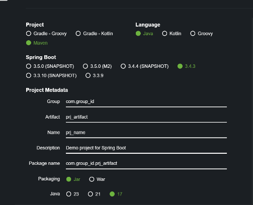
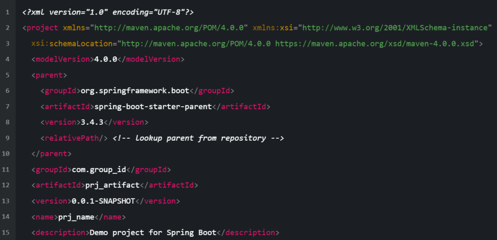
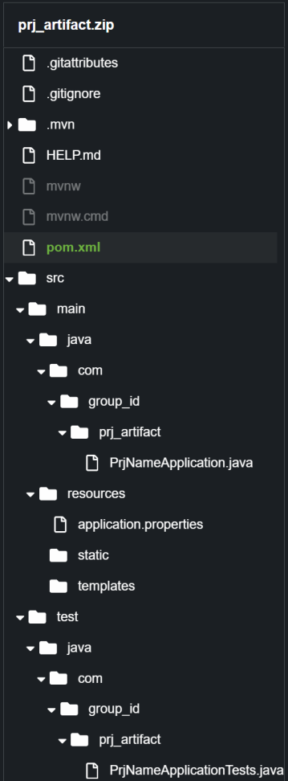
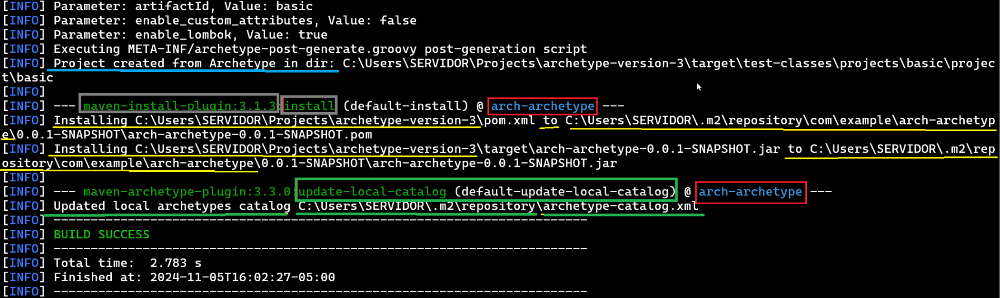
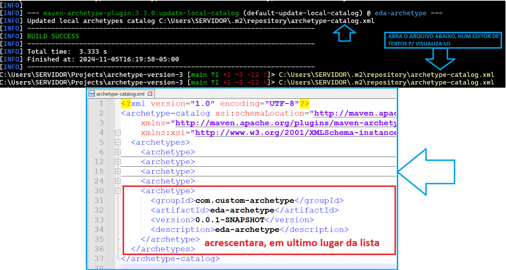
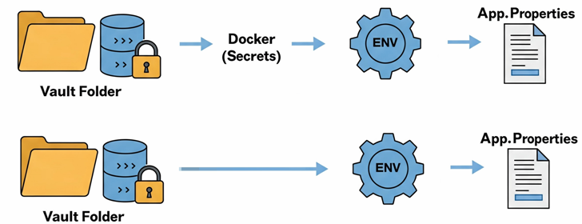
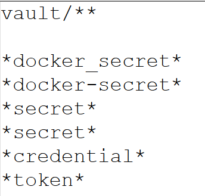
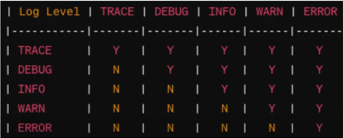

### Eda Archetype

**Sumário**

- [Etapas de Processamento](#etapas-proc)
- [Mecanismo de 'Inferência via LLM'](#mecanismo-inferencia-llm)
- [Instalação](#instalacao)
- [Acrescentando Novas Flags](#acrescentando-novas-flags)
- [Usando a 'Inferência via LLM'](#usando-inferencia-llm)
- [Processamento do Archetype-Metadata.xml](#proc-archetype-metadata-xml)
- [Processamento do Archetype-Post-Generate.groovy](#proc-archetype-post-generate)
- [Testes de Integração](#testes-integracao)
- [verify.groovy — Validação por Fixture](#verify-groovy-valid-fixture)
- [Flags do mvn archetype:generate](#flags-mvn-archetype-generate)

<details><summary><strong>Introdução 👋</strong></summary>

* Este projeto cria um "archetype" baseado na metodologia do MAVEN archetypes.
* _"Eda"_ remete ao termo celta para "reflexo" ou "imagem" trazendo a ideia de algo que espelha ou reflete, remetendo à
  simplicidade e clareza de um espelho. Nao se trata de um termo mitologico.
* Este projeto partir da prova de conceito desenvolvida em out24(ferias BR) no projeto "archetype-v1-concept-proof"
</details>

<details><summary><strong> ️Velocity Guidelines 📍</strong></summary>

* [User Guide](https://velocity.apache.org/engine/2.4.1/user-guide.html)
* [VTL Reference](https://velocity.apache.org/engine/2.4.1/vtl-reference.html)

</details>

<details><summary><strong>Cores do Maven Archetype System ⚛️</strong></summary>

**1) Flags p/ 'maven:Archetype:Generate':**
  * Arquivo: [ARCHETYPE-METADATA.XML](src/main/resources/META-INF/maven/archetype-metadata.xml):
  * Conceito:
    * Arquivo de configuração do archetype
    * Contendo:
      * as propriedades que serao capturadas para o uso no MVN CLI
      * Estrutura do Archetype e seus respectivos arquivos e pastas
  * Formacao do arquivo: Ver o item [**'Processamento do arquivo Archetype-Metadata.xml'**](#proc-archetype-metadata-xml) desta documentacao
  * Local:
    * [src \ "MAIN" \ resources \ _META-INF_ \ _**"MAVEN"**_ \ ](src/main/resources/META-INF/maven)
    * 02 - Setores (**_FileSet_** + **_RequiredProperties_**):
      * **_Setor 01:_** [_FileSets_](src/main/resources/META-INF/maven/archetype_metadata_filesets)
        * **Packaged** Tag:
          * **Conceito:**
            - A tag `packaged` controla como os arquivos serao estruturados
            - durante a geracao do projeto a partir do archetype,
            - especificamente em relacao a estrutura de pacotes Java.
            - Portanto:
              - os arquivos determinados neste _fileSet_
              - serao automaticamente movidos para a estrutura:
                + **"src/main"** OU
                + **"src/test"**

          * **packaged="true":**
            * **Comportamento esperado:**
              - Os arquivos SERAO organizados seguindo
              - a estrutura do _**pacote base do projeto**_
              - Por exemplo:
                + Se o pacote base for _"com.empresa.app"_. Um arquivo:
                  + _'Controller.Java'_ definido em **"src/main/java** / _Controller.java"_
                    + sera movido para _"src/main/java_ / **_com/empresa/app_** / _Controller.java"_
                  + _'ControllerTest.java'_ definido em **"src/test/java** / _ControllerTest.java"_
                    + sera movido para _"src/test/java_ / **_com/empresa/app_** / _ControllerTest.java"_
            * **Casos tipicos:**
              + Arquivos Java (.java)
              + Testes unitarios
              + Recursos especificos de classes.

          * **packaged="false":**
            * **Comportamento esperado:**
              - Os arquivos NAO seguirao a estrutura do _**pacote base do projeto**_
              - Permanecerao exatamente onde foram definidos no archetype
                - _**src/main/resources**_ / _properties_ / _**config.properties**_
            * **Casos Tipicos:**
              - Arquivos de configuracao global (application.properties)
              - Scripts de banco de dados
              - Arquivos de documentacao
              - Recursos estaticos (imagens, CSS, etc)

        * _Filtered_:
          * **Conceito:**
            - E um mecanismo para substituicao de variaveis (placeholders) no arquivo.
            - O Maven aplica o 'motor do velocity' nos elementos anotados por essa tag.
          * **filtered="true":**
            * **Comportamento esperado:**
              - O Maven procura por 'placeholders', nos padroes _**${variavel}**_ no arquivo.
              - Substituindo-os por valores pre-definidos no 'requiredProperties'.
          * **filtered="false":**
            * **Comportamento esperado:**
              - O arquivo seria copiado exatamente como esta.
              - Os placeholders **_${variavel}_** seriam ignorados.

        * _Enconding_:
          * **Conceito:**
            - E crucial para o tratamento correto de caracteres especiais.
          * **encoding="UTF-8":**
            * **Comportamento esperado:**
              - Caracteres como **ç, ã, é** sao processados corretamente.
              - **Emojis** sao mantidos.
              - Idiomas complexos **(chinês, arabe, etc)** sao processados corretamente.
          * **"SEM encoding":**
            * **Comportamento observado:**
              - Pode ocorrer mojibake (corrupcao de caracteres), exemplo:
                - "Configuração" _ficaria_ "Configuração"
                - "pais" _ficaria_ "país"

        * _Outros tipos de Tags_:
          * **Conceito:** tags complementares do `<fileSet>` que configuram aspectos especificos do empacotamento.
            - _directory_: Define o diretorio fonte dos arquivos.
            - _includes_: Define padroes de inclusao de arquivos.
            - _excludes_: Define padroes de exclusao de arquivos.
            - _followSymlinks_: (true/false) - Se deve seguir links simbolicos.
            - _lineEnding_: Define o tipo de quebra de linha (keep, unix, windows, lf, crlf).

        * Estrutura das Tags:
        ```xml
        <fileSet
                filtered="true"
                packaged="true"
                encoding="UTF-8"
                followSymlinks="false"
                lineEnding="unix">
          <directory>src/main/resources</directory>
          <includes>
            <include>**/*.properties</include>
          </includes>
          <excludes>
            <exclude>**/*.tmp</exclude>
          </excludes>
        </fileSet> 
        ```

      * **_Setor 02:_** [_RequiredProperty_](src/main/resources/META-INF/maven/archetype_metadata_properties)
         * Conceito:
           - Define propriedades que serao capturadas pelo **_SWITCHES -D_** do Maven CLI
         * Utilidade Pratica:
           - Captura **_SWITCHES -D_** fornecendo-as p/ a 'montagem' do Archetype
         * Caso de uso:
         1. Usuario deve _obrigatoriamente fornecer_ o **_-Denable_jwt_** no MVN CLI
            - **defaultValue** AUSENTE
            - Caso contrario, o MAVEN "prompetara"(geracao interativa)
              - Indagando o Switch **_-Denable_jwt_** omitido
              ```xml
                <requiredProperty key="enable_jwt">
                    <defaultValue></defaultValue>
                </requiredProperty>
              ```
         2. Usuario OMITE (NAO fornece) a Switch o **_-Denable_jwt_** do Maven CLI
            - (PROMPT INTERATIVO DO MAVEN) Define value for property 'enable_jwt':
               - **defaultValue** PRESENTE
               - MAVEN "nao prompetara"(geracao interativa)
                 - **defaultValue** sera usado
              ```xml
                  <requiredProperty key="enable_jwt">
                      <defaultValue>false</defaultValue>
                  </requiredProperty>
              ```

              - Exemplo de OMISSAO DA SWITCH 'enable_jwt':
                - mvn archetype:generate -DarchetypeGroupId=seu.grupo

**2) Manejo de Arquivos c/ Groovy (seguido da geracao do archetype):**
  * Arquivo: [ARCHETYPE-POST-GENERATE.GROOVY](src/main/resources/META-INF/archetype-post-generate.groovy)
  * Conceito:
    * Arquivo Groovy de manejo de pastas/arquivos, **APOS** a geracao do ARchetype
    * Contendo:
      * Codigo Groovy de manejo de pastas/arquivos
      * Formacao do arquivo: Ver item [**'Processamento do Archetype-Post-Generate.groovy'**](#proc-archetype-post-generate) desta documentacao
    * Local: [src \ "MAIN" \ resources \ _**META-INF**_ \ ](src/main/resources/META-INF)
  * Conceito:
    * Script GROOVY nativo (build-time) que COMPOE o `archetype-post-generate.groovy` a partir dos snippets em `META-INF/archetype_post_generate_body/`, `..._snippets/` e `..._variables/`. Substituiu o pre-processamento em bash (`bash_script/create_archetype_post_generate.sh`).
  * Local:
    * [src \ "MAIN" \ groovy \](src/main/groovy/)
  * Invocado por: `org.codehaus.gmaven:groovy-maven-plugin:2.1.1` (goal `execute`) na fase `process-resources`. Configurado em `pom.xml` (raiz).
  * Output: `target/classes/META-INF/archetype-post-generate.groovy` (gerado a cada build, equivalente ao output do bash legado).


**3) Testes Relativos ao Archetype:**
  * Local: [src \ "TEST" \ resources \ _projects_ \ _**"BASIC"**_ \ ](src/test/resources/projects/basic)
  * Conceito:
	* Arquivo de propriedades(requiredProperties) do archetype
	* Responsavel pelo _**teste do Archetype**_
	* Esse teste e realizado antes da montagem do Archetype

</details>

<details><summary><strong>Maven Coordinates 📍</strong></summary>

* [Click to check the Coordinates Documentation](https://maven.apache.org/pom.html#Maven_Coordinates)

##### Configuration Project 🔧


##### POM.xml 📝


##### Folder Structure 🗂️

</details>

<a id="etapas-proc"></a>
<details><summary><strong> Etapas de Processamento 📈</strong></summary>

* Visão geral: o processamento do archetype acontece em **3 etapas** — e apenas 2
  delas viajam empacotadas dentro do JAR:
  - **1) Pré-processamento** — captura a intenção (use-case + contrato JSON) e
    produz a command line `-D...` do Maven. ❌ **não empacotado** (sempre viveu
    fora do `src/main/resources`; hoje é o mecanismo LLM — A7).
  - **2) Processamento** — o `maven-archetype-plugin` materializa a árvore do
    projeto a partir do catálogo de flags + templates. ✅ **empacotado** (A1–A4).
  - **3) Pós-processamento** — o Groovy modulariza o projeto gerado (mantém /
    exclui arquivos e pastas). ✅ **empacotado** (A5–A6).

#### Visão das três etapas 🧭

| Etapa | Papel | Tecnologia | Empacotado no JAR? | Momento |
|---|---|---|---|---|
| 1. Pré-processamento | intenção → `mvn ... -D...` | Orchestrator + LLM (A7) | ❌ (projeto-fonte) | antes do `archetype:generate` |
| 2. Processamento | catálogo + templates → árvore do projeto | `archetype-metadata.xml` + `archetype-resources/` (Velocity) | ✅ | durante o `mvn archetype:generate` |
| 3. Pós-processamento | árvore gerada → modularização | `archetype-post-generate.groovy` | ✅ | ao fim do `mvn archetype:generate` |

> O `mvn clean install` **não** é uma etapa de processamento: é o passo final do
> *pipeline do artefato* (montagem, testes e instalação em `~/.m2`), detalhado no
> §4 abaixo.

#### 1) Pré-processamento (não empacotado) 🧠

* **Objetivo:** transformar **use-case + contrato JSON** na command line pronta
  do `mvn archetype:generate` (todas as flags `-D` resolvidas).
* **Composição (A7):** `Orchestrator` + módulos
  [`pre-processamento-maven-flags-via-llm/`](src/main/pre-processamento-maven-flags-via-llm/)
  (`ContractEntityDeriver`, `ContractTypeResolver`, `FlagCatalogExtractor`,
  `CatalogEntry`, `JsonCanonicalizer`, `InvocationCache`, `FlagProposalMerger`,
  `CommandLineAssembler`).
* **Entrada/Saída:** descrição + contrato JSON via `stdin` → command line no
  `stdout` + relatório de proveniência no `stderr`.
* **Por que não é empacotado:** é uma **CLI de operador**, não uma fase do build
  (o `pom.xml` registra isso explicitamente) e vive em
  `src/main/pre-processamento-maven-flags-via-llm/` — que nunca entra no JAR do archetype.
* **Dependência operacional:** o catálogo só existe em
  `target/classes/META-INF/maven/` após `mvn clean process-resources`; portanto
  rode o mecanismo **dentro da pasta do projeto-fonte**.
* **Evolução — 3 eras, sempre fora do empacotamento:**
  - *bash Q&A:* `eda.sh` + scripts de input + montagem das switches `-D`
    (commits 1.0–14.0);
  - *bash + JSON:* `json_processor.sh` / `json_validator.sh` passam a consumir o
    contrato (commits 56.0–59.0);
  - *LLM:* `Orchestrator` + `pre_processamento_maven_flags_via_llm/` substituem o Q&A (spec
    `003-llm-flag-inference`).
* **Garantias:** gates do CLI (FR-001/002/003), precedência
  contrato > derivadas > proposta LLM > default (FR-006/009), fallback por
  `validationRegex`, cache de invocação (FR-011/012/017).
* Detalhes, CLI, precedência e exit codes → seção [**"Mecanismo de 'Inferência via LLM' 🧠"**](#mecanismo-inferencia-llm)

#### Suítes unitárias do mecanismo LLM 🧪

| Suíte | Checks | O que garante |
|---|---|---|
| `ContractTypeResolverTest` | 50 | inferência de tipo: `java.lang`, **tipo do projeto**, detecção de enum, normalização de constantes, nomenclatura pelo tipo |
| `ContractDerivationTest` | 52 | derivação da entidade, precedência, flags de imports/enums, colisão de nomes, **paridade** canônico × espelho do `Orchestrator` |
| `CustomEnumGenerationTest` | 24 | pós-processador: geração dos enums (pacote, constantes, plural, arquivo existente **não** sobrescrito, entrada inválida) |
| `CustomAttributesProfileConsistencyTest` | 25 | **contrato ↔ perfil do archetype**: as flags derivadas são exatamente as declaradas no perfil de integração |
| `OrchestratorCacheTest` | 34 | cache v2/v1, byte-equivalência, guarda FR-017 |
| `ProvenanceReportTest` | 24 | relatório de proveniência, FR-006/007/008/009/017 |
| `FlagCatalogExtractorTest` | 29 | catálogo real (35 flags), FR-018, defaults × regex |
| `OrchestratorContractGateTest` | 25 | gates do CLI (FR-001/002/003), stdout puro |
| `CommandLineAssemblerTest` | 21 | formatação e escape da command line (FR-010) |
| `FlagCatalogExtractorDriftTest` | 12 | o catálogo segue o metadata sem lista hardcoded (FR-013) |

#### 2) Processamento (empacotado) 🏗️

* **Objetivo:** o `maven-archetype-plugin` materializa a árvore do projeto
  gerado a partir do catálogo de flags + templates — durante o
  `mvn archetype:generate`.
* **Composição (fonte da verdade):**

| # | Artefato | Local | Papel |
|---|----------|-------|-------|
| A1 | Catálogo de flags — `archetype_metadata_properties` | `src/main/resources/META-INF/maven/archetype_metadata_properties/` | 35 flags: `key`, `defaultValue`, `validationRegex`; descrição e `DEPENDS_ON` em comentário XML |
| A2 | Filesets — `archetype_metadata_filesets` | `src/main/resources/META-INF/maven/archetype_metadata_filesets/` | mapeia `archetype-resources/` → árvore do projeto gerado |
| A3 | Core do metadata | `src/main/resources/META-INF/maven/archetype-metadata.xml` | DOCTYPE com 26 entities (17 `property-*` + 9 `fileset-*`) |
| A4 | XSLT identidade | `src/main/resources/META-INF/maven/identity.xsl` | resolve as entities `SYSTEM` e materializa os blocos inline |

| Artefato | Local | Papel |
|----------|-------|-------|
| Templates | `src/main/resources/archetype-resources/` | esqueleto do projeto gerado; os `${...}` são renderizados pelo Velocity |
| Fixtures de integração | `src/test/resources/projects/*` | 11 projetos gerados pelo `integration-test`, cada um validado com `mvn clean verify` |

* **Montagem do catálogo:** fragmentos (A1 + A2) + DOCTYPE (A3) →
  `xml-maven-plugin:transform` + `identity.xsl` (A4) na fase
  `generate-resources` → `target/classes/META-INF/maven/archetype-metadata.xml`
  (cópia convencional excluída — `pom.xml:38-41`).
* **Execução:** o plugin lê o JAR instalado (`~/.m2`), valida as flags `-D`
  (default × `validationRegex`) e renderiza os templates — etapa
  **autossuficiente**: depende apenas do `.m2`, nunca da pasta-fonte.

#### 3) Pós-processamento (empacotado) 🧬

* **Objetivo:** modularizar o projeto recém-gerado (mantém / exclui pastas e
  arquivos conforme as flags escolhidas) — ao fim do `mvn archetype:generate`.
* **Composição:**

| # | Artefato | Local | Papel |
|---|----------|-------|-------|
| A5 | Pós-processador — `body/` + `variables/` + `snippets/` | `src/main/resources/META-INF/archetype_post_generate_{body,variables,snippets}/` | 34 fragmentos Groovy (11 `body/` + 11 `variables/` + 12 `snippets/`) |
| A6 | Compositor do pós-processador | `src/main/groovy/SnippetComposer.groovy` | remonta A5 em 1 arquivo: ordem canônica + consolidação de imports |

* **Montagem:** `SnippetComposer` (A6) via `groovy-maven-plugin:execute` na fase
  `process-resources` → `target/classes/META-INF/archetype-post-generate.groovy`
  → levado no JAR.
* **O que faz em runtime:** mantém / exclui por flag; persiste o contrato em
  `src/test/resources/contracts/contract.json` (FR-023, quando
  `enable_folder_src_test_java=true`); gera enums customizados; log opcional
  (`show_archetype_pos_processor_log`).
* Histórico: arquivo único editado à mão → compositor bash
  (`bash_script/create_archetype_post_generate.sh`) → compositor nativo Groovy
  (commit `63.0`).

#### 4) Montagem e instalação do artefato 📦 (fora das três etapas)

| Fase | Plugin | Entrada | Saída |
|------|--------|---------|-------|
| `generate-resources` | `xml-maven-plugin:1.2.1` (`transform`) | `archetype-metadata.xml` + `identity.xsl` | `target/classes/META-INF/maven/archetype-metadata.xml` (catálogo completo, sem DOCTYPE) |
| `process-resources` | `groovy-maven-plugin:2.1.1` (`execute`) | 34 fragmentos `.groovy` | `target/classes/META-INF/archetype-post-generate.groovy` |
| `test` | `groovy-maven-plugin:2.1.1` (`execute`) | `src/test/groovy/run-all-tests.groovy` | 10 suítes unitárias do mecanismo LLM (296 checks; o build falha se alguma falhar) |
| `integration-test` | `maven-archetype-plugin:3.4.1` (`integration-test`) | `src/test/resources/projects/*` | 11 projetos gerados, cada um com `mvn clean verify` |
| `install` | `maven-install-plugin` + `maven-archetype-plugin:3.4.1` (`update-local-catalog`) | JAR do archetype | `~/.m2/repository/` + `archetype-catalog.xml` |

> **Comando canônico:** `mvn clean install`
>
> A fase `integration-test` é **anterior** a `install` e já é executada por ele.
> Portanto `mvn clean install integration-test` roda a suíte de integração
> **duas vezes** (cada fixture é gerada e validada 2×) — use `mvn clean install`
> ou, se não quiser instalar, `mvn clean integration-test`.

* **De volta aos 2 momentos do archetype:** o §4 acima é o **momento de
  montagem** (build + testes + instalação em `~/.m2`); as **etapas 1 → 3** são o
  **momento de geração** (`mvn archetype:generate`).

#### Fluxo 🔄

```text
TRILHA 1 — MONTAGEM (mvn clean install; fora das três etapas)
─────────────────────────────────────────────────────────────────────
[1] CATÁLOGO         17 property-*.xml + 9 fileset-*.xml + DOCTYPE (26 entities)
                     └─ xml-maven-plugin:transform + identity.xsl (generate-resources)
[2] PÓS-PROCESSADOR  34 fragmentos .groovy
                     └─ SnippetComposer.groovy via gmaven:execute (process-resources)
                        (local: src/main/groovy/SnippetComposer.groovy)
[3] TESTES           unitários: 10 suítes / 296 checks (fase test)
                     integração: 11 fixtures + verify.groovy (2) (fase integration-test)
[4] INSTALAÇÃO       ~/.m2/repository + archetype-catalog.xml (fase install)

TRILHA 2 — USO (mvn archetype:generate; etapas 1 → 3)
─────────────────────────────────────────────────────────────────────
[5] PRÉ (FORA DO JAR)   use-case + contrato JSON → Orchestrator (A7) lê o catálogo
                        em target/classes → mvn archetype:generate --batch-mode -D...
[6] PROCESSAMENTO       archetype-metadata.xml + archetype-resources/ (Velocity)
                        → árvore do projeto gerado
[7] PÓS                 archetype-post-generate.groovy mantém / exclui
                        + FR-023: contrato → src/test/resources/contracts/contract.json
                              ▼
                        projeto final
```

#### Regras estruturais 📏

* **Fonte da verdade = os fragmentos** (A1, A2, A5). Os arquivos em `target/classes/`
  são **gerados** a cada build — editá-los é trabalho perdido.
* **O pré-processamento nunca é empacotado:** em todas as suas eras (bash Q&A →
  bash + JSON → LLM) ele viveu fora de `src/main/resources` (`src/main/pre-processamento-maven-flags-via-llm/`) — trocar de tecnologia jamais significou viajar no JAR.
* **O catálogo precisa existir antes da inferência:** o Orchestrator lê
  `target/classes/META-INF/maven/archetype-metadata.xml`; portanto rode
  `mvn clean process-resources` antes de usá-lo.
* **O catálogo não é alterado em código:** o Orchestrator lê as flags em runtime
  (FR-013) — flag nova = 1 fragmento `property-*.xml` + registro no DOCTYPE.
* **As flags são auto-descritivas:** o `defaultValue` nunca é vazio (FR-018) e o
  `validationRegex` é aplicado por quem emite a command line.

#### Onde detalhar cada parte 🔎

* Metadata (entities + XSLT) → seção [**"Processamento do Archetype-Metadata.xml"**](#proc-archetype-metadata-xml)
* Pós-processador (compositor Groovy) → seção [**"Processamento do Archetype-Post-Generate.groovy"**](#proc-archetype-post-generate)
* Catálogo de flags (35) → seção [**"Flags do mvn archetype:generate"**](#flags-mvn-archetype-generate)
* Como adicionar uma flag → seção [**"Acrescentando Novas Flags ➕️"**](#acrescentando-novas-flags)
* Mecanismo (A7) → seção [**"Mecanismo de 'Inferência via LLM' 🧠"**](#mecanismo-inferencia-llm)
* Inferência via LLM (uso no OpenCode) → seção [**"Usando a 'Inferência via LLM'"**](#usando-inferencia-llm)
* Testes → seções [**"Testes de Integracao ✅"**](#testes-integracao) e [**"verify.groovy - Validacao por Fixture (Integracao) 🔬"**](#verify-groovy-valid-fixture)

---

> **Sanity Check (Instrução para Agentes de Execução) 🛠️**
>
> Ao ser solicitado para rodar o build completo (`mvn clean install`) e validar a integridade técnica, o agente DEVE auditar: (1) O `archetype-metadata.xml` (catálogo); (2) O `archetype-post-generate.groovy` (pós-processador); (3) Os testes unitários Groovy (todos os checks, agora inclusos no build), todas as fixtures de `src/test/resources/projects/`, e o `verify.groovy` das fixtures `custom-attributes` e `entity-contract`. 
>
> (4) Me entregue um sumário final tabelado, com DOIS blocos: 
> (4.1) UNITÁRIOS — Todas as suítes, todos os checks, quantas passaram e a lista de checks por suíte; 
> (4.2) INTEGRAÇÃO — todas as fixtures, quantas passaram e qualquer `verify.groovy` que tenha falhado, nesse caso observando:
>
> (5) Quanto ao Sumário Final:
> (5.1) Quando o item falhar, mostre o trecho do log e sugira a correção. 
> (5.2) Quando o item passar, confirme com 'Tudo verde' e o tempo total gasto.
>
> (6) Formato obrigatório do relatório (100% em tabelas Markdown, nesta ordem): 
> (6.1) Tabela de Setup [(1)-(3)]: colunas `Etapa | Comando / Verificacao | Resultado Obtido | Status | Tempo`. 
> (6.2) Bloco (4.1) UNITÁRIOS: 
> - Tabela Resumo Geral: colunas `# | Suite | Total de Checks | Passaram | Falharam | Status` (com linha final de Total).
> - Uma tabela separada para CADA suíte listando TODOS os checks individuais: colunas `ID | Check | Resultado`.    
> (6.3) Bloco (4.2) INTEGRAÇÃO: tabela única com todas as fixtures e linha final de Total: colunas `# | Fixture | Invoker Exit Code | Pos-Build verify.groovy | Verificações do verify.groovy | Status`.  
> (6.4) Bloco (5) Sumário Final: tabela consolidada por bloco + linha `TOTAL GERAL`: colunas `Bloco | Escopo | Passaram | Falharam | Diagnostico / Correcao (5.1) | Confirmacao e Tempo (5.2)`.

</details>

<a id="mecanismo-inferencia-llm"></a>
<details><summary><strong> Mecanismo de 'Inferência via LLM' 🧠</strong></summary>

**O que é:** o mecanismo que transforma **uma intenção em linguagem natural + um contrato JSON** na **command line pronta** do `mvn archetype:generate`.
É uma **CLI de operador** — *não* é uma fase do build do archetype (o `pom.xml` registra isso explicitamente).

**Local:** `src/main/pre-processamento-maven-flags-via-llm/`

| # | Classe | Papel | Momento (runtime) |
|---|--------|-------|-------------------|
| 1 | `Orchestrator.groovy` | entry point da CLI; orquestra o fluxo completo | parse dos args, gate FR-001, leitura do `stdin` (entrada padrão do processo) e **chave de cache** (`makeCacheKey`) |
| 2 | `ContractTypeResolver.groovy` | **inferência de tipo** de UM atributo (resolve o tipo Java; higieniza o nome) | passo 8 — resolve o `Tipo:nome` de cada atributo derivado do contrato |
| 3 | `ContractEntityDeriver.groovy` | **derivação da entidade** a partir do contrato (nome, pacote, atributos) | passo 8 — deriva `entity_name`, `entity_name_package` e `custom_attributes_list` |
| 4 | `FlagCatalogExtractor.groovy` | lê o catálogo de flags do metadata transformado (FR-005, FR-013, FR-018) | passo 3 — lê as **35 flags** de `target/classes/META-INF/maven/archetype-metadata.xml` |
| 5 | `CatalogEntry.groovy` | invariantes de cada flag: `key` e `defaultValue` não-vazios, regex compilável (FR-018) | passo 3 — valida cada flag extraída |
| 6 | `JsonCanonicalizer.groovy` | canonicaliza o JSON (representação estável, independente da ordem dos campos) | passo 4 — o `Orchestrator` usa o contrato canônico como parte da chave de cache |
| 7 | `InvocationCache.groovy` | cache em JSONL fora do repositório (FR-011, FR-012, FR-017) | passo 6 — **consulta antes da LLM** (cache hit encerra) e passo 11 — gravação |
| 8 | `FlagProposalMerger.groovy` | merge das fontes de valor + **proveniência** por flag (FR-006..FR-009, FR-020, FR-021) | passo 8 — consolida contrato > derivadas > LLM > defaults |
| 9 | `CommandLineAssembler.groovy` | monta a command line final (FR-010), com escape de valores | passo 9 — último passo antes do stdout |

> ⚠️ **O `Orchestrator` é *self-contained*: a lógica de cada componente está *inline* nele** (marcadores `// Inlined <Classe> logic` e o bloco de espelhos no fim do arquivo). Motivo: o `gmaven` embarca Groovy 2.4.9 e não enxerga as classes irmãs compiladas com Groovy 4.0.28.
> Os **módulos canônicos** são a fonte da verdade e existem como **gêmeos testáveis** — as 10 suítes unitárias carregam cada `.groovy` via `GroovyClassLoader` e comparam com a versão inline (paridade verificada em `ContractDerivationTest`), e `FlagCatalogExtractorDriftTest` garante que o catálogo lido reflete o metadata **sem lista de flags hardcoded**.
> Os espelhos inline de `ContractTypeResolver`/`ContractEntityDeriver` levam o prefixo `Orchestrator` porque vivem no mesmo pacote dos canônicos — e um `GroovyClassLoader` guarda **uma classe por nome**: um espelho homônimo esconderia a classe canônica nos testes.
> O `FlagProposalMerger` (gêmeo testável) **consome os módulos canônicos** por injeção de construtor (`ContractEntityDeriver` ← `ContractTypeResolver`); as suítes fazem a fiação por reflexão.

#### Separação de responsabilidades: derivação da entidade × inferência de tipo 🧩

As duas etapas que transformam o contrato JSON em atributos da entidade são **componentes separados**, cada um com uma responsabilidade única:

| Componente | Entrada | Saída | Responsabilidade |
|---|---|---|---|
| `ContractEntityDeriver` | contrato JSON + inferência LLM + catálogo | `entityName`, `entityNameSource`, `attributes[]`, `attributeList`, `warnings[]` | **derivação**: quais atributos existem, como se chamam e em que ordem; monta a lista `Tipo:nome,Tipo:nome` |
| `ContractTypeResolver` | nome do atributo + tipo declarado (opcional) + valor (opcional) | `TypeResolution { type, warning }` | **inferência de tipo**: qual tipo Java aquele atributo tem |

**Fluxo no passo 8:**

```
contrato JSON ──► ContractEntityDeriver ──► (por atributo) ──► ContractTypeResolver ──► "Integer:id,String:name"
                              │                                            │
                              │                                            └─► TypeResolution { type, warning }
                              └─► attributeList ──► flag custom_attributes_list ──► merge ──► command line
```

**Regra de inferência de tipo** (`ContractTypeResolver.resolve`):

1. **Tipo declarado de `java.lang` vence** — normalizado para o nome simples (`java.lang.String` → `String`; genéricos são removidos).
2. **Tipo do projeto** (fora de `java.lang`: uma classe de domínio ou um enum) → **é preservado**. A entidade o referencia pelo **nome simples** e o **nome do atributo vem do próprio tipo** (`EnderecoCliente` → `enderecoCliente`, `StatusPedido` → `statusPedido`). O tipo viaja em `custom_attribute_imports` (import) e/ou em `custom_enum_definitions` (enum gerado pelo pós-processador).
3. **Qualquer outro tipo declarado** (`java.time.Instant`, `List<String>`, tipos genéricos) → **warning explícito** e *fallback* para a estimativa pelo valor.
4. **Estimativa pelo valor** — conforme o tipo em memória do valor: `Integer` → `Integer`, `Long`/`BigInteger` → `Long`, `BigDecimal`/`Double`/`Float` → `Double`, `Boolean` → `Boolean`, texto → `String`.
5. **Objeto JSON, array ou `null`** → `String` (quando não há tipo declarado).
6. **O nome do atributo é único** — a entidade não pode repetir um campo. Quando dois atributos share o mesmo tipo do projeto, o primeiro fica com o nome do tipo (`statusPedido`) e o segundo mantém o nome do contrato (`statusAnterior`); um nome ainda duplicado descarta o atributo com **aviso**.
7. **Dois tipos com o mesmo nome simples e pacotes diferentes** (ex.: `br.com.projeto.Pedido` e `br.com.outro.Pedido`) são avisados: a entidade não consegue importar os dois.

> O nome do atributo também é higienizado (`ContractTypeResolver.sanitizeAttributeName`): caracteres inválidos viram `_`, o primeiro caractere é minúsculo (o regex do catálogo exige `^[a-z][a-zA-Z0-9_]*$`) e um nome sem caractere válido é descartado com warning.

#### Como executar (operador)

```bash
groovy src/main/pre-processamento-maven-flags-via-llm/Orchestrator.groovy \
  --use-case-description "descrição do use-case" \
  --use-case-contract \
  < contract.json
```

> `stdin` = **entrada padrão do processo**: o fluxo de dados que o programa recebe.
> No shell, `< contract.json` redireciona o arquivo para esse fluxo.

**Pré-requisitos:**
- **Groovy 4** no classpath (o script usa `groovy.json` / `groovy.xml`);
- o catálogo precisa existir → rode `mvn clean process-resources` antes (o mecanismo lê `target/classes/META-INF/maven/archetype-metadata.xml` — `Orchestrator.groovy:116`).

#### Argumentos

| Argumento | Obrig. | Efeito |
|---|---|---|
| `--use-case-description "<texto>"` | sim | descrição do caso de uso; **gate FR-001** — se faltar ou vier vazia, o mecanismo para **antes de ler o stdin** |
| `--use-case-contract` | sim | flag **sem valor**: o contrato JSON é lido do `stdin` (entrada padrão do processo) em multi-linha; a raiz precisa ser um objeto JSON |
| `--cache-dir "<path>"` | não | diretório do cache (default: `$XDG_CACHE_HOME/eda-archetype/llm-flag-inference/`; fallback `%LOCALAPPDATA%` / `~/.cache`) |
| `--contract-dir "<path>"` | não | onde o contrato é materializado (default: `<cache-dir>/contracts/`) |
| `--inference-bin "<path>"` | não | script externo de inferência (LLM); default: `scripts/inference-stub.sh` (stub determinístico para CI) |

#### O que ele faz

1. **Gate da descrição** (FR-001) — ausente/vazia → exit 2, **sem consumir o stdin**.
2. **Lê o contrato** do `stdin` (FR-003) — vazio → exit 2; JSON inválido ou raiz não-objeto → exit 5.
3. **Lê o catálogo** de flags do metadata transformado (FR-005/013/018) → inválido → exit 4.
4. **Canonicaliza o contrato** e deriva a **chave de cache** = SHA-256(fingerprint do catálogo + descrição + contrato canônico).
5. **Materializa o contrato** em disco (FR-023) → o caminho sai em `entity_contract_path`.
6. **Consulta o cache** (FR-011/012) — em *hit*, imprime a command line cacheada e sai (exit 0), **sem chamar a LLM**.
7. **Chama a inferência externa** (LLM) com `--use-case-description-file` + `--use-case-contract-file` → exit ≠ 0 → exit 3.
8. **Merge** das fontes de valor + **proveniência** por flag (FR-020); valor que viola o `validationRegex` → **default do catálogo** + aviso.
9. **Monta a command line**: `mvn archetype:generate --batch-mode -D<flag>=<valor> ...`
10. **stdout** = command line (1 linha) · **stderr** = relatório de proveniência.
11. **Grava o cache** (`cache.jsonl`) — o payload do contrato **nunca** é persistido.

#### Precedência de valores (maior vence)

| # | Origem | Regra |
|---|---|---|
| 1 | Contrato JSON | valor declarado pelo operador (FR-007) |
| 2 | Derivação do contrato (pelo próprio mecanismo) | ex.: caminho do contrato materializado (FR-023) |
| 3 | Semântica da entidade derivada do contrato | nome, pacote, lista de atributos, `enable_custom_attributes` (FR-009 amended) |
| 4 | Valor inferido pela LLM | aceito **só** se a key estiver no contrato **ou** na allowlist do FR-009 |
| 5 | Default do catálogo | último recurso (FR-008) |

#### Verificação dos exit codes

*Conferidos no `Orchestrator.groovy` — não inferidos.*

| Exit | Situação | Fonte |
|---|---|---|
| `0` | sucesso | `Orchestrator.groovy:170, 206` |
| `2` | use-case ausente ou vazio (FR-001) | `Orchestrator.groovy:61-65` |
| `2` | contrato ausente ou vazio (FR-003) | `Orchestrator.groovy:89-93` |
| `3` | script de inferência externo falhou | `Orchestrator.groovy:179-180` |
| `4` | catálogo de flags malformado ou ilegível (FR-018) | `Orchestrator.groovy:122-124` |
| `5` | erro interno: args inválidos, JSON inválido, raiz não-objeto, falha na leitura do stdin | `Orchestrator.groovy:46-47, 83-84, 102-109` |

</details>

<a id="instalacao"></a>
<details>
<summary><strong> Instalacao 📦</strong></summary>

#### Pré-requisitos

* **Java 21** e **Maven 3.9.x** (ambiente validado: Maven 3.9.16 + Java 21).
* Conferir a instalação: `mvn -version`.
* Maven 'nao se atualiza' → instalar a versao mais recente:
  * Encontrar a versao mais recente em [Apache Maven](https://maven.apache.org/install.html)
  * Baixar o 'bin.zip', descompactar e atualizar o `PATH` (no Windows).

> **Possível BUG por Maven desatualizado** _(erro histórico)_:
> ```Console
> No signature of method: Script1.var()
>
>     [ERROR] Failed to execute goal org.apache.maven.plugins:maven-archetype-plugin:3.2.1:generate (default-cli)
>     on project standalone-pom:
>     No signature of method: Script1.var() is applicable for argument types:
>     (java.lang.String)
> ```
> * A versão do plugin citada no erro é a **3.2.1**; o projeto usa **3.4.1**.

---

#### Instalar e publicar este archetype

**a) Instale no repositório local do Maven:**

```bash
mvn clean install
```

* A fase `install` executa, em ordem: as **10 suítes unitárias** do mecanismo LLM (fase `test`),
  as **11 fixtures** de integração (fase `integration-test`) e a publicação no repositório local.
  * ⚠️ A fase `integration-test` é **anterior** a `install` → `mvn clean install integration-test`
    roda a suíte de integração **duas vezes**. Use `mvn clean install`.
* Opções:
  * `-Darchetype.test.skip=true` → instala **sem** rodar as 11 fixtures;
  * `-Darchetype.test.projects=minimal` → roda **apenas** a fixture indicada.
* O registro no catálogo local é feito pelo `maven-archetype-plugin:3.4.1:update-local-catalog`,
  disparado na fase `install`.

**b) Resultado da instalação 🎨**


**Legenda:**

* **Vermelho:** o nome do archetype criado
* **Verde:** catálogo que registra a instalação
* **Amarelo:** Destino das instalações
* **Azul:** Projeto instalado
* **Cinza:** Plugin de instalação

**c) Localização dos elementos 'Locais' do Maven:**

* Repositorio Local: `%USERPROFILE%\.m2\repository\`
  * Ex.: `C:\Users\<seu-usuario>\.m2\repository\`
* Archetype instalado: `%USERPROFILE%\.m2\repository\com\eda-archetype\eda-archetype\0.0.1-SNAPSHOT\`
* Catalogo de 'Archetypes Locais': `%USERPROFILE%\.m2\repository\archetype-catalog.xml`

**d) Visualizando/Checando a Instalação**
  

</details>

<details><summary><strong> Milestones 📅</strong></summary>

* CRUD
  - Basic
  - Advanced


* Integration Testes
  - Repo
  - Service
  - Controller


  * DB's for Tests
    - H2
    - TestContainer


* Externalized Configurations
  - App properties
  - Excecoes
  - Mensagens
  - I18N
  - Rotas
  - Credentials (Unpushaveis)
  - etc...


* Type Safe 'Externalized Properties/Configuration' Binding
  - Filetypes:
    - .proprerties
    - .yml
  - Types:
    - Simple
    - List
    - Map
  - Mutable / Immutable
  - Validation


* Good Practices
  - Pageable
  - HATEOAS


* DTO
  - Tipos
    - Request
    - Response
    - Entity protection


* Mapper


* Exceptions
  - Global
  - Customizadas
  - Segurança
  - Autenticação


* BeanValidation
  - Exceções
  - Validações Personalizadas
    - Pattern Regex


* Cache


* I18N


* Testes de Contratos
  - Contratos
    - JSON
  - SchemaValidator
    - JSONSchema


* Documentação
- Swagger


* Database
  - DBs:
    - MongoDB
    - MySQL
    - Postgres
  - DDL
    - Hibernate
    - Flyway
  - Persistence
    - Spring Data
    - JDBC
    - JDBC Clients


* Autenticação (Spring Security)
  - JWT:
    - Simples
    - Oauth Server
  - OAuth2
    - GitHub
    - Google
    - Facebook


* DevOps
  - Docker
    - Folder
    - Dockerfiles
    - Docker Secrets
    - Docker-Compose
  - CI/CD
  - CloudFlare
  - AWS


* Seguranca
  - SAST (Static Application Security Testing)
    - Credentials:
      - GitGuardian:
        - dificil instalacao
        - Freemium
      - GitLeaks:
        - facil instalacao
        - Open-source
        - Depende de regras personalizadas, para credenciais customizidas
  - Proxy Reverso (Nginx)


* Modularidade


* Performance
  - Load Balancer (Nginx)
  - Cache
  - CDN
  - Virtual Threads


* API Proxies  (Internal UI Clients)
  - DB
  - Docker (Portainer)
  - Spring actuator (graphana)
  - Documentacao (swagger)
  - Log Kibana (logstash + Elasticsearch)
</details>

<details><summary><strong>Task Planning 📝️</strong></summary>

1. DTO
  - Libraries
    - MapStruct (AutoAPI)
    - MyBatis (Guang)
    - ModelMapper
  - Request / Response
  - AbstractDto
    - Public class to facilitate DTO creation (Guang)


2. Lombok
  - AutoAPI
  - Guang


3. Database Versioning
  - FlyWay
  - Liquibase (AutoAPI)


4. Documentation
  - Swagger (AutoAPI + Guang)
  - Montagem Automática de README.md


5. Testing
  - DataBuilder (Guang)
  - CustomUtils (Guang)
    - Convert Java object to JSON string
    - Handle conversion failure with RuntimeException
  - TestController (Guang)
    - Unit testing with:
      - `@Transactional`
      - Mockito
  - Test-Db:
    - H2
    - TestContainer


6. Service
  - Transactional (Guang)
  - Dto-Mapper (Guang)
  - Apache Commons BeanUtils (Guang)
    - Copy properties from object to entity


7. Controller
  - @Validated on DTO (Guang)
    - BeanValidation
  - Pageable (Guang)
  - Dto-Mapper (Guang)


8. Repository
  - JPA Repository (AutoAPI + Guang)
  - CRUD Repository (AutoAPI)
  - JpaSpecificationExecutor (Guang)
  - Transactions (ACID)


9. Entities
  - POJO
  - Records


10. Safety
  - Input:
    - sanitizing/encode (replace)
    - filtering (block)
  - Shield Dtos:
    - BeanValidation REGEX
  - OWASP
  - Credentials Protection
    - Externalized Properties-File FROM .Env-file
    - Gitleaks (SAST)
      - Nao sera usado, pois depende de instalacao local
      - Apenas 'Recomendado como 2 layer de protecao"'
  - Sanitização de URL:
    - pré despatcherServlet
    - Header Request


11. Log
  - Logback:
    - logback-spring
    - logback-test
  - ELK:
    - Elasticsearch
    - Logstach
    - Kibana
    - Fluxo do ELK:
> 1) O WebApp envia os logs p/ (logstash.conf: "INPUT") APPENDER-TCP-LOGSTASH "<destination>" do Logback-spring.xml
> 2) O Logstasch (logstash.conf: "OUTPUT") envia os 'Logs Processados' p/ 'elasticsearch:9200'
> 3) O kibana exibe os Logs recebidos no 'elasticsearch:9200'


12. Health Check
  - Actuator


13. API Proxies (Internal UI Clients)
  - DBA Client
  - Docker (Portainer)
  - Spring actuator (graphana)
  - Documentacao (swagger)
  - Log Kibana (logstash + Elasticsearch)


14. Type Safe Externalized Properties/Configuration Binding
  - Application.propriedades
  - Mensagens:
    - Gerais
    - Excecoes
  - I18N (Traducoes)
  - Rotas
  - Credentials(secrets) Vault 'Unpushaveis'
</details>

<details><summary><strong>Concluded Tasks ✅</strong></summary>

- [x] Credentials protection
  - [x] Gitleaks / GitGuardian (Alternative Approaches)
    - CONS:
      - GitGuardian:
        - is not free
        - Must be installed locally
      - GitLeaks:
        - dont works 'efficiently' with Custom-Credentials
  - [x] **'Encrypted Folder + Global GitIgnore'** _(Chosen Approach)_
    - [x] Encripted Folder:
      - Win10 BitLocker
      - ALL **Credentials-Files** (any sensitive data) must be storaged on this folder 'individually'
      - The folder will encrypt All its content automatically (files + subfolders)
      - This folder:
        - "IS NOT VERSIONED/COMMITTED" _(MUST be inserted in GitIgnore Global)_
        - 'dont belong' to any project
        - is not inside any project
        - is not inside any folder, from any project
      - Example:
        - 
    - [x] **GitIgnore-Global**:
      - Will detect (excluding for any commit):
      - Global GitIgnore CLI:
        - _Creating_ an "Global GitIgnore" **'NOT CREATED YET'**:
          - _git config --global core.excludesfile C:\your-path\.gitignore_global_
        - _Finding_ an **'ALREADY EXISTING FILE'**:
          - _git config --global core.excludesfile_
        - _GitIgnore-Global_ **'HELP'** can be found, in: 
          - [GitHub - Global GitIgnore Documentation](https://gist.github.com/subfuzion/db7f57fff2fb6998a16c)
      - Example:
        - 

      - Exclusion 'keywords'(fragment-word in begin/middle/end), such as:
          * docker_secret
          * dockersecret
          * secret
          * authorization
          * authentication
          * secret
          * secretkey
          * credential
          * token
          * etc...
    - [x] **_'Protected-properties-folder'_**
      - App Folder for 'sensitive-properties'
      - These 'sensitive-properties' will data from receive "Environment_Variables"
      - These "Environment_Variables" will be extracted from the **'Credentials-Files'**
      - All **'Credentials-Files'** will be stored in a **'Windows Encrypted Folder'**


- [x] Log
  - [x] Logback:
    - Logback-spring + logback-test
    - Console banner (dev + test)
  - [x] Logback - Console Appender:
    - 03 types:
      - Default (Spring)
      - Tabular
      - Granular
  - [x] Logback - Extra Appenders:
    - Email
    - RollingFile storage
      - classic
      - rolling
      - logstash
    - TCP-SOCKETS for logstash (CPanel)
  - [x] Log Hierarchy:
    - 


- [x] Type Safe 'Externalized Properties/Configuration' Binding
  - Types:
    - Constructor Binding (Immutable)
      - Record (native: no setters + canonical constructor + only constants[finals])
        - OBS: Implicit Canonical constructor not allow @ConstructorBinding annotation
      - Class (no setters + canonical constructor + only constants[finals])
        - OBS: All arguments constructor (canonical constructor in Records)
    - JavaBean Binding (Mutable)
      - No arguments constructor (implicit default constructor)
      - Setter mandatory
      - Only Classes (with setters/mutators)
  - **_'Context Scanning'_**:
    - Constructor Binding + JavaBean Binding:
        * EnableConfigurationProperties (define the class to be scanned)
        * _ConfigurationPropertiesScan_ (define the package to be scanned)
    -  JavaBean Binding:
        * Stereotype Annotations: Component or Configuration
  - File Types:
    - Properties
    - YAML
  - Formats:
    - Simple
    - Map
    - List
  - Validation:
    - Spring-Validation
      - jakarta.validation.constraints
    - Externalization of Messages Absence - Explanation:
      - Mensagens de 'falha de validacao' serao hardcoded
      - Pois, servem apenas para 'Log' ou 'debug' da API (Internal Messages)
      - Nao destinando-se ao 'output'(User/Admin Messages) da API
      - Nao sendo entao, objeto de I18N ou Externalizacao


  - [ ] TestDB
    - H2
    - TestContainer


- [ ] CPanel - API Proxies (UI Clients)
  - [ ] Log Kibana (ELK - Elasticsearch + Logstash + Kibana)
  - [ ] Docker (Portainer)
  - [ ] DB (DB-Client)
  - [ ] Documentacao (Swagger)
  - [ ] Spring actuator (Graphana)
</details>

<details><summary><strong> Next Version 🔮️</strong></summary>

  - JpaSpecificationExecutor
  - Upload
  - Download
  - Oauth2 (Google + Facebook + Linkedin)
  - Swagger
  - Performance (ECache + Virtual Threads)
  - Multi-Tenant
  - Modularity (Java)
  - "Feature" Generation/Automation
  - "Component" Generation
  - Stripe
  - Document/PDF Visualizer
  - 2FA Authentication
  - Passwordless Authentication
  - UbyKey (OTP)
</details>

<a id="acrescentando-novas-flags"></a>
<details><summary><strong>Acrescentando Novas Flags ➕️</strong></summary>

#### 1) Areas alteradas pela adição:

   + **Processador:** [_"ARCHETYPE-METADATA"_.XML](src/main/resources/META-INF/maven/archetype-metadata.xml)
     - Local: _"maven"_
       - Root Path: [_C:\WORKBASE\DEV\SCRIPTS\archetype-v2-eda\src\main\resources\ "META-INF" \ **maven**_](src/main/resources/META-INF/maven)


  + **Processador Test:** [_"ARCHETYPE-PROPERTIES"_.PROPERTIES](src/test/resources/projects/basic/archetype.properties)
    - Local: _"basic"_
      - Root Path: [_C:\WORKBASE\DEV\SCRIPTS\archetype-v2-eda\src\test\resources\projects\ **basic**_](src/test/resources/projects/basic)


  + **Pos-Processador:** [_"ARCHETYPE-POS-GENERATE"_.GROOVY](src/main/resources/META-INF/archetype-post-generate.groovy)
    - Local: _"META-INF"_
        - Root Path: [_C:\WORKBASE\DEV\SCRIPTS\archetype-v2-eda\src\main\resources\ **META-INF**_](src/main/resources/META-INF)


  + **Orquestrador (mecanismo de inferência de flags):** [Orchestrator.groovy](src/main/pre-processamento-maven-flags-via-llm/Orchestrator.groovy)
    - Local: _"pre-processamento-maven-flags-via-llm"_
      - Root Path: [_src/main/pre-processamento-maven-flags-via-llm/_](src/main/pre-processamento-maven-flags-via-llm/)

  * **NOTA _(a partir de `003-llm-flag-inference`)_:**
    * O passo de adição de uma nova flag **NÃO** requer criar um script
      `user_*_input.sh` nem editar `maven_command_line_archetype_generate.sh`.
    * Em vez disso, declare a flag no catálogo canônico
      ([`property-*.xml`](src/main/resources/META-INF/maven/archetype_metadata_properties/))
      e use o mecanismo de inferência LLM para montar a linha de comando a
      partir de uma descrição textual + um contrato JSON.
    * O `Orchestrator` lê o catálogo **em runtime** _(FR-013)_:
      + **zero** lista de flags hardcoded.
      + Uma flag nova é reconhecida **sem nenhuma alteração no código dele**.
    * Veja o passo 1 abaixo, o passo 5 (registro da `ENTITY`) e
      [`specs/003-llm-flag-inference/spec.md`](specs/003-llm-flag-inference/spec.md).


#### 2) EXEMPLO PRATICO (na mao) - Flag c/ MANIPULACAO de Pasta e Arquivo:

  * **Cenario:**
    * Flag: `enable_s3_storage`
    * Ela traz **2 arquivos** e **1 pasta**:
      + `src/main/resources/config/s3-storage.properties` (arquivo)
      + `src/main/java/.../config/StorageProperties.java` (arquivo)
      + pasta `docker/minio/` com `docker-compose.yml` (pasta)

  * **Total de arquivos tocados:** 7 CRIADOS + 3 EDITADOS (em 2 arquivos existentes)

---

##### PASSO 1 - Criar a pasta e os arquivos dentro do ARCHETYPE-RESOURCES:

  * Primeiro se cria a **pasta** e os **arquivos** que a flag traz.
```bash
src/main/resources/archetype-resources/
├── config/                          <- CRIAR
│   └── s3-storage.properties        <- CRIAR
├── src/main/java/                   <- JA EXISTE
│   └── config/
│       └── StorageProperties.java   <- CRIAR
└── docker/                          <- JA EXISTE
    └── minio/                       <- CRIAR
        └── docker-compose.yml       <- CRIAR
```

  * Conteudo de `config/s3-storage.properties`:
```properties
storage.type=${enable_s3_storage}
storage.bucket=app-uploads
storage.endpoint=http://localhost:9000
```
    - OBS: o `${enable_s3_storage}` aqui **NAO** faz nada.
    - O Velocity so substitui o que esta entre `#if(...)`.

  * Conteudo de `src/main/java/config/StorageProperties.java`:
```java
package ${package}.config;

import org.springframework.boot.context.properties.ConfigurationProperties;

@ConfigurationProperties(prefix = "storage")
public class StorageProperties {
    private String type;
    private String bucket;
    private String endpoint;
    // getters e setters
}
```
    - OBS: aqui o `${package}` **FUNCIONA**, porque o arquivo passa pelo Velocity.

  * Conteudo de `docker/minio/docker-compose.yml`:
```yaml
services:
  minio:
    image: minio/minio:latest
    ports:
      - "9000:9000"
```

---

##### PASSO 2 - Criar a property 'PROPERTY-S3-STORAGE.XML':

  * Local: [_archetype_metadata_properties_](src/main/resources/META-INF/maven/archetype_metadata_properties/)
  * Nome do arquivo: `property-s3-storage.xml`
  * Conteudo completo (FORMATO OBRIGATORIO):
```xml
<?xml version="1.0" encoding="UTF-8"?>
<!-- PROPERTY-S3-STORAGE.XML _____________________________________ -->
<!-- FLAG: enable_s3_storage -->
<!--   DESCRIPTION : Habilita o armazenamento de arquivos em S3 -->
<!--                  (MinIO local em desenvolvimento). -->
<!--   PROMPT      : Enable 'S3 Storage' -->
<!--   TYPE        : boolean -->
<!--   DEFAULT     : false -->
<!--   DOMAIN      : true | false -->
<!--   VALIDATION  : ^(true|false)$ -->
<requiredProperty key="enable_s3_storage">
    <defaultValue>false</defaultValue>
    <validationRegex>^(true|false)$</validationRegex>
</requiredProperty>
```
    - **REGRA CRITICA:** o `<defaultValue>` **NUNCA** pode ser vazio.
    - Se for vazio, o build quebra com **exit 4**.
    - Mensagem: `Flag 'X' has empty defaultValue.`
    - Indentacao: **4 ESPACOS** (nao 8).

---

##### PASSO 3 - Registrar a ENTITY da nova property no 'ARCHETYPE-METADATA.XML':

  * Local: [archetype-metadata.xml](src/main/resources/META-INF/maven/archetype-metadata.xml)
  * Sao **DUAS** edicoes neste arquivo:

  * Edicao A - Dentro do `<DOCTYPE>` (ordem alfabetica):
```xml
    <!ENTITY property-properties-filetype SYSTEM "archetype_metadata_properties/property-properties-filetype.xml">
    <!ENTITY property-s3-storage SYSTEM "archetype_metadata_properties/property-s3-storage.xml">
    <!ENTITY property-src-test SYSTEM "archetype_metadata_properties/property-src-test.xml">
```

  * Edicao B - Dentro do `<requiredProperties>` (ordem alfabetica):
```xml
        &property-properties-filetype;
        &property-s3-storage;
        &property-src-test;
```
    - **ATENCAO:** se este passo for esquecido, o arquivo criado no Passo 2 **nunca sera lido**.

---

##### PASSO 4 - Criar o 'FILESET-S3-STORAGE.XML':

  * Local: [_archetype_metadata_filesets_](src/main/resources/META-INF/maven/archetype_metadata_filesets)
  * Nome do arquivo: `fileset-s3-storage.xml`
  * Este arquivo contem **os 2 arquivos e a pasta** que a flag traz:
```xml
<!--  FILESET-S3-STORAGE.XML _____________________________________ -->
        <!-- S3 / MINIO SUPPORT -->
        <fileSet filtered="true" encoding="UTF-8">
            <directory>config</directory>
            <includes>
                <include>s3-storage.properties</include>
            </includes>
        </fileSet>

        <fileSet filtered="true" encoding="UTF-8">
            <directory>src/main/java/config</directory>
            <includes>
                <include>StorageProperties.java</include>
            </includes>
        </fileSet>

        <fileSet filtered="true" encoding="UTF-8">
            <directory>docker/minio</directory>
            <includes>
                <include>**/*.*</include>
            </includes>
        </fileSet>
```
    - **REGRA:** tres `<fileSet>` no mesmo arquivo e permitido.
    - Agrupa o que pertence a **mesma flag**.

---

##### PASSO 5 - Registrar o fileset no 'ARCHETYPE-METADATA.XML':

  * No mesmo arquivo do Passo 3, dentro do `<fileSets>` (ordem alfabetica):
```xml
        &fileset-maven;
        &fileset-s3-storage;
        &fileset-src-main-java;
        &fileset-src-main-resources;
```

---

##### PASSO 6 - Criar o 'VARIABLES-S3-STORAGE.GROOVY':

  * Local: [_archetype_post_generate_variables_](src/main/resources/META-INF/archetype_post_generate_variables)
  * Nome do arquivo: `variables-s3-storage.groovy`
  * Objetivo: "ler" a flag e storing em uma variavel Groovy:
```groovy
// -----------------------------------------------------------------------------// VARIABLES-S3-STORAGE.GROOVY -----------------------------------------------
def keep_s3_storage = "${properties?.enable_s3_storage}"
```
    - **CONVENCAO:** o nome da variavel costuma ser `keep_` + nome da flag.

---

##### PASSO 7 - Criar o 'SNIPPET-S3-STORAGE.GROOVY' (a manobra real):

  * Local: [_archetype_post_generate_snippets_](src/main/resources/META-INF/archetype_post_generate_snippets)
  * Nome do arquivo: `snippet-s3-storage.groovy`
  * Aqui esta a **logica condicional** (manipulacao de pasta/arquivo):

  * **CASO 1 - Apagar ARQUIVO:**
```groovy
import java.nio.file.Path
import java.nio.file.Paths

// -----------------------------------------------------------------------------


// SNIPPET-S3-STORAGE.GROOVY -------------------------------------------------
if (keep_s3_storage == 'false') {

    Path s3PropertiesPath =
            Paths.get(request.outputDirectory,
                    request.artifactId,
                    'src', 'main', 'resources', 'config', 's3-storage.properties')

    log_text += "\nFILE-S3-STORAGE.PROPERTIES:\n $s3PropertiesPath\n"
    deleteFile(s3PropertiesPath.toFile())
}
```

  * **CASO 2 - Apagar PASTA INTEIRA:**
```groovy
// -----------------------------------------------------------------------------


// SNIPPET-S3-STORAGE.GROOVY -------------------------------------------------
if (keep_s3_storage == 'false') {

    Path minioFolder =
            Paths.get(request.outputDirectory,
                    request.artifactId,
                    'docker', 'minio')

    log_text += "\nFOLDER_MINIO:\n $minioFolder\n"
    deleteFolder(minioFolder.toFile())
}
```
    - **REGRA IMPORTANTE:** os `import` ficam na **linha 1, coluna 1**.
    - Sem espaco antes. Sem indentacao.

---

##### PASSO 8 - Adicionar na 'FIXTURE' de teste:

  * Local: [archetype.properties](src/test/resources/projects/basic/archetype.properties)
  * Adicionar:
```properties
enable_s3_storage=false
```
    - O nome tem que ser **IDENTICO** ao `<key>` do Passo 2.

---

##### PASSO 9 - Recriar o ARCHETYPE e TESTAR:

  * O arquivo `archetype-post-generate.groovy` e **GERADO**, nao editado.
  * O build monta ele a partir das pastas:
```bash
archetype_post_generate_body/          (11 arquivos, ordem fixa)
archetype_post_generate_variables/      (11 arquivos, alfabetico)
archetype_post_generate_snippets/       (12 arquivos, alfabetico)
```
    - `variables-s3-storage.groovy` entra em ordem alfabetica.
    - `snippet-s3-storage.groovy` tambem.

  * Rodar o build:
```bash
mvn clean install
```

  * Testar a geracao (flag LIGADA):
```bash
mvn archetype:generate \
  -DarchetypeGroupId=com.eda-archetype \
  -DarchetypeArtifactId=eda-archetype \
  -DarchetypeVersion=0.0.1-SNAPSHOT \
  -Denable_s3_storage=true
```
    - Se aparecer a pasta `docker/minio/` e o `StorageProperties.java` -> FUNCIONOU.

  * Testar a geracao (flag DESLIGADA):
```bash
mvn archetype:generate \
  -DarchetypeGroupId=com.eda-archetype \
  -DarchetypeArtifactId=eda-archetype \
  -DarchetypeVersion=0.0.1-SNAPSHOT \
  -Denable_s3_storage=false
```
    - Os arquivos devem SUMIR do projeto gerado.

---

##### RESUMO - 7 arquivos CRIADOS + 3 EDITADOS (em 2 arquivos existentes):

| #  | Arquivo | Acao |
|----|---------|------|
| 01 | `archetype-resources/config/s3-storage.properties` | CRIAR |
| 02 | `archetype-resources/src/main/java/config/StorageProperties.java` | CRIAR |
| 03 | `archetype-resources/docker/minio/docker-compose.yml` | CRIAR |
| 04 | `archetype_metadata_properties/property-s3-storage.xml` | CRIAR |
| 05 | `archetype-metadata.xml` | **EDITAR** (2 pontos: DOCTYPE + requiredProperties) |
| 06 | `archetype_metadata_filesets/fileset-s3-storage.xml` | CRIAR |
| 07 | `archetype-metadata.xml` | **EDITAR** (1 ponto: fileSets) |
| 08 | `archetype_post_generate_variables/variables-s3-storage.groovy` | CRIAR |
| 09 | `archetype_post_generate_snippets/snippet-s3-storage.groovy` | CRIAR |
| 10 | `projects/basic/archetype.properties` | **EDITAR** |

---

##### O QUE NAO FOI FEITO (e nao precisa ser):

  * Nenhum script `user_*_input.sh` criado
  * Nenhuma edicao no `Orchestrator.groovy`
  * Nenhuma edicao no `maven_command_line_archetype_generate.sh`
  * Nenhuma lista de flags adicionada em lugar nenhum
  * Nenhuma edicao no `SnippetComposer.groovy` (ele le as pastas automaticamente)

  * **O `Orchestrator` nao precisa saber que `enable_s3_storage` existe.**
  * Ele le o catalogo em runtime (FR-013).
  * O catalogo acabou de crescer -> a flag ja existe para o mecanismo.

---

#### 3) Padronização:
  * **FORMATO OBRIGATORIO** _(o mesmo dos 17 arquivos existentes)_:
```xml
<?xml version="1.0" encoding="UTF-8"?>
<!-- PROPERTY-CPANEL.XML _______________________________________ -->
<!-- FLAG: enable_api_cpanel -->
<!--   DESCRIPTION : Habilita o painel administrativo do cPanel. -->
<!--   PROMPT      : Enable 'API cPanel' -->
<!--   TYPE        : boolean -->
<!--   DEFAULT     : false -->
<!--   DOMAIN      : true | false -->
<!--   DEPENDS_ON  : So faz sentido se enable_logback = true. -->
<!--                  Se o Logback estiver desligado, o valor -->
<!--                  ja e fixado como false. -->
<!--   VALIDATION  : ^(true|false)$ -->
<requiredProperty key="enable_api_cpanel">
    <defaultValue>false</defaultValue>
    <validationRegex>^(true|false)$</validationRegex>
</requiredProperty>
```
    - **REGRA CRITICA** _(FR-018)_: o `<defaultValue>` **NUNCA** pode ser vazio.
      + Vazio => o build quebra com **exit 4**.
      + Mensagem: `Flag 'X' has empty defaultValue. Catalog is invalid per FR-018.`
    - **REGRA DE INDENTACAO**: **4 ESPACOS** _(nao 8)_. Veja os 17 arquivos
      existentes em [_archetype_metadata_properties_](src/main/resources/META-INF/maven/archetype_metadata_properties/)
      como referencia canonica.


  3. Use a _'REQUIRED-PROPERTY'_, c/ o **_VELOCITY_**, no _**'CODIGO'**_ SE _necessario_
  * **Local:** [_src/main/resources/archetype-resources_](src/main/resources/archetype-resources)


  4. Criar o **_'FILE-SET'_** _**(em caso de"MANIPULACAO DE PASTAS OU ARQUIVOS")**_:
  * _**ATENCAO:**_
    * No caso de REUSO de um _"**Script Aglutinador de InputS**"_
    * Adicione uma 'files-set' no XML que "**Aglutina essas respectivas filesetS**"
  * Criar um 'arquivo.XML'
    * **Local:** [_src/main/resources/META-INF/maven/archetype_metadata_filesets_](src/main/resources/META-INF/maven/archetype_metadata_filesets)


  * Em sua nomenclatura, esse 'arquivo.XML' tera **_'obrigatoriamente'_**:
    * **'fileset-'** como prefixo
    * apos o prefixo, um texto semelhante ao _'SWITCH -D'_ criado
    * Exemplo:
      * fileset-cpanel.xml


  * **REGRA DE INDENTACAO**: **8 ESPACOS** para o `<fileSet>` e seus filhos
    * Veja os 9 arquivos existentes em [_archetype_metadata_filesets_](src/main/resources/META-INF/maven/archetype_metadata_filesets)
    * como referencia canonica.


  * EXEMPLO 01 - **_'fileSet' de "PASTA"_** criado, dentro do arquivo 'fileset-cpanel.xml':
```xml
<!--  FILESET-LOGBACK.XML ___________________________________________ -->
        <!-- LOGBACK ELK SUPPORT -->
        <fileSet filtered="true" encoding="UTF-8">
            <directory>ELK</directory>
            <includes>
                <include>**/*.*</include>
            </includes>
        </fileSet>
```

* EXEMPLO 02 - _**'fileSet' de "PASTA"**_ criado no arquivo 'fileset-cpanel.xml':
```xml
<!-- FILESET-LOGBACK.XML _______________________________________________ -->
        <!-- LOGBACK SUPPORT -->
        <fileSet filtered="true" encoding="UTF-8">
            <directory>src/main/resources/logback-spring-config</directory>
            <includes>
                <include>**/*.xml</include>
            </includes>
        </fileSet>
```

* EXEMPLO 03 - **_'fileSet' de "ARQUIVO"_** criado no arquivo 'fileset-cpanel.xml':
```xml
<!-- FILESET-SRC-TEST.XML ______________________________________________ -->
        <!--   SRC\TEST  -->
        <fileSet filtered="true" encoding="UTF-8">
            <directory>src/test/resources</directory>
            <includes>
                <include>**/*.properties</include>
                <include>logback-test.xml</include>
                <include>banner.txt</include>
            </includes>
        </fileSet>
```
  * Varios `<fileSet>` no mesmo arquivo sao permitidos:
    * Agrupa o que pertence a **mesma flag**.

  5. **Se** o 'novo Criterio' _realizar **"MANIPULACAO DE PASTAS OU ARQUIVOS"**_:
  * Insira a 'pasta/arquivo' a ser manipulado, dentro do 'ARCHETYPE', EM:
    * **Local:** [_src\ "MAIN" \resources\ "ARCHETYPE-RESOURCES"_](src/main/resources/archetype-resources)


  6. Crie uma **pos generate _'VARIAVEL 'GROOVY' P/ MANIPULACAO'_** do 'arquivo/pasta' (se necessario)
  * Criar um 'arquivo.GROOVY'
    * **Local:** [_src/main/resources/META-INF/archetype_post_generate_variables_](src/main/resources/META-INF/archetype_post_generate_variables)


  * Em sua nomenclatura, esse 'arquivo.GROOVY' tera **_'obrigatoriamente'_**:
    * **'variables-'**(PLURAL) como prefixo
    * apos o prefixo, um texto semelhante ao _'SWITCH -D'_ criado
    * Exemplo:
      * variables-cpanel.groovy


  * _Dentro deste 'arquivo.GROOVY'_, a 'property' tera **nome semelhante** ao da _'SWITCH -D'_


  * EXEMPLO:

```groovy
// -----------------------------------------------------------------------------// VARIABLES-LOGBACK.GROOVY --------------------------------------------------
def keep_logback = "${properties?.enable_logback}"
```
  * **CONVENCAO** _(nao obrigatoria)_: o nome da variavel costuma ser
    `keep_` + nome da flag, em `snake_case`.
    + `enable_logback` -> `keep_logback`
    + `enable_api_cpanel_elk_log_system` -> `keep_cpanel_elk_log_system`


  7. Crie uma **pos generate _'SNIPPET 'GROOVY' P/ MANIPULACAO'_** do 'arquivo/pasta' (se necessario)
  * Criar um 'arquivo.GROOVY'
    * **Local:** [_src/main/resources/META-INF/archetype_post_generate_snippets_](src/main/resources/META-INF/archetype_post_generate_snippets)


  * Em sua nomenclatura, esse 'arquivo.GROOVY' tera **_'obrigatoriamente'_**:
    * **'snippet-'** como prefixo
    * apos o prefixo, um texto semelhante ao _'SWITCH -D'_ criado
    * Exemplo:
      * snippet-cpanel.groovy


  * _Os IMPORTES_(se houver), NAO TERAO ESPACOS 'ANTES DELES' iniciando-se EXATAMENTE na linha '01'


  * EXEMPLO de remocao de **_"FILE"_**:
```groovy
import java.nio.file.Path
import java.nio.file.Paths

// -----------------------------------------------------------------------------


// SNIPPET-LOGBACK.GROOVY --------------------------------------------------------
if (keep_logback == 'true' && keep_cpanel_elk_log_system == 'false') {

    Path logstachPath =
            Paths.get(request.outputDirectory,
                    request.artifactId,
                    'src', 'main', 'resources', 'logback-spring-config', 'appender-tcp-elk-logstash.xml')

    log_text += "\nAppenders-tcp-logstash.xml -> resources -> logback-spring-config:\n $logstachPath\n"

    deleteFile(logstachPath.toFile())

    deleteElkLogSystemStructure(log_text)
}
```

  * EXEMPLO de remocao de **_"FOLDER"_**:
```groovy
import java.nio.file.Path
import java.nio.file.Paths

// -----------------------------------------------------------------------------


// SNIPPET-BINDING-PROPERTIES.GROOVY --------------------------------------------
if (keep_binding_properties == 'false') {

    Path bindingPropertiesPath =
            Paths.get(request.outputDirectory,
                    request.artifactId,
                    'src', 'main', 'java', entity_name, 'config', 'properties')

    log_text += "\nFOLDER_BINDING_PROPERTIES:\n $bindingPropertiesPath\n"

    deleteFolder(bindingPropertiesPath.toFile())
}
```
    - **BUG CONHECIDO no exemplo antigo**: usava `folderPath.toFile()`, mas
      `folderPath` nao existe — o correto e `bindingPropertiesPath.toFile()`.

</details>

<a id="usando-inferencia-llm"></a>
<details><summary><strong> Usando a 'Inferência via LLM' </strong></summary>

* Esta seção mostra, na prática, como gerar um projeto a partir do archetype
usando o mecanismo de inferência LLM. 
* O fluxo é simples: 
  * você descreve o caso de uso em texto e cola um contrato JSON multilinha. 
  * O mecanismo lê ambos, infere as flags complementares e devolve a linha de comando
`mvn archetype:generate` pronta para executar.

#### Exemplo concreto: cadastro de clientes de uma clínica
* Imagine uma tela de cadastro de clientes. 
* Os dados coletados são: nome do cliente, data de nascimento, endereço, telefone e se o cliente está ativo. 
* O sistema expõe uma API REST com autenticação JWT na porta 8080.

#### Como usar no 'OpenCode' OU na Spec do 'GitHub Spec Kit'
* Você digita o bloco abaixo no chat do OpenCode. 
* O agente converte para a chamada técnica e devolve a linha de comando.
```text
# TAREFA: Gerar módulo com o Maven Archetype EDA

1. Papel e restrições
- Seu papel é **operar** o archetype: rodar `mvn archetype:generate` com os parâmetros corretos.
- O módulo deve ser criado **pelo archetype**, nunca escrito por você.
- Se precisar ajustar algo, **reexecute o archetype** com outros parâmetros. Nunca edite o código à mão (inclusive o `package`).

2. PREENCHA AQUI - USE-CASE + CONTRATO:
2.1 TIPO DE MODULO:
[X] RAIZ
[ ] SECUNDARIO

2.2 USE-CASE:
- Cadastro de clientes de uma clínica
- O cadastro coleta: nome, data de nascimento, endereço, telefone e se o cliente está ativo.
- O sistema expõe uma API REST com autenticação JWT na porta 8080.

2.3 CONTRATO JSON do módulo:
{
  "id": 1024,
  "nome_cliente": "Maria Silva",
  "data_nascimento": "1990-05-14",
  "endereco": "Rua das Faias, 221",
  "telefone": "11987654321",
  "ativo": true,
  "enable_jwt_authentication": true,
  "api_port": 8080
}

3. Preparação — fonte de verdade
3.1. Localize o artefato EDA (`com.eda-archetype:eda-archetype`) no repositório local do Maven.
3.2. Leia o CONTEÚDO EMPACOTADO no JAR (fonte de verdade para flags e geração):
     - `META-INF/maven/archetype-metadata.xml` — catálogo consolidado de propriedades.
     - `META-INF/maven/archetype_metadata_properties/*.xml` — por flag: DESCRIPTION, PROMPT, TYPE,
       DEFAULT, DOMAIN, DEPENDS_ON, VALIDATION.
     - `META-INF/archetype-post-generate.groovy` — comportamento do pós-processador.
     - `archetype-resources/**` — templates (ex.: `package ${package}.${entity_name_package}`).
     Se estiver operando no repositório-fonte, os mesmos arquivos estão em `src/main/resources/`.
3.3. Use a seção **"Usando a 'Inferência via LLM'"** DESTE README — documentação do mecanismo,
não do JAR — apenas para o que o conteúdo empacotado NÃO cobre com 100% de precisão:
     - contrato JSON → atributos da entidade (`custom_attributes_list`);
     - resolução de tipos (`java.lang` × tipos do projeto × enums);
     - precedência de `attributes` sobre campos avulsos;
     - materialização/emissão de `entity_contract_path`;
     - cache, proveniência e relatório de tokens.
3.4. Não use o código interno do mecanismo de inferência para redescobrir semântica de flags:
ela já está no catálogo empacotado.

4. Regras obrigatórias do archetype (EDA)
4.1 Package (REGRA CRÍTICA)
O archetype declara `package ${package}.${entity_name_package}`. Portanto:
- `-Dpackage` é o **pacote-base (parent)**; o archetype concatena `entity_name_package` automaticamente.
- **Nunca** inclua o nome da entidade em `-Dpackage`.
- ✅ Correto (entidade `Cliente`): `-Dpackage=org.clinica` → `package org.clinica.cliente;`
- ❌ Errado: `-Dpackage=org.clinica.cliente` → gera `package org.clinica.cliente.cliente;`

4.2 Propriedades obrigatórias
Passe sempre (validação regex do catálogo empacotado):
- `-Dentity_name_package=<entity_name em minúsculas>`
  - Fonte empacotada: `archetype_metadata_properties/property-entity.xml`
    (`DEFAULT=myentity`, `VALIDATION=^[a-z][a-z0-9_.]+$`, `DEPENDS_ON=entity_name`).
  - O archetype usa o valor **verbatim** como pacote (`src/main/java/<entity_name_package>/`);
    o default `myentity` existe apenas para satisfazer a exigência de `defaultValue` não vazio.
  - O valor correto é sempre `entity_name` em minúsculas — passe explicitamente, inclusive ao
    operar o archetype direto.
  - Quando o orquestrador de inferência é usado, ele deriva e emite esse valor
    automaticamente (comportamento do mecanismo, não do artefato).
- `-Dentity_contract_path=<caminho do contrato .json>`
  - Fonte empacotada: descrição de `entity_contract_path` em `property-entity.xml` e a lógica
    de cópia em `archetype-post-generate.groovy`.
  - Efeito: quando o arquivo existe E `enable_folder_src_test_java=true`, o contrato é copiado
    para `src/test/resources/contracts/contract.json` no projeto gerado.
  - Quando o orquestrador de inferência é usado, ele materializa o contrato e emite o caminho
    automaticamente (comportamento do mecanismo, não do artefato).

4.3 Archetype dentro de outro projeto Maven
- Execute `mvn archetype:generate` **fora** do diretório do projeto pai (ex.: `cd C:\Users\edufi\Downloads`).
- Depois mova a pasta gerada (`cliente-module/`) para dentro do projeto com `robocopy ... /E /MOVE`, evitando aninhamento.
- Isso contorna o erro *"Unable to add module to the current project as it is not of packaging type 'pom'"*.

4.4 Execução no PowerShell
- Coloque **todos** os `-D...` entre aspas simples (evita truncar versões com ponto, ex.: `0.0.1-SNAPSHOT`).
- Não use parênteses em valores de propriedades; troque por espaços ou aspas.

5. Fluxo de execução
5.1. **Antes de executar**, mostre as flags e valores com a origem de cada um
(`CONTRACT`, `CONTRACT_DERIVED`, `INFERENCE`, `DEFAULT` — mesmos rótulos do relatório de proveniência)
e uma justificativa curta.
5.2. Confirme o checklist (em voz alta, na resposta):
  - [ ] `package` = base (sem o nome da entidade)
  - [ ] `entity_name` = PascalCase
  - [ ] `entity_name_package` = minúsculas derivado de `entity_name`
5.3. Execute `mvn archetype:generate`.
5.4. **Validação pós-geração (obrigatória):** abra `Cliente.java` (ou `<Entity>.java`) e leia a primeira linha 
`package ...;`.
  - Se o nome da entidade estiver duplicado (ex.: `org.clinica.cliente.cliente`), **reexecute o archetype do zero** com `-Dpackage` corrigido (`org.clinica`).
5.5. Rode `mvn clean compile` no módulo gerado.
  - `BUILD SUCCESS` = OK.
  - Warning de `parent.relativePath` apontando para o projeto pai é benigno: reporte e siga.

6. Entregáveis finais
6.1 Classificação do módulo
Informe se o módulo gerado é **central** ou **secundário**.
- O conteúdo empacotado NÃO define esses termos (nem o metadata nem os templates); não procure
  essa definição no JAR.
- Classifique pelo use-case com estes critérios e diga que a classificação é inferida:
  - **Central**: concentra a entidade principal do domínio, outros módulos dependem dele, ou ele expõe/publica eventos que outros consomem.
  - **Secundário**: apoia o domínio, depende de outros módulos e não é referência para eles.
- Justifique a classificação em 2 ou 3 linhas, com base no use-case (cadastro de clientes de uma clínica).

6.2 Relatório de Tokens (somente desta execução)
Tabela com as colunas: **Etapa | Tokens de entrada | Tokens de saída | Total**, com linha de **total geral**. Se não for possível medir com precisão, marque como *estimativa*.

6.3 Economia por usar o archetype
- Liste os arquivos gerados.
- Estime os tokens que o modelo gastaria escrevendo esse boilerplate à mão.
- Mostre a economia em **valor absoluto** e em **%**.

7. Lembrete final
Antes de executar, confira que o valor de `-Dpackage` **NÃO** contém o nome da entidade. Se contiver, remova.
```

#### Detalhe importante: campos de negócio vs. chaves de flag

* **Campos de negócio** (`id`, `nome_cliente`, `data_nascimento`,
  `endereco`, `telefone`, `ativo`): não existem no catálogo de flags do
  archetype.
  Eles passam como contexto para o LLM inferir e **viram os atributos da
  entidade** — o mecanismo monta a `custom_attributes_list` a partir deles,
  com o tipo estimado pelo valor (`id: 1024` → `Integer:id`,
  `ativo: true` → `Boolean:ativo`). Não viram `-D` "soltos" na linha de
  comando: viram `-Dcustom_attributes_list=...`.
* **Chaves de flag** (`enable_jwt_authentication`, `api_port`): existem no
  catálogo. São elas que efetivamente viram
  `-Denable_jwt_authentication=true -Dapi_port=8080` na saída.
* Ou seja: o contrato mistura os dois mundos — os dados da sua tela + as
  flags do archetype. Cada chave de flag vira uma flag; cada campo de
  negócio vira um atributo da entidade.
* O contrato também pode trazer a coleção `attributes` explícita
  (`{"attributes": [{"name": "id", "value": 1024}]}`), que tem precedência
  sobre os campos de negócio avulsos.
* Cada atributo pode declarar o seu `type`
  (`{"name": "convenio_medico", "type": "br.com.clinica.convenio.Convenio"}`). Um tipo de
  `java.lang` é usado como está; um **tipo do projeto** (fora de `java.lang`)
  é preservado: a entidade o referencia pelo nome simples, **o atributo passa
  a se chamar pelo tipo** (`Convenio` → `convenio`) e o tipo viaja em
  `custom_attribute_imports` (import) e/ou `custom_enum_definitions` (enum
  gerado pelo pós-processador).
* O contrato **é a base do módulo**: o mecanismo o grava em disco e o
  archetype o copia para `src/test/resources/contracts/contract.json` no
  projeto gerado (quando `enable_folder_src_test_java = true`). Os testes de
  esquema do módulo usarão esse arquivo para garantir que a entidade gerada
  continue correspondendo ao contrato.

#### Onde usar cada abordagem

| Abordagem | Quando usar | Prós | Contras                        |
|---|---|---|--------------------------------|
| OpenCode | Testes rápidos, exploração, validação de ideias | Simples e imediato | Sem rastreabilidade; você cola a cada pedido |
| Spec Kit | Projeto que vai evoluir | Contrato vira artefato versionado; fases seguintes reutilizam | Burocrático                    |

**Em ambos os casos**, o seu modelo mental é o mesmo: descrição em cima,
JSON indentado embaixo. A parte técnica (`stdin`, flags, `-D` na saída)
fica a cargo do mecanismo `Orchestrator.groovy`.

</details>

<a id="proc-archetype-metadata-xml"></a>
<details><summary><strong>Processamento do Archetype-Metadata.xml🏗️</strong></summary>
* **OBJETIVO**
  * Manter 1 arquivo final [ARCHETYPE-METADATA.XML](src/main/resources/META-INF/maven/archetype-metadata.xml) consumido pelo (`maven-archetype-plugin`),
    mas organizado no source em modulos menores (17 snippets de propriedades + 9 de filesets).

* **MECANISMO**
  * O XML "core" declara DOCTYPE com (`ENTITY property-X SYSTEM ".../property-X.xml"`) para cada snippet.
  * O corpo referencia as entities como (`&property-X;`) (em (`requiredProperties`)) e (`&fileset-X;`) (em (`fileSets`)).
  * Resultado: o arquivo-fonte continua sendo um unico XML valido, legivel, com (`&`) no lugar dos blocos.

* **PLUGIN** — [`xml-maven-plugin`](https://www.mojohaus.org/xml-maven-plugin/) 1.2.1
  * Fase: (`generate-resources`) (antes do (`maven-archetype-plugin`) ler o metadata).
  * Goal: (`transform`) — aplica XSLT em um input e grava o resultado no outputDir.
  * Input : (`src/main/resources/META-INF/maven/archetype-metadata.xml`)
  * Output: (`${project.build.outputDirectory}/META-INF/maven/archetype-metadata.xml`)
    (ou seja, (`target/classes/META-INF/maven/...`), dentro do JAR do arquetipo).
  * O (`<resources>`) do pom **exclui** o (`archetype-metadata.xml`) da copia convencional,
    garantindo que so a versao transformada va para o classpath.

* **IDENTITY.XSL**
  * XSLT 1.0, template identidade: (`<xsl:template match="@*|node()"><xsl:copy><xsl:apply-templates.../></xsl:copy></xsl:template>`).
  * Copia verbatim, forca reescrita do XML — efeito colateral desejado: o parser XSLT resolve as (`SYSTEM`) entities DOCTYPE
    e o output sai com os blocos inline (sem DOCTYPE/entities no XML final).

* **LAYOUT FISICO**
  * [`archetype_metadata_properties/`](src/main/resources/META-INF/maven/archetype_metadata_properties)
    => 17 (`property-*.xml`) (1 por categoria de flag).
  * [`archetype_metadata_filesets/`](src/main/resources/META-INF/maven/archetype_metadata_filesets)
    => 9 (`fileset-*.xml`) (1 por setor da estrutura do projeto).
  * [`identity.xsl`](src/main/resources/META-INF/maven/identity.xsl) => folha de estilo XSLT.
  * [`archetype-metadata.xml`](src/main/resources/META-INF/maven/archetype-metadata.xml) => core (DOCTYPE + (`&property-X;`)/(`&fileset-X;`)).

* **FLUXO BUILD**
  * source (`archetype-metadata.xml`) (com (`&entity;`))
    * => (`xml-maven-plugin:transform`) aplica (`identity.xsl`)
    * => (`target/classes/META-INF/maven/archetype-metadata.xml`) (XML completo, sem DOCTYPE)
    * => empacotado no JAR do arquetipo
    * => lido pelo (`maven-archetype-plugin`) 3.4.1 em (`mvn archetype:generate`).

</details>
<a id="proc-archetype-post-generate"></a>
<details><summary><strong>Processamento do Archetype-Post-Generate.groovy🧬</strong></summary>

* **OBJETIVO**
  * Manter 1 arquivo final [ARCHETYPE-POST-GENERATE.GROOVY](src/main/resources/META-INF/archetype-post-generate.groovy) consumido pelo (`maven-archetype-plugin`)
    durante o pos-processamento do projeto gerado,
    mas organizado no source em modulos menores (11 arquivos de (`body/`) + 11 de (`variables/`) + 12 de (`snippets/`)).

* **MECANISMO**
  * O arquivo final **nao existe como fonte unica** — ele e remontado a cada build a partir de 3 diretorios.
  * A [`List<String> SECTIONS`](src/main/groovy/SnippetComposer.groovy) no topo do compositor e a **fonte unica da verdade da ordem** (substitui o `ls -1` alfabetico implicito do bash legado).
  * Resultado: o source continua sendo uma colecao de 34 arquivos `.groovy` granulares, e o arquivo final e remontado sob demanda.

* **PLUGIN** — [`groovy-maven-plugin`](https://groovy.github.io/gmaven/) 2.1.1
  * Fase: (`process-resources`) (imediatamente apos (`xml-maven-plugin:transform`) montar o metadata em (`generate-resources`), e antes do (`package`) e do (`integration-test`)).
  * Goal: (`execute`) — invoca o script Groovy declarado em (`<source>`).
  * Input : [`src/main/groovy/SnippetComposer.groovy`](src/main/groovy/SnippetComposer.groovy) (o compositor).
  * Output: (`${project.build.outputDirectory}/META-INF/archetype-post-generate.groovy`)
    (ou seja, (`target/classes/META-INF/...`), dentro do JAR do arquetipo).
  * O (`<resources>`) do pom **exclui** o (`archetype-post-generate.groovy`) da copia convencional,
    garantindo que so a versao remontada va para o classpath.

* **COMPOSITOR** — [`SnippetComposer.groovy`](src/main/groovy/SnippetComposer.groovy)
  * Le os 11 arquivos de (`body/`) na ordem canonica da (`List<String> SECTIONS`); le os diretorios (`variables/`) e (`snippets/`) em ordem alfabetica via (`listFiles().sort { it.name }`).
  * Aplica **consolidacao de imports** em 3 passos:
    1. Para cada arquivo concatenado, remove (`^import …`) e (`^//[[:space:]]*import`) (espelha o (`remove_lines_with_import_keyword`) do bash legado).
    2. Prepende o conteudo de (`archetype_post_generate_body/archetype-imports.groovy`) no topo, aplicando (`replaceAll('/', '')`) em cada linha (espelha o (`tr -d '/'`) do bash legado).
    3. Concatena tudo e grava em (`target/classes/META-INF/archetype-post-generate.groovy`).
  * Sanity check: falha com (`IllegalStateException`) listando o arquivo faltando se qualquer arquivo obrigatorio de (`body/`) estiver ausente, ou se (`variables/`)/(`snippets/`) estiverem vazios.

* **LAYOUT FISICO**
  * [`archetype_post_generate_body/`](src/main/resources/META-INF/archetype_post_generate_body)
    => 11 arquivos canonicos (1 header, 1 global-vars, 5 path-vars, 1 footer, 1 file-functions, 1 folder-functions, 1 imports).
  * [`archetype_post_generate_variables/`](src/main/resources/META-INF/archetype_post_generate_variables)
    => 11 (`variables-*.groovy`) (1 por categoria de flag).
  * [`archetype_post_generate_snippets/`](src/main/resources/META-INF/archetype_post_generate_snippets)
    => 12 (`snippet-*.groovy`) (1 por comportamento condicional).
  * [`SnippetComposer.groovy`](src/main/groovy/SnippetComposer.groovy) => o compositor Groovy de build-time.

* **FLUXO BUILD**
  * source 3 diretorios (`body/`)+(`variables/`)+(`snippets/`) + (`archetype-imports.groovy`)
    * => (`SnippetComposer.groovy`) le na ordem da (`List<String> SECTIONS`), consolida imports
    * => (`target/classes/META-INF/archetype-post-generate.groovy`) (Groovy completo, sem duplicacao de imports)
    * => empacotado no JAR do arquetipo
    * => executado pelo (`maven-archetype-plugin`) 3.4.1 em (`mvn archetype:generate`), durante o pos-processamento do projeto gerado.

* **⚠️ ADVERTENCIAS** (particularidades deste mecanismo)
  * **1. Plugin estagnado**: o (`groovy-maven-plugin:2.1.1`) nao recebe release desde **2019-08-04** — risco latente se o (`groovy-bom`) do archetype-plugin migrar para Groovy 5/6.
  * **2. Override de Groovy 4.0.28 via (`<dependencies>`) nao pega**: o gmaven roda em classloader proprio com Groovy 2.4.9 default. O composer funciona com 2.4.9, mas o override documentado em `specs/002-native-groovy-composer/research.md` Decisao 2 e parcialmente falso (validado em T019).
  * **3. Arquivo commitado e artefato congelado**: o (`archetype-post-generate.groovy`) em (`src/main/resources/META-INF/`) e **gerado**, nao editado — o (`<exclude>`) em (`pom.xml:31`) garante que ele nao vai para o JAR. Edicoes manuais nesse arquivo sao perdidas a cada build.
  * **4. Equivalencia byte-a-byte com o bash legado**: o output do composer e byte-equivalente a saida historica de (`bash_script/create_archetype_post_generate.sh`), **mas nao e byte-equivalente** ao arquivo commitado manualmente em (`src/main/resources/META-INF/`) (esse foi editado a posteriori para usar (`properties?.show_archetype_pos_processor_log`) direto, sem variavel intermediaria — validado em T014).

</details>
<a id="testes-integracao"></a>
<details><summary><strong>Testes de Integracao ✅</strong></summary>

* **OBJETIVO**
  * Validar combinacoes de flags do archetype. Cada fixture em [src/test/resources/projects/](src/test/resources/projects) gera um projeto Spring Boot completo e executa `mvn clean verify`.

* **COMO RODAR (Maven)**
  * **Todos os cenarios** (na raiz do projeto; **nao instala** o artefato em `~/.m2`):
    ```bash
    mvn clean integration-test
    ```
  * **Modo offline** (apos primeira execucao online):
    ```bash
    mvn -o integration-test
    ```
  * NAO use `mvn archetype:integration-test` — esse goal falha procurando o .jar em `~/.m2/` em vez de `target/`.

* **COMO RODAR (OpenCode)**
  * **Todos os cenarios:**
    ```text
       "Rode `mvn clean integration-test` e me diga quais fixtures passaram. Se alguma falhar, me mostre o trecho relevante do log."
    ```
  * **Sanity Check Completo:** 
    ```txt
    Faca um sanity check completo do projeto archetype-v2-eda, na ordem:
    (1) Confirme os pre-requisitos: Java 21 e Maven 3.9.x instalados.
    (2) Prepare o catalogo com `mvn clean process-resources` para que `target/classes/META-INF/maven/archetype-metadata.xml` exista.
    (3) Rode os testes de integracao com `mvn clean integration-test` — isto cobre todas as suites unitarias 
    Groovy (todos os checks, agora inclusas no build), todas as fixtures de `src/test/resources/projects/`, e o `verify.groovy` das fixtures `custom-attributes` e `entity-contract`. 
    (4) Me entregue um sumario final tabelado, com DOIS blocos: 
    (4.1) UNITARIOS — Todas as suites, todos os checks, quantas passaram e a lista de checks por suite; 
    (4.2) INTEGRACAO — todas as fixtures, quantas passaram e qualquer `verify.groovy` que tenha falhado, nesse caso observando:
    (5) Quanto ao Sumario Final:
    (5.1) Qdo o item falhar, mostre o trecho do log e sugira a correcao. 
    (5.2) Qdo o item passar, confirme com 'Tudo verde' e o tempo total gasto.
    (6) Formato obrigatorio do relatorio (100% em tabelas Markdown, nesta ordem): 
    (6.1) Tabela de Setup [(1)-(3)]: colunas `Etapa | Comando / Verificacao | Resultado Obtido | Status | Tempo`. 
    (6.2) Bloco (4.1) UNITARIOS: 
    - Tabela Resumo Geral: colunas `# | Suite | Total de Checks | Passaram | Falharam | Status` (com linha final de Total).
    - Uma tabela separada para CADA suite listando TODOS os checks individuais: colunas `ID | Check | Resultado`.         
    (6.3) Bloco (4.2) INTEGRACAO: tabela unica com todas as fixtures e linha final de Total: colunas `# | Fixture | Invoker Exit Code | Pos-Build verify.groovy | Verificacoes do verify.groovy | Status`.  
    (6.4) Bloco (5) Sumario Final: tabela consolidada por bloco + linha `TOTAL GERAL`: colunas `Bloco | Escopo | Passaram | Falharam | Diagnostico / Correcao (5.1) | Confirmacao e Tempo (5.2)`. 
    ```

* **FIXTURES** (em [src/test/resources/projects/](src/test/resources/projects))
  * `basic/`, `minimal/`, `full/`, `custom-attributes/`, `entity-contract/`, `defaults-only/`, `binding-default-only/`, `binding-list-only/`, `binding-map-only/`, `binding-mutable-only/`, `binding-validated-only/`.
  * Detalhes tecnicos completos: [specs/001-archetype-integration-tests/quickstart.md](specs/001-archetype-integration-tests/quickstart.md).

</details>

<a id="verify-groovy-valid-fixture"></a>
<details><summary><strong>verify.groovy — Validacao por Fixture (Integracao) 🔬</strong></summary>

* **OBJETIVO**
  * Script Groovy executado **apos** o `mvn verify` em fixtures de teste de integracao. Atua como **assercao estrutural pos-build** sobre o projeto Spring Boot gerado (NAO e teste unitario).
  * Atualmente 2 fixtures usam `verify.groovy`: [`src/test/resources/projects/custom-attributes/verify.groovy`](src/test/resources/projects/custom-attributes/verify.groovy) e [`src/test/resources/projects/entity-contract/verify.groovy`](src/test/resources/projects/entity-contract/verify.groovy).

* **O QUE FAZ** (exemplo `custom-attributes`)
  * Procura `ContractEntity.java` em 5 caminhos candidatos.
  * Valida via regex que existem os campos `private Long id`, `private String name`, `private String createdAt`,
    `private StatusPedido statusPedido`, `private Situacao situacao`, `private AdminCredentials adminCredentials`.
  * Valida os **tipos do projeto** (FR-021/FR-024): a entidade importa `it.pkg.domain.StatusPedido` e
    `it.pkg.contractentity.config.properties.credentials.AdminCredentials`, **nao** importa
    `it.pkg.contractentity.Situacao` (mesmo pacote da entidade) e os enums `StatusPedido` e `Situacao`
    foram gerados nos pacotes declarados.
  * Valida que a classe **referenciada** (`AdminCredentials`) nao foi transformada em enum nem sobrescrita
    e que a pasta do enum gerado contem **apenas** o enum (nada e gerado para uma classe referenciada).
  * Lanca `IllegalStateException` se entity ausente ou atributo faltar.
  * E **auto-contido** — hardcoda a expectativa e nao depende do JSON copiado.
  * No caso negativo do FR-023, verifica que a pasta `src/test/resources/contracts/` **nao** existe
    quando `enable_folder_src_test_java=false`.

* **O QUE FAZ** (exemplo `entity-contract` — FR-023)
  * Verifica que o contrato foi persistido em `src/test/resources/contracts/contract.json`.
  * Verifica que o conteudo e **byte a byte igual** ao contrato entregue ao archetype.
  * Verifica que a entidade gerada ainda corresponde ao contrato (nome, pacote e atributos com seus tipos).

* **COMO RODAR (OpenCode)**
  * **Rodar via fixture (com verify automatico):**
    ```txt
    Rode so a fixture `entity-contract` com `mvn clean integration-test -Darchetype.test.projects=entity-contract` e me de o resultado, incluindo a saida do `verify.groovy`.
    ```
  * **Debug manual do verify:**
    ```txt
    Debug: rode o `verify.groovy` da fixture `entity-contract` fora do Maven, setando `basedir` manualmente, e me diga se passou.
    ```
  * **Criar verify para nova fixture:**
    ```txt
    Crie um `verify.groovy` para a fixture `minimal` que valide que o entity padrao foi gerado com 1 atributo `id: Long`.
    ```

</details>

<details><summary><strong>Orquestrando os Testes via OpenCode 🤖</strong></summary>

* **OBJETIVO**
  * Encadear os fluxos de teste (integracao + `verify.groovy`) em linguagem natural, sem decorar comandos. O OpenCode interpreta saidas, isola falhas e sugere correcoes.

* **PROMPTS RAPIDOS** (copy-paste no OpenCode)

  * **Rodar integracao**:
    ```txt
    Rode `mvn clean integration-test` e me diga quais fixtures passaram. Se alguma falhar, me mostre o trecho relevante do log.
    ```

  * **Rodar em modo offline**:
    ```txt
    Rode `mvn -o integration-test` e me confirme que as fixtures passam sem rede.
    ```

  * **Sanity check completo (1 comando)**:
    ```txt
    Faca um sanity check completo do projeto archetype-v2-eda, na ordem:
    (1) Confirme os pre-requisitos: Java 21 e Maven 3.9.x instalados.
    (2) Prepare o catalogo com `mvn clean process-resources` para que `target/classes/META-INF/maven/archetype-metadata.xml` exista.
    (3) Rode os testes de integracao com `mvn clean integration-test` — isto cobre todas as suites unitarias 
    Groovy (todos os checks, agora inclusas no build), todas as fixtures de `src/test/resources/projects/`, e o `verify.groovy` das fixtures `custom-attributes` e `entity-contract`. 
    (4) Me entregue um sumario final tabelado, com DOIS blocos: 
    (4.1) UNITARIOS — Todas as suites, todos os checks, quantas passaram e a lista de checks por suite; 
    (4.2) INTEGRACAO — todas as fixtures, quantas passaram e qualquer `verify.groovy` que tenha falhado, nesse caso observando:
    (5) Quanto ao Sumario Final:
    (5.1) Qdo o item falhar, mostre o trecho do log e sugira a correcao. 
    (5.2) Qdo o item passar, confirme com 'Tudo verde' e o tempo total gasto.
    (6) Formato obrigatorio do relatorio (100% em tabelas Markdown, nesta ordem): 
    (6.1) Tabela de Setup [(1)-(3)]: colunas `Etapa | Comando / Verificacao | Resultado Obtido | Status | Tempo`. 
    (6.2) Bloco (4.1) UNITARIOS: 
    - Tabela Resumo Geral: colunas `# | Suite | Total de Checks | Passaram | Falharam | Status` (com linha final de Total).
    - Uma tabela separada para CADA suite listando TODOS os checks individuais: colunas `ID | Check | Resultado`.         
    (6.3) Bloco (4.2) INTEGRACAO: tabela unica com todas as fixtures e linha final de Total: colunas `# | Fixture | Invoker Exit Code | Pos-Build verify.groovy | Verificacoes do verify.groovy | Status`.  
    (6.4) Bloco (5) Sumario Final: tabela consolidada por bloco + linha `TOTAL GERAL`: colunas `Bloco | Escopo | Passaram | Falharam | Diagnostico / Correcao (5.1) | Confirmacao e Tempo (5.2)`. 
    ```
</details>

<a id="flags-mvn-archetype-generate"></a>
<details><summary><strong>Flags do mvn archetype:generate</strong></summary>

* **NOTA**: as flags se dividem em *de pergunta* (aparecem no prompt interativo do archetype:generate) e *de 
  resposta* (vão no archetype.properties do perfil de teste). A flag entity_name_package é **derivada** — nunca é 
  perguntada ao usuário.

---

### 1. Projeto

#### 1.1 Metadados do projeto

* **`project_description`**
  * Padrão: `This is my Archetype`
  * Efeito: escreve a `<description>` do `pom.xml` e o texto do `README.md`.
  * Sem dependência.

* **`show_archetype_pos_processor_log`**
  * Padrão: `false`
  * Efeito: quando `true`, imprime no console todo o relatório de deleção/renomeação acumulado no pós-processador.
  * Sem dependência.

#### 1.2 Ambiente de build

* **`java_version`**
  * Padrão: `21` (aceita `17` ou `21`)
  * Efeito: define `java.version` e `maven.compiler.release` no `pom.xml`.
  * Sem dependência.

#### 1.3 Idioma — dois eixos independentes

* **`language`**
  * Padrão: `pt`
  * Efeito: define **apenas o idioma do prompt de texto enviado ao LLM** no fluxo `llm-flag-inference`. Não altera nenhum arquivo do projeto gerado.
  * Sem dependência.

* **`project_language`**
  * Padrão: `pt`
  * Efeito: filtra os resources de i18n — só o idioma escolhido permanece no projeto final.
  * Sem dependência.

#### 1.4 Dependências externas

* **`extra_POM_dependencies`**
  * Padrão: `false`
  * Efeito: quando não é `false`, o pós-processador lê o `pom.xml` gerado linha a linha e insere cada `groupId:artifactId:version[:scope]` dentro da primeira tag `<dependencies>` encontrada. Sem `scope` → assume `compile`.
  * Sem dependência.

---

### 2. Domínio

* **`entity_name`**
  * Padrão: `MyEntity`
  * Efeito: nome da pasta da entidade em `src/main/java/<pkg>/<entity_name>/`. Validação `^[A-Z][a-zA-Z0-9_]+$`.
  * Sem dependência.
  * *Derivação:* o mecanismo de inferência LLM resolve o nome **a partir do contrato**
    (campo `entityName`/`entity_name`/`entity`) e, na ausência dele, aceita a estimativa da
    LLM (a flag está na *allowlist* do FR-009). O default do catálogo só entra como último
    recurso.

* **`entity_name_package`**
  * Padrão: `myentity` (literal do catálogo — exigido pelo FR-018, que proíbe default vazio)
  * Efeito: o archetype **usa o valor verbatim** como pacote (não há `${entity_name,,}` no
    template). Passar `-Dentity_name_package=<entity_name em minúsculas>` é o que faz o
    pacote acompanhar o nome da entidade.
  * *Derivação:* quando o contrato não traz `entity_name_package`, o mecanismo LLM o deriva
    do nome resolvido da entidade (em minúsculas) — fonte `CONTRACT_DERIVED` no relatório de
    proveniência.
  * **Depende de:** `entity_name`

* **`enable_custom_attributes`**
  * Padrão: `false`
  * Efeito: habilita a inclusão de campos extras na entidade.
  * Sem dependência.
  * *Derivação:* é **forçado** a `true` sempre que o contrato traz atributos — sem isso o
    template nem renderiza os campos.

* **`custom_attributes_list`**
  * Padrão: `Long:id,MyId:id,My_Id:my_id`
  * Efeito: cada par `Tipo:nome` gera um campo na entidade.
  * **Depende de:** `enable_custom_attributes = true`
  * *Derivação:* o mecanismo monta a lista **a partir do contrato**, no formato estrito
    `Tipo:nome,Tipo:nome` (sem espaços, na ordem do contrato). O **tipo é estimado pelo
    valor** do atributo (`Boolean`, `Integer`, `Long`, `Double`, `String`); um `type`
    declarado no contrato tem precedência quando é um tipo de `java.lang` **ou um tipo do
    projeto** (fora de `java.lang`). Um tipo do projeto é referenciado pelo nome simples e
    **nomeia o atributo pelo próprio tipo** (`EnderecoCliente` → `enderecoCliente`). Um
    `type` fora dessas duas categorias (ex.: `java.time.Instant`, `List<String>`) é
    rejeitado com **aviso** e o valor volta a ser estimado pelo valor do atributo.

* **`custom_attribute_imports`**
  * Padrão: `none`
  * Efeito: lista de FQNs dos **tipos do projeto** referenciados pela entidade — o template
    emite um `import` para cada um (o import do próprio pacote da entidade é omitido).
  * **Depende de:** `enable_custom_attributes = true`
  * *Derivação:* preenchida pelo mecanismo a partir do contrato: cada atributo com `type`
    fora de `java.lang` **e com pacote declarado** contribui com seu FQN.
  * Validação: `none` ou uma lista de FQNs separados por vírgula.

* **`custom_enum_definitions`**
  * Padrão: `none`
  * Efeito: os **enums** que o pós-processador gera no projeto gerado, no formato
    `Tipo:CONSTANTE|CONSTANTE` (vários enums separados por `;`).
  * **Depende de:** `enable_custom_attributes = true`
  * *Derivação:* preenchida pelo mecanismo a partir do contrato: um tipo do projeto com
    **valor textual** é um enum. As constantes vêm de `enumValues`/`values` quando
    declaradas; caso contrário, do próprio valor observado (`"ATIVO"` → `ATIVO`).
    Um `Tipo` sem pacote é gerado no pacote da entidade; um `Tipo` com pacote é gerado no
    próprio pacote. Um arquivo de enum já existente **não é sobrescrito**.
  * Validação: `none` ou uma lista de definições no formato acima.

* **`entity_contract_path`**
  * Padrão: `none`
  * Efeito: caminho do arquivo JSON do contrato do módulo. É preenchido pelo mecanismo de
    inferência LLM, que grava o contrato extraído do prompt e emite o caminho aqui.
    Quando o arquivo existe **E** `enable_folder_src_test_java = true`, o pós-processador
    copia o contrato para `src/test/resources/contracts/contract.json` no projeto gerado —
    o contrato passa a ser a **base do módulo** e a referência dos testes de esquema futuros.
  * Validação: `none` ou um caminho (absoluto ou relativo) para arquivo `.json`.
  * **Depende de:** `enable_folder_src_test_java = true` (a pasta de contratos pertence à
    árvore de testes)

> **Removido em 2026-10-23** (`flag-contrato-absoluto-obsoleta`): as flags `enable_json_entity_contracts` e
> `absolute_path_jsonfile_contract` saíram do catálogo. O contrato JSON chega **inline** ao mecanismo de
> inferência LLM (pelo `stdin`), junto da descrição do caso de uso — não existe mais caminho de arquivo a
> apontar, e o fluxo `src/main/resources/contracts/` deixou de ser materializado no projeto gerado.
>
> **Parcialmente revogado em 2026-10-23** (`contrato-json-inferido-inoperante`): o contrato deixou de ser
> apenas conteúdo do prompt. O mecanismo o **materializa em disco** e emite o caminho em
> `entity_contract_path`; o pós-processador o copia para `src/test/resources/contracts/contract.json`
> (quando `enable_folder_src_test_java = true`). A extração do nome da entidade e dos atributos a partir
> do contrato no prompt está em
> `.specify/bugs/contrato-json-inferido-inoperante/assessment.md`.


---

### 3. Servidor HTTP

* **`api_port`**
  * Padrão: `8080`
  * Efeito: define `server.port` no `application.properties`/`.yml`. Validação `^([1-9][0-9]{3,4})$`.
  * Sem dependência.

* **`enable_api_cpanel`**
  * Padrão: `false`
  * Efeito: mantém a pasta `ELK/` na raiz do projeto.
  * Sem dependência.

---

### 4. Segurança

* **`enable_jwt_authentication`**
  * Padrão: `false`
  * Efeito: quando `false`, o pós-processador **deleta** a pasta `authentication/` (dentro de `<Entity>/config/`), `appJwt.key` e `appJwt.pub` de `src/main/resources/`.
  * Sem dependência.

---

### 5. Containers

* **`enable_docker`**
  * Padrão: `false`
  * Efeito: quando `false`, deleta a pasta `docker/` inteira (inclui `docker-compose.yml` e `Dockerfile`).
  * Sem dependência.

---

### 6. Repositório Git

* **`enable_git_support`**
  * Padrão: `false`
  * Efeito: quando `true`, renomeia `git_temp/` → `.git/` e `gitignore` → `.gitignore`. Quando `false`, deleta ambos.
  * Sem dependência.

* **`git_url_repo`**
  * Padrão: `https://github.com/your-git-user/your-repo.git`
  * Efeito: usado no `git remote add origin <url>`.
  * **Depende de:** `enable_git_support = true`

* **`git_branch_repo`**
  * Padrão: `master`
  * Efeito: usado no `git checkout -b <branch>`.
  * **Depende de:** `enable_git_support = true`

---

### 7. Produtividade

* **`enable_lombok`**
  * Padrão: `false`
  * Efeito: injeta `org.projectlombok:lombok` no `pom.xml` e configura `annotationProcessorPaths` no `maven-compiler-plugin`.
  * Sem dependência.

---

### 8. Observabilidade

* **`enable_logback`**
  * Padrão: `false`
  * Efeito: quando `false`, deleta `logback-spring.xml`, `logback-test.xml`, a pasta `logback-spring-config/`, a pasta `ELK/` e `docker/elk-compose.yml`.
  * Sem dependência.

* **`logback_console_type`**
  * Padrão: `1`
  * Efeito: `1` = deleta os 3 consoles custom (usa o console default do Spring); `2` = mantém o console granular colorido; `3` = mantém o console tabular.
  * **Depende de:** `enable_logback = true`

* **`enable_logback_appender_smtp`**
  * Padrão: `false`
  * Efeito: quando `false`, deleta `appender-smtp-email.xml` de `logback-spring-config/`.
  * **Depende de:** `enable_logback = true`

* **`enable_logback_appender_file`**
  * Padrão: `false`
  * Efeito: quando `false`, deleta `appender-rolfile-file.xml` de `logback-spring-config/`.
  * **Depende de:** `enable_logback = true`

* **`enable_api_cpanel_elk_log_system`**
  * Padrão: `false`
  * Efeito: quando `true`, mantém `appender-tcp-elk-logstash.xml`, a pasta `ELK/` e `docker/elk-compose.yml`. Quando `false`, os três são removidos.
  * **Depende de:** `enable_api_cpanel = true` **E** `enable_logback = true`

---

### 9. Externalização de Propriedades

#### 9.1 Formato do arquivo

* **`properties_filetype`**
  * Padrão: `1`
  * Efeito: `1` = deleta todos os `.yml` de `src/main/resources/` e `src/test/resources/` recursivamente; `2` = deleta todos os `.properties`. Apenas um formato sobrevive.
  * Sem dependência.

#### 9.2 Sistema de binding

* **`enable_binding_properties`**
  * Padrão: `false`
  * Efeito: liga o sistema inteiro. Quando `false` (ou quando nenhum sub-módulo está ligado), deleta `config/properties/`, `list_properties/`, `map_properties/` e os arquivos `application_list.*` / `application_map.*`.
  * Sem dependência.

* **`default_binding_properties`**
  * Padrão: `false`
  * Efeito: mantém `ApplicationProperties.java` e `ApplicationPropertiesRecord.java` na pasta `config/properties/`. Quando `false`, ambos são deletados.
  * **Depende de:** `enable_binding_properties = true`

* **`list_binding_properties`**
  * Padrão: `false`
  * Efeito: mantém a pasta `config/properties/list_properties/` com `ListObjects.java`, `ListProperties.java`, `ListPropertiesImmutable.java`, `ListPropertiesRecord.java` e os resources `application_list.*`.
  * **Depende de:** `enable_binding_properties = true`

* **`map_binding_properties`**
  * Padrão: `false`
  * Efeito: mantém a pasta `config/properties/map_properties/` com `MapItem.java`, `MapProperties.java`, `MapPropertiesImmutable.java`, `MapPropertiesRecord.java` e os resources `application_map.*`.
  * **Depende de:** `enable_binding_properties = true`

* **`mutable_binding_properties`**
  * Padrão: `false`
  * Efeito: `1` = mantém apenas as variantes imutáveis; `2` = mantém apenas as variantes mutáveis. Age sobre as classes `.java` do main e do test, deletando as que não combinam com a escolha.
  * **Depende de:** `enable_binding_properties = true` **E** pelo menos um dos três sub-módulos ligado

* **`validated_binding_properties`**
  * Padrão: `false`
  * Efeito: quando `false`, deleta `ApplicationPropertiesValidationTest.java` e `ApplicationPropertiesRecordValidationTest.java` do projeto de testes.
  * **Depende de:** `default_binding_properties = true`

#### 9.3 Testes do binding

* **`enable_binding_properties_tests`**
  * Padrão: `false`
  * Efeito: quando `false`, deleta `src/test/java/<Entity>/config/properties/` e `src/test/resources/properties/` inteiros.
  * **Depende de:** `enable_folder_src_test_java = true` **E** pelo menos um sub-módulo de binding ligado

---

### 10. Estrutura de testes

* **`enable_folder_src_test_java`**
  * Padrão: `false`
  * Efeito: quando `false`, deleta `src/test/java/` e `src/test/resources/` inteiros.
    Sem dependência.
  * **Consequência (FR-023):** a pasta `src/test/resources/contracts/` — onde o contrato do
    módulo é persistido — **só existe quando esta flag é `true`**. Com a flag `false` não há
    pasta de contratos e o contrato não é persistido.

---

### Grafo de dependências

```text
enable_folder_src_test_java = true
  └─→ enable_binding_properties_tests

enable_binding_properties = true
  ├─→ default_binding_properties = true
  │     └─→ validated_binding_properties = true
  ├─→ list_binding_properties = true
  ├─→ map_binding_properties = true
  └─→ mutable_binding_properties (false | 1 | 2 | 3)

enable_logback = true
  ├─→ logback_console_type
  ├─→ enable_logback_appender_smtp
  ├─→ enable_logback_appender_file
  └─→ enable_api_cpanel_elk_log_system

enable_api_cpanel = true
  └─→ enable_api_cpanel_elk_log_system

enable_git_support = true
  ├─→ git_url_repo
  └─→ git_branch_repo

enable_custom_attributes = true
  ├─→ custom_attributes_list
  ├─→ custom_attribute_imports
  └─→ custom_enum_definitions

entity_name
  └─→ entity_name_package (derivada pelo mecanismo LLM a partir de entity_name)

enable_folder_src_test_java = true
  └─→ entity_contract_path (contrato copiado para src/test/resources/contracts/)
```
</details>